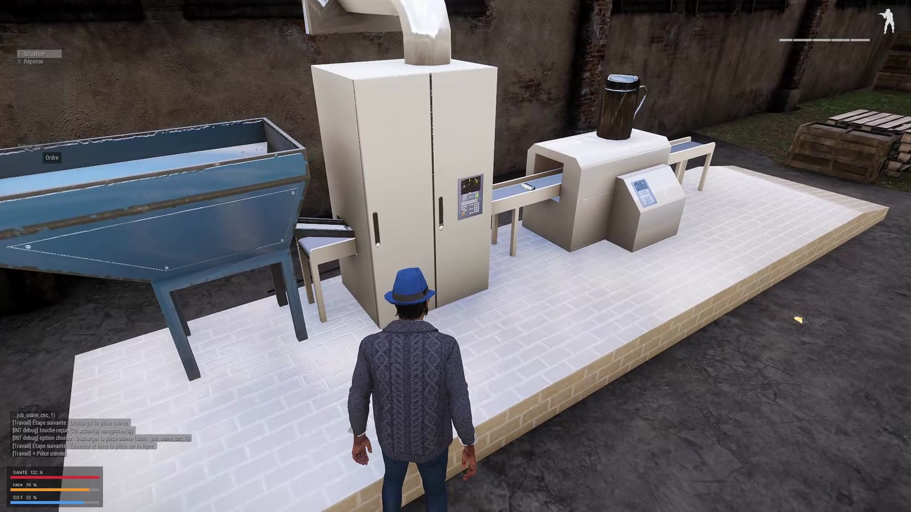
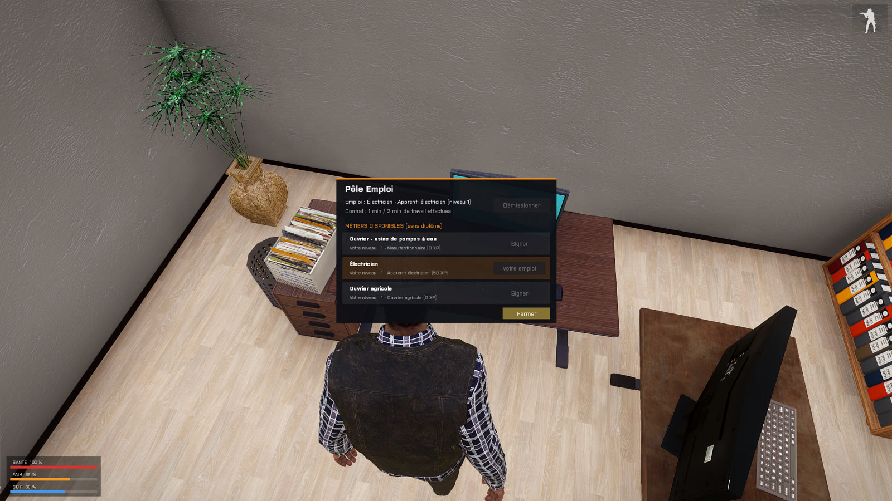
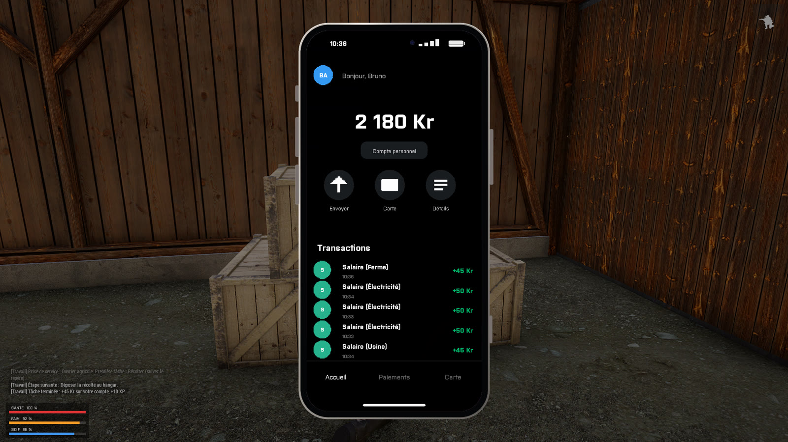
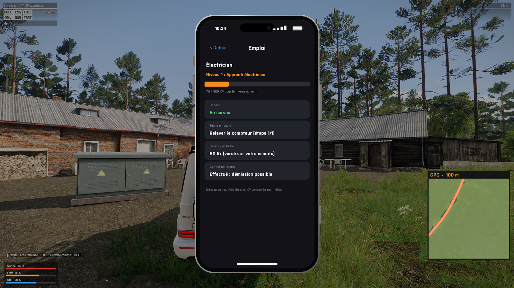
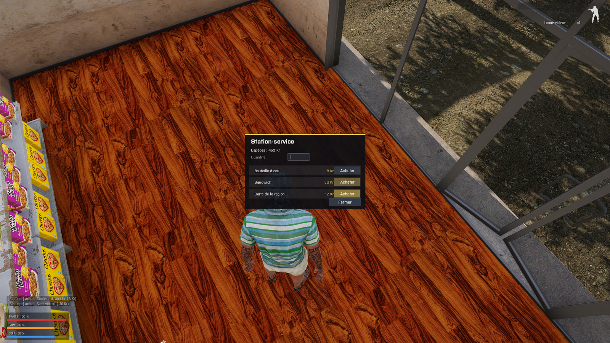

# EastRP — Serveur de jeu de rôle multijoueur (Arma 3)

🇫🇷 [Français](#-français) · 🇬🇧 [English](#-english)

---

## 🇫🇷 Français

**EastRP** est un serveur de jeu de rôle (« RP ») multijoueur pour **Arma 3**, sur le thème d'un pays d'Europe de l'Est moderne. Il est **développé de zéro**, sans framework existant comme Altis Life ou Exile.

Le joueur crée son identité, gagne et dépense de l'argent, gère sa faim et sa soif, utilise un téléphone (banque, messagerie, appels) et travaille dans des métiers à plusieurs niveaux. Le plus avancé est une **usine de pompes à eau** : production sur machine CNC, puis contrôle qualité sur fiche technique.

### Chiffres clés

| | |
|---|---|
| Langage principal | **SQF** (langage de script d'Arma 3), plus Python, PowerShell et SQL |
| Modules | 8 modules de jeu indépendants, un addon et des outils de build |
| Fonctions | **~220 fonctions** documentées une par une |
| Code | ~5 000 lignes de SQF, ~1 600 lignes de configuration et d'interface, ~500 lignes de Python et PowerShell |
| Architecture | Client / serveur, **le serveur fait autorité**, appels réseau sur liste blanche (39 RPC autorisés) |

### Aperçu en jeu

| | |
|---|---|
|  |  |
| *Usine : la machine CNC et le menu d'interaction (TAB)* | *Contrôle qualité : fiche technique aléatoire, validée par le serveur* |
|  |  |
| *Ligne d'ébavurage et de lavage* | *Électricien : animation maison avec carnet et stylo* |
|  |  |
| *Pôle Emploi : signature d'un contrat* | *Téléphone : compte bancaire et salaires reçus* |
|  |  |
| *Application « Emploi » et mini-carte GPS* | *Boutique : achat validé par le serveur* |

### Ce que le projet démontre

- **Architecture client/serveur sécurisée.** Le client ne fait que *demander*. Le serveur revérifie tout avant d'agir : l'expéditeur réel, la distance, les durées, les objets possédés et les soldes. C'est la base de l'anti-triche.
- **Conception modulaire.** Chaque module a son préfixe, son dossier et sa plage d'identifiants d'interface. Les modules communiquent par **événements** (publish/subscribe) et par **registres de plugins** : le module Métiers ajoute ses actions au menu d'interaction et une application au téléphone sans modifier ces modules.
- **Machine à états.** Le cycle d'un métier (signature, prise de service, étapes, paie, promotion) est piloté par le serveur et synchronisé vers le client.
- **Configuration déclarative.** Les métiers, niveaux et étapes sont décrits comme des **données**. Le même moteur fait tourner les trois métiers.
- **Persistance.** Sessions joueur en table de hachage, sauvegarde groupée, migration d'ancien format, schéma SQL prévu pour MariaDB.
- **Interfaces générées par code.** Le téléphone, avec ses composants réutilisables, ses pages et ses coins arrondis calculés, et les formulaires.
- **Pipeline d'animation.** Je me suis filmé, l'IA de capture de mouvement en a tiré un FBX, puis un script Blender en Python l'a transféré sur le squelette du jeu. Le résultat est une animation `.rtm` utilisée en jeu.
- **Outillage.** Écriture d'un format de texture compressé (DXT5) et d'archives PBO en Python, scripts de build et de **signature numérique** du modpack.

### Méthode de travail

J'ai développé ce projet **avec l'assistance d'une IA (Claude)** pour l'écriture d'une grande partie du code. Mon rôle a été de définir les fonctionnalités et les règles de jeu, de mettre en place l'environnement (serveur, modpack, éditeur, Blender), de faire tous les tests en jeu, de diagnostiquer les bugs à partir des journaux (`.rpt`) et des vidéos de test, et de piloter les corrections, itération après itération. La documentation ci-dessous m'a servi à comprendre et à pouvoir expliquer chaque fonction.

### Documentation

Tout est dans [`docs/`](docs/README.md) :

- [Architecture générale](docs/ARCHITECTURE.md)
- [Fiches par module](docs/README.md#modules) : chaque fonction expliquée, *dans le jeu* et *en informatique*
- [Glossaire](docs/GLOSSAIRE.md)
- [Journal de développement](docs/JOURNAL_DEV.md) : problèmes rencontrés et comment je les ai résolus

### Structure du dépôt

```
EastRP/
├── missions/RP.Maksniemi/      La mission (le « serveur de jeu »)
│   ├── description.ext         Point d'entrée : uniquement des #include
│   ├── spawnSystem/  (SPN)     Choix du point d'apparition
│   ├── idSystem/     (DOC)     Identité, carte d'identité, permis
│   ├── coreSystem/   (CORE)    Noyau : sessions, argent, sauvegarde
│   ├── needSystem/   (NEED)    Faim, soif, consommation
│   ├── interactSystem/ (INT)   Menu d'interaction (touche TAB)
│   ├── ecoSystem/    (ECO)     Boutiques, distributeurs
│   ├── jobSystem/    (JOB)     Pôle Emploi, métiers, production
│   └── phoneSystem/  (PHN)     Téléphone : banque, messagerie, appels, admin
├── addons/eastrp_core/         Addon : objets, icônes, animation
├── animations/                 Script Blender de transfert d'animation
├── tools/                      Outils Python (textures PAA, archives PBO, icônes)
├── modpack/                    Build et signature du pack de mods
├── server/                     Lancement du serveur dédié
├── db/                         Schéma SQL (MariaDB, prévu)
└── docs/                       Documentation
```

### Lancer le projet (développement)

1. Installer Arma 3 Server (`server/update_server.bat`, via SteamCMD).
2. Construire le modpack (`modpack/construire_modpack.bat`). Il faut sa propre paire de clés, que le dépôt ne fournit pas.
3. Lancer `server/start_server.bat`. Il copie la mission vers le serveur et le démarre.
4. En jeu : Multijoueur, puis Connexion directe sur `127.0.0.1:2302`.

> ⚠️ C'est un projet **en développement**. Certaines valeurs de test sont encore actives (elles sont signalées dans les docs), et la base de données MariaDB n'est pas encore branchée : la sauvegarde utilise le profil du serveur.

---

## 🇬🇧 English

**EastRP** is a multiplayer **role-play game server for Arma 3**, set in a modern Eastern-European country. It is built **from scratch**, without an existing framework.

Players register an identity, earn and spend money, manage hunger and thirst, use an in-game smartphone (bank, messaging, calls) and work multi-level jobs. The most advanced one is a **water-pump factory** with a CNC production line followed by quality control against a technical sheet.

**Highlights**

- **Server-authoritative client/server architecture.** Clients only send *requests*. The server re-validates the real sender, distance, timing, owned items and balances. RPCs go through a whitelist of 39 entries.
- **Modular design.** 8 independent modules communicate through **events (pub/sub)** and **plugin registries**. For example, the Jobs module registers its own interaction actions and phone app.
- **Server-driven state machine** for jobs, with **data-driven configuration**: one engine runs every job.
- **Persistence layer.** Per-player hash maps, batched saves, legacy-format migration, and an SQL schema prepared for MariaDB.
- **Code-generated UI.** A full smartphone UI built from reusable components.
- **Animation pipeline.** Self-filmed video → AI motion capture (FBX) → Python retargeting script in Blender → in-game `.rtm` animation.
- **Tooling.** A DXT5 texture writer and a PBO packer in Python, plus PowerShell build and **code-signing** scripts.

**How it was built:** with the help of an AI assistant (Claude) for much of the code writing. I defined the features and game rules, set up the whole environment, ran every in-game test, diagnosed bugs from logs and test videos, and drove the fixes.

**Stack:** SQF (Arma 3 scripting), Python, PowerShell, SQL. ~220 functions, ~5k lines of SQF.

The detailed documentation (in French) is in [`docs/`](docs/README.md).

> Work in progress: some test values are still enabled (they are flagged in the docs), and the MariaDB storage is not wired yet.
