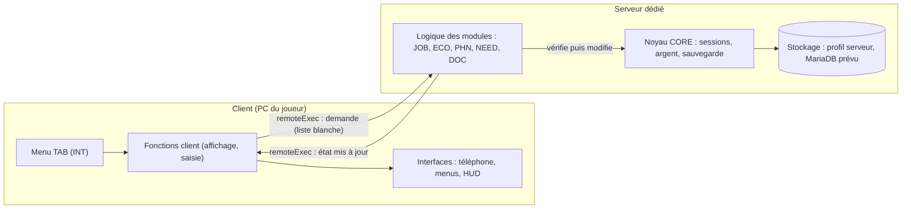
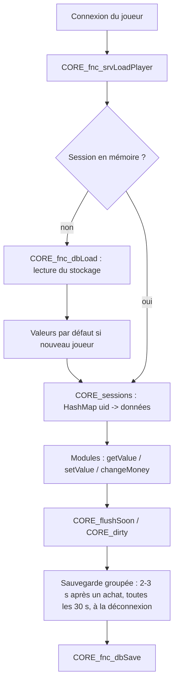
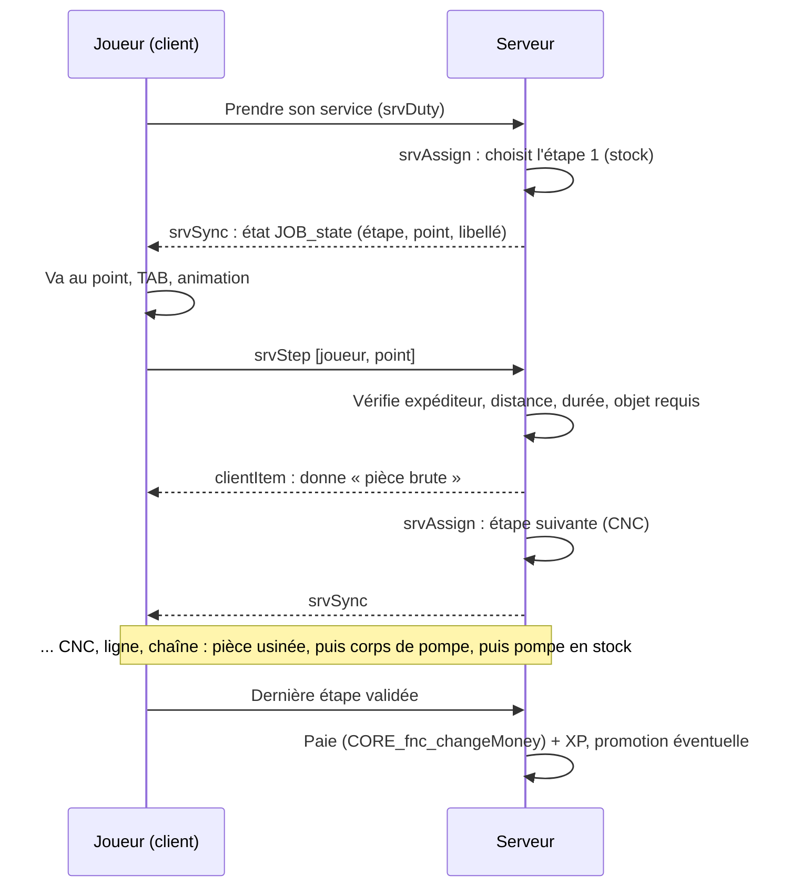
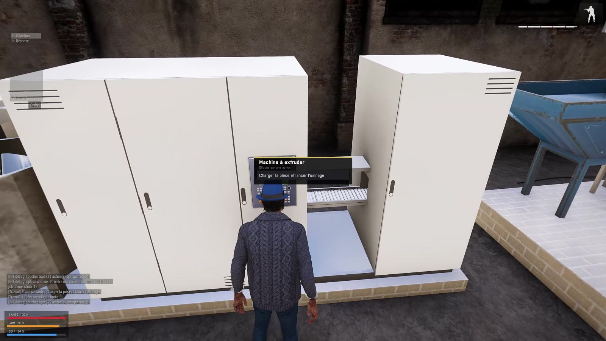
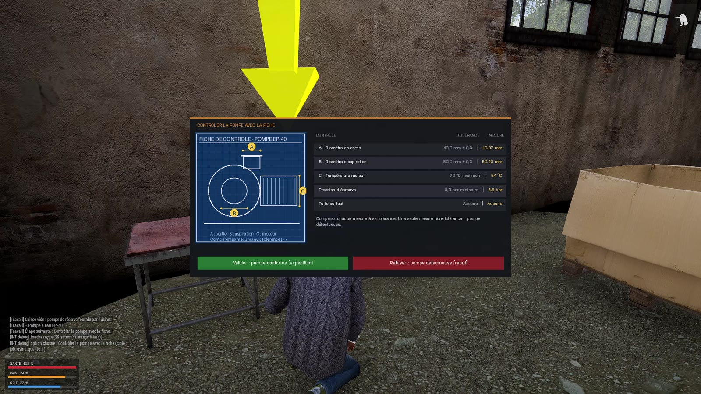

# Architecture générale d'EastRP

Ce document explique **comment le projet est construit**, au-delà du jeu. C'est la page à lire en premier : elle donne la vue d'ensemble, et les fiches de [modules](README.md#modules) détaillent chaque fonction.

---

## 1. Le contexte technique en 30 secondes

- **Arma 3** est un jeu de simulation militaire. On peut y héberger un **serveur dédié** et écrire ses propres règles de jeu grâce à un langage de script, le **SQF**.
- Une **mission** est un dossier de scripts et de configurations que le serveur charge. Chaque joueur qui se connecte la télécharge.
- Le serveur et chaque joueur (le **client**) exécutent du code. **Ils ne partagent pas leur mémoire** : pour se parler, ils s'envoient des appels réseau.
- En SQF, une fonction est un fichier `fn_nom.sqf`, déclaré dans une configuration (`CfgFunctions`) et appelé sous le nom `TAG_fnc_nom`.

> **En résumé :** J'ai développé un serveur de jeu multijoueur en SQF, le langage de script d'Arma 3. C'est une architecture client/serveur où le serveur fait autorité, découpée en 8 modules indépendants.

---

## 2. Vue d'ensemble



**Le principe :** le client *demande*, le serveur *vérifie et décide*, puis il *renvoie l'état* au seul client concerné.

---

## 3. Les 8 modules

| Ordre | Module | Tag | Rôle | Fiche |
|---|---|---|---|---|
| 1 | spawnSystem | `SPN` | Écran de choix du point d'apparition, caméra | [01_spawn](modules/01_spawn.md) |
| 2 | idSystem | `DOC` | Création d'identité, carte d'identité, permis, présentation à un autre joueur | [02_identite](modules/02_identite.md) |
| 3 | coreSystem | `CORE` | **Noyau** : sessions joueur, argent, sauvegarde, restauration de l'équipement | [03_core](modules/03_core.md) |
| 4 | needSystem | `NEED` | Faim, soif, consommation de nourriture | [04_besoins](modules/04_besoins.md) |
| 5 | interactSystem | `INT` | Menu d'interaction (touche TAB), registre d'actions | [05_interaction](modules/05_interaction.md) |
| 6 | ecoSystem | `ECO` | Boutiques, distributeurs de billets | [06_economie](modules/06_economie.md) |
| 7 | jobSystem | `JOB` | Pôle Emploi, métiers, chaîne de production, contrôle qualité | [07_metiers](modules/07_metiers.md) |
| 8 | phoneSystem | `PHN` | Téléphone : banque, messagerie, appels, administration | [08_telephone](modules/08_telephone.md) |
| — | addon et outils | — | Objets, icônes, animation, outils Python | [09_addon_et_outils](modules/09_addon_et_outils.md) |
| — | déploiement | — | Modpack, signature, serveur, base de données | [10_deploiement](modules/10_deploiement.md) |

### Règles communes ([docs/CONVENTIONS.md](CONVENTIONS.md))

1. **Un module = un dossier + un tag unique.** Toutes ses fonctions s'appellent `TAG_fnc_xxx` et ses variables `TAG_xxx`. *En informatique : c'est un **espace de noms** (namespace). Il évite les collisions de noms, puisque SQF n'a pas de vrais modules.*
2. **Chaque module a sa plage d'identifiants d'interface** (IDD/IDC). *Même idée pour les fenêtres : deux modules ne se marchent jamais dessus.*
3. **`description.ext` ne contient presque que des `#include`** (plus quelques réglages globaux : réapparition, console de debug). *C'est le point d'entrée, comme un `main` qui se contente d'assembler les modules. Ajouter un module revient à ajouter des lignes, sans réécrire le reste.*
4. **Chaque module a la même structure** : `config/functions.hpp` (déclaration des fonctions), `config/remoteExec.hpp` (fonctions appelables par le réseau), `config/settings.hpp` (réglages), `functions/` (code) et `ui/` (fenêtres). Seul `spawnSystem` n'a pas de `remoteExec.hpp`, car il n'appelle jamais le serveur.
5. **Démarrage automatique.** Chaque module a une fonction `init` marquée `postInit = 1` : le moteur l'exécute après le chargement de la mission. *En informatique : c'est l'**inversion de contrôle**, le framework appelle notre code au bon moment.*

---

## 4. Le serveur fait autorité (sécurité et anti-triche)

C'est **le point le plus important du projet**. Dans un jeu en ligne, le PC du joueur n'est pas fiable : un tricheur peut modifier sa mémoire ou envoyer de faux messages. Le projet applique trois protections.

### a) Liste blanche des appels réseau (RPC)

Un **RPC** (*Remote Procedure Call*, appel de procédure à distance) consiste à exécuter une fonction sur une autre machine. En SQF, c'est `remoteExec`.

Dans `description.ext`, la classe `CfgRemoteExec` est réglée en **`mode = 1`**, c'est-à-dire en *liste blanche*. Seules les fonctions déclarées dans les `remoteExec.hpp` peuvent être appelées à distance, et chacune dit **qui** a le droit de l'exécuter :

| `allowedTargets` | Signification | Nombre |
|---|---|---|
| `2` | Seul le **serveur** l'exécute (les demandes du client) | 26 |
| `1` | Seuls les **clients** l'exécutent (les ordres du serveur) | 2 |
| `0` | Les deux | 11 |

Les **commandes brutes** sont toutes interdites (`class Commands { mode = 0; }`) : un client ne peut pas exécuter du code arbitraire sur le serveur.

### b) Vérification de l'expéditeur

Sur le serveur, `remoteExecutedOwner` donne l'identifiant réseau de la machine qui a réellement envoyé l'appel. Les fonctions serveur comparent cet identifiant au propriétaire de l'unité concernée (`owner _unit`). **Un joueur ne peut donc pas agir au nom d'un autre.** Ce contrôle apparaît une quarantaine de fois dans le code.

```sqf
// Extrait de CORE_fnc_srvLoadPlayer
private _ro = remoteExecutedOwner;
if (_ro != 0 && {_ro != owner _unit}) exitWith { diag_log "[CORE] srvLoadPlayer refusé (propriétaire)"; };
```

### c) Revalidation de chaque règle de jeu

Le client n'envoie **jamais de valeur à faire confiance**, seulement un identifiant (« je veux l'article n°3 », « j'ai fini l'étape au point X »). Le serveur recalcule et vérifie lui-même :

- **Argent.** Seul `CORE_fnc_changeMoney` (serveur) peut modifier un solde. Il refuse les types invalides, arrondit et interdit les soldes négatifs et le dépassement d'un plafond.
- **Achats.** Le serveur relit le prix dans sa propre configuration, ne fait pas confiance au prix envoyé et vérifie la distance au magasin.
- **Métiers.** Le serveur revérifie la distance au point de travail, la **durée minimale** de l'étape (anti-accélération), l'objet requis dans l'inventaire, la bonne réponse au quiz (qui ne quitte jamais le serveur) et la présence à bord du bon véhicule de service.

> **En résumé :** Je ne fais jamais confiance au client. Il envoie une intention, le serveur vérifie l'expéditeur réel, la distance, le temps et les ressources, puis il applique le changement et renvoie le nouvel état.

---

## 5. Communication entre modules (couplage faible)

Les modules ne s'appellent presque pas directement. Ils utilisent trois mécanismes.

### a) Événements (publish/subscribe)

Un module **publie** un événement, et les autres **s'abonnent** sans que l'émetteur les connaisse.

| Événement | Émis par | Écouté par | Sens |
|---|---|---|---|
| `SPN_menuOpened` | Spawn | Core | Le menu d'apparition s'ouvre (connexion ou réapparition) |
| `SPN_spawned` | Spawn | Core, Identité, Besoins | Le joueur vient d'apparaître |
| `CORE_playerLoaded` | Core (serveur) | Besoins, Métiers, Téléphone | Les données du joueur sont chargées |
| `CORE_loadoutApplied` | Core (client) | Identité | L'équipement sauvegardé a été restauré (l'identité redonne alors les papiers) |

Le mécanisme utilisé est `BIS_fnc_addScriptedEventHandler` / `BIS_fnc_callScriptedEventHandler`.

### b) Hooks (crochets)

Le module Spawn tient une liste de fonctions `SPN_preSpawnHooks`. Avant de laisser un joueur apparaître, il appelle chacune. Le module Identité y ajoute la sienne, qui bloque l'apparition tant que le joueur n'a pas créé son identité. **Spawn ne connaît pas le module Identité** : c'est l'Identité qui vient se brancher.

### c) Registres de plugins

- **Menu d'interaction.** N'importe quel module appelle `INT_fnc_registerAction` avec un libellé, un type de cible, une **condition** (du code) et une **action** (du code). Le menu TAB affiche ensuite toutes les actions dont la condition est vraie. Les métiers, les boutiques et l'identité s'y branchent ainsi.
- **Téléphone.** `PHN_fnc_registerApp` ajoute une application (nom, couleur, icône, fonction qui dessine la page). L'application « Emploi » vient du module Métiers.

> **En résumé :** J'ai évité le couplage fort. Les modules communiquent par événements et par registres : le module Métiers ajoute son application au téléphone sans que le code du téléphone change. C'est le principe ouvert/fermé : ouvert à l'extension, fermé à la modification.

---

## 6. Données et persistance



- **Session en mémoire.** Côté serveur, chaque joueur a une **table de hachage** (`HashMap`, accès par clé en temps constant), indexée par son identifiant Steam (UID). Tous les modules y rangent leurs valeurs par `CORE_fnc_getValue` / `CORE_fnc_setValue` : argent, XP, téléphone, faim, etc.
- **Couche de stockage isolée.** Pour les données de session, seules `CORE_fnc_dbLoad` et `CORE_fnc_dbSave` touchent au stockage. Pour l'instant, c'est le *profil du serveur*. Passer à une vraie base de données ne demandera de changer que ces deux fonctions : c'est une **couche d'abstraction** (pattern *Repository*). *Limite connue : les modules Identité et Téléphone écrivent encore certaines données directement dans le profil. Il faudra les faire passer par la même couche.*
- **Sérialisation.** Les données sont enregistrées sous forme de **paires `[clé, valeur]`**. `dbLoad` sait aussi **migrer** un ancien format erroné vers le nouveau.
- **Écritures groupées.** Plutôt qu'écrire sur le disque à chaque changement, on lève un **drapeau** (`CORE_flushSoon`), et une boucle écrit dans les 2 à 3 secondes qui suivent. C'est un compromis entre performance et sécurité des données, une forme de *write-behind*.
- **Base de données prévue.** Le schéma SQL (`db/`) et la procédure (MariaDB + extension extDB3) sont prêts, et un test de connexion existe (`CORE_fnc_dbTest`). La sauvegarde de production n'y est pas encore branchée.

---

## 7. Interfaces graphiques

Deux approches coexistent :

- **Déclarative** : des fenêtres décrites dans des fichiers `.hpp` (formulaire d'identité, menu de spawn).
- **Générée par code** : le téléphone, le menu TAB, la fiche de contrôle qualité et le HUD des besoins sont construits par script (`ctrlCreate`). Le téléphone a sa propre **boîte à outils de composants** (`PHN_fnc_uiButton`, `uiText`, `uiAvatar`, `uiTabBar`…). Chaque page est une fonction qui redessine l'écran à partir de l'état, ce qui ressemble à des **composants** au sens React ou Flutter.

---

## 8. La chaîne de production de l'usine (exemple complet)

C'est l'exemple le plus complet du projet, car il réunit tous les concepts ci-dessus.



- **Niveau 2 (opérateur CNC)** : la pièce brute devient une pièce usinée, puis un corps de pompe, puis une pompe ajoutée au **stock partagé**.
- **Niveau 3 (contrôleur qualité)** : il prend une pompe du stock. Le serveur **génère une fiche technique aléatoire** : cotes, tolérances, température, pression, fuite, avec une pompe sur deux défectueuse. Le joueur décide « conforme » ou « défectueuse ». Le serveur compare avec la vérité qu'il est le seul à connaître, puis impose le dépôt correspondant à la décision du joueur : caisse d'expédition ou benne à rebut. Une erreur réduit le salaire.

| Machine CNC (niveau 2) | Fiche de contrôle qualité (niveau 3) |
|---|---|
|  |  |

---


## 9. Ce que je ferais ensuite (vision technique)

- Brancher la sauvegarde sur **MariaDB** (extDB3), avec une table clé/valeur ou une colonne JSON pour les données libres des modules.
- Activer la **vérification des signatures** et BattlEye sur le serveur public.
- Retirer le code mort et les doublons signalés dans les fiches, et remettre les valeurs de production.
- Ajouter des **tests automatisés** des fonctions pures (formatage, calculs de fiche, validation).
