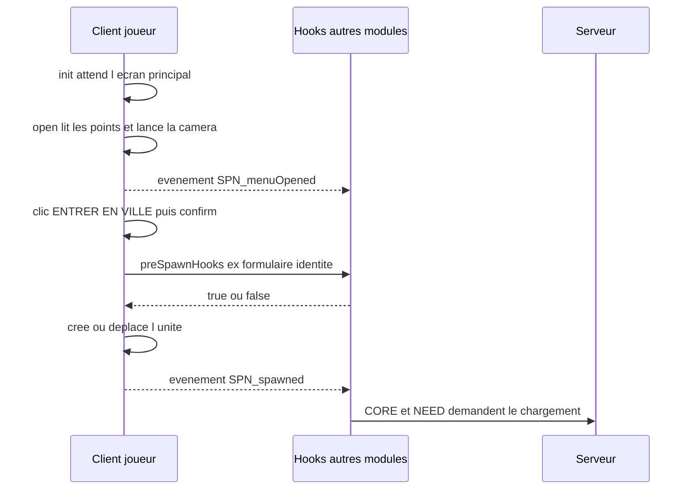

# Spawn (`SPN`)

> Écran d'arrivée du joueur : une caméra cinématique tourne autour du point d'apparition, puis le bouton « ENTRER EN VILLE » place le joueur dans le monde (à la connexion et après chaque mort).

## Ce que ce module démontre en informatique

- **Programmation événementielle (publish/subscribe)** : le module ne connaît pas les autres modules ; il publie deux événements, `SPN_menuOpened` et `SPN_spawned`, auxquels CORE, NEED et le module d'identité s'abonnent.
- **Registre de plugins / injection de callbacks** : deux listes de code, `SPN_conditions` et `SPN_preSpawnHooks`, permettent à d'autres modules d'ajouter des conditions ou des étapes obligatoires avant le spawn (le module d'identité y branche son formulaire).
- **Séparation données / logique (configuration déclarative)** : les points d'apparition et les réglages (nom du serveur, classe de l'unité, vitesse de caméra) sont décrits dans des fichiers `.hpp`, le code ne fait que les lire.
- **Maths / trigonométrie** : la caméra suit un cercle (`x = centre + r·sin(angle)`, `y = centre + r·cos(angle)`) avec un angle qui avance selon le temps écoulé, donc la vitesse ne dépend pas du nombre d'images par seconde.
- **Gestion de concurrence / verrou** : un drapeau `SPN_busy` empêche de valider deux fois le spawn (double-clic), et `SPN_isOpen` empêche d'ouvrir l'écran deux fois.
- **Boucle d'événements par image** : l'animation de la caméra est un gestionnaire `EachFrame` ajouté avec `addMissionEventHandler` (et retiré proprement), conformément aux conventions du projet.

## Fichiers

| Fichier / dossier | Rôle |
|---|---|
| `spawnSystem/config/functions.hpp` | Déclare les 9 fonctions `SPN_fnc_*` (seule `init` est lancée automatiquement, en `postInit`). |
| `spawnSystem/config/settings.hpp` | Classe `SPN_Settings` : nom du serveur affiché, `createNewUnit`, classe de l'unité créée (`C_man_1`), vitesse d'orbite. |
| `spawnSystem/config/spawnPoints.hpp` | Classe `SPN_CfgSpawnPoints` : un seul point, `port` (marqueur `spn_port` ou position de secours, distance et hauteur de caméra). |
| `spawnSystem/functions/fn_*.sqf` | Le code des 9 fonctions. |
| `spawnSystem/ui/dialog.hpp` | Classes d'interface `SPN_RscText`, `SPN_RscStructuredText`, `SPN_RscButton` et la fenêtre `SPN_Dialog` (IDD 74100, contrôles 74101 à 74109). |

Le module n'a **pas** de fichier `remoteExec.hpp` : tout se passe côté client, il n'appelle jamais le serveur directement.

## Comment ça marche (flux)

Au démarrage (et à chaque réapparition après une mort), le client ouvre l'écran de spawn : il lit les points dans la configuration, place la caméra en orbite autour du premier point et rend le joueur invulnérable. Quand le joueur clique sur « ENTRER EN VILLE », `SPN_fnc_confirm` vérifie les conditions, ferme l'écran puis exécute une à une les étapes obligatoires enregistrées par d'autres modules ; si l'une renvoie autre chose que `true`, on revient à l'écran de spawn. Sinon, l'écran passe au noir, la caméra est détruite et une nouvelle unité est créée au point d'arrivée (ou l'unité actuelle est déplacée selon le réglage). Enfin l'événement `SPN_spawned` est publié : c'est lui qui déclenche, dans CORE et NEED, la demande de chargement des données au serveur. Le module SPN lui-même ne parle jamais au serveur.

## Fonctions

| Fonction | Côté | Rôle en une ligne |
|---|---|---|
| `SPN_fnc_init` | Client | Initialise les variables, branche la réapparition et ouvre l'écran au premier spawn. |
| `SPN_fnc_getPoints` | Client | Lit la configuration et renvoie la liste des points d'apparition. |
| `SPN_fnc_open` | Client | Ouvre l'écran de spawn (caméra, invulnérabilité, événement). |
| `SPN_fnc_onLoad` | Client | Remplit les textes de la fenêtre et joue l'apparition progressive. |
| `SPN_fnc_confirm` | Client | Valide le spawn : hooks, création/déplacement de l'unité, événement. |
| `SPN_fnc_canSpawn` | Client | Renvoie vrai si toutes les conditions enregistrées sont remplies. |
| `SPN_fnc_camStart` | Client | Crée la caméra et l'anime en orbite à chaque image. |
| `SPN_fnc_camFocus` | Client | Recentre la caméra sur un point. |
| `SPN_fnc_camStop` | Client | Retire l'animation et détruit la caméra. |

### `SPN_fnc_init`
- **Côté :** client uniquement (lancée automatiquement après le chargement de la mission grâce à `postInit = 1` ; sort tout de suite sur une machine sans interface comme le serveur dédié, test `hasInterface`).
- **Dans le jeu :** à la connexion, l'écran de spawn s'affiche dès que le jeu est prêt ; après chaque mort, il s'affiche de nouveau.
- **En informatique :** initialise tout l'état du module dans des variables globales préfixées `SPN_` (convention d'espace de noms). Crée les deux listes de hooks `SPN_conditions` et `SPN_preSpawnHooks` seulement si elles n'existent pas encore (`isNil`), pour ne pas effacer ce qu'un autre module aurait déjà ajouté. Ajoute un gestionnaire d'événement de mission `EntityRespawned` (qui s'ajoute aux autres au lieu de les écraser) et lance un petit fil d'exécution qui attend `time > 0`, un joueur valide et l'écran principal (display 46) avant d'appeler `SPN_fnc_open`.
- **Paramètres → retour :** `aucun → rien`.

### `SPN_fnc_getPoints`
- **Côté :** client.
- **Dans le jeu :** détermine où le joueur peut apparaître (actuellement : le Port).
- **En informatique :** parcourt toutes les sous-classes de `SPN_CfgSpawnPoints` (`configClasses`). Pour chaque point, si un marqueur d'éditeur portant le nom indiqué existe (`markerType` non vide), on prend sa position et sa direction ; sinon on utilise la position écrite dans la config (valeur de secours). Le résultat est normalisé en tableaux de 7 cases toujours dans le même ordre.
- **Paramètres → retour :** `aucun → [[id, nom, description, position, direction, distanceCam, hauteurCam], ...]`.

### `SPN_fnc_open`
- **Côté :** client (à lancer avec `spawn` car elle attend avec `waitUntil`).
- **Dans le jeu :** affiche l'écran de spawn avec la caméra qui tourne ; pendant ce temps, le joueur ne peut pas être blessé.
- **En informatique :** garde d'entrée `SPN_isOpen` pour ne pas ouvrir deux fois l'écran. Si aucun point n'est configuré, affiche un message et s'arrête. Attend que le joueur soit vivant, le rend invulnérable (`allowDamage false`), recentre puis démarre la caméra, crée la fenêtre `SPN_Dialog` et publie l'événement `SPN_menuOpened [joueur, premierSpawn]` avec `BIS_fnc_callScriptedEventHandler`.
- **Paramètres → retour :** `[premierSpawn (booléen, défaut false)] → rien`.

### `SPN_fnc_onLoad`
- **Côté :** client (appelée par l'attribut `onLoad` de la fenêtre).
- **Dans le jeu :** affiche le nom du serveur, le nom du point, sa description et « Bienvenue, <pseudo> », puis fait apparaître les éléments un par un en fondu.
- **En informatique :** remplit les contrôles par leur identifiant (IDC 74101 à 74104), active ou non le bouton (74105) selon `SPN_fnc_canSpawn`. L'animation est décrite par une liste de données `[IDC, délai]` : tous les éléments sont d'abord rendus transparents, puis un fil d'exécution séparé les fait réapparaître l'un après l'autre et s'arrête si la fenêtre est fermée entre-temps (`isNull _display`).
- **Paramètres → retour :** `[display] → rien`.

### `SPN_fnc_confirm`
- **Côté :** client (lancée par le bouton avec `spawn`, car elle contient des pauses).
- **Dans le jeu :** le joueur clique sur « ENTRER EN VILLE » ; si une étape obligatoire existe (par exemple le formulaire d'identité), elle s'affiche d'abord ; puis fondu au noir et apparition en ville.
- **En informatique :** verrou `SPN_busy` contre les doubles validations. Vérifie `SPN_fnc_canSpawn`, ferme l'écran, puis exécute chaque hook de `SPN_preSpawnHooks` dans l'ordre : le résultat doit être exactement le booléen `true`, sinon (valeur absente, mauvais type ou `false`) le spawn est annulé et l'écran rouvert. Ensuite, si `createNewUnit = 1`, crée un groupe du même camp (supprimé automatiquement quand il est vide), une nouvelle unité de la classe configurée, transfère le contrôle avec `selectPlayer` et supprime l'ancienne unité ; sinon, déplace simplement l'unité. Rend l'unité vulnérable et publie `SPN_spawned [unité, idDuPoint]`.
- **Paramètres → retour :** `aucun → rien`.

### `SPN_fnc_canSpawn`
- **Côté :** client.
- **Dans le jeu :** décide si le bouton « ENTRER EN VILLE » est actif.
- **En informatique :** applique un « ET logique » sur toutes les fonctions de la liste `SPN_conditions` en s'arrêtant à la première qui renvoie faux (évaluation court-circuit avec `exitWith`). Liste vide = autorisé. Dans le code actuel, aucun autre module n'ajoute de condition : la liste reste vide, c'est un point d'extension prévu.
- **Paramètres → retour :** `[point] → booléen`.

### `SPN_fnc_camStart`
- **Côté :** client.
- **Dans le jeu :** la caméra tourne lentement autour du point d'arrivée en montant et descendant légèrement.
- **En informatique :** ne fait rien si une caméra existe déjà. Crée une caméra de script, puis ajoute un gestionnaire `EachFrame` qui, à chaque image, calcule le temps écoulé depuis l'image précédente (`diag_tickTime`) et fait avancer l'angle de `vitesse × temps écoulé` (modulo 360). La position est calculée par trigonométrie sur un cercle de rayon `SPN_camDist`, plus une petite oscillation verticale en sinus ; la caméra vise un point 2 m au-dessus du centre. L'identifiant du gestionnaire est conservé pour pouvoir le retirer.
- **Paramètres → retour :** `aucun → rien`.

### `SPN_fnc_camFocus`
- **Côté :** client.
- **Dans le jeu :** place la caméra autour du point choisi, avec un petit fondu.
- **En informatique :** copie la position du point (opérateur `+`, copie profonde, pour ne pas modifier le tableau d'origine par référence) et borne la distance (minimum 4 m) et la hauteur (minimum 2 m) pour éviter une caméra dans le sol ou collée au décor.
- **Paramètres → retour :** `[point] → rien`.

### `SPN_fnc_camStop`
- **Côté :** client.
- **Dans le jeu :** la caméra disparaît et la vue revient au personnage.
- **En informatique :** libération propre des ressources : retire le gestionnaire `EachFrame` s'il existe (puis remet l'identifiant à -1), termine l'effet caméra et détruit l'objet. Chaque étape est protégée, donc l'appeler deux fois ne provoque pas d'erreur (idempotence).
- **Paramètres → retour :** `aucun → rien`.

## Sécurité et robustesse

- La touche Échap est bloquée sur l'écran de spawn (`onKeyDown` renvoie vrai pour la touche 1), le joueur ne peut pas fermer le menu sans passer par le bouton.
- Le joueur est invulnérable tant que le menu est ouvert (`allowDamage false`), puis redevient vulnérable au spawn.
- Verrous `SPN_isOpen` et `SPN_busy` contre l'ouverture double du menu et la double validation.
- Les hooks sont vérifiés strictement : seule la valeur booléenne `true` autorise le spawn.
- La fonction `init` sort immédiatement sur une machine sans interface (serveur dédié).
- Valeurs de repli : position de config si le marqueur `spn_port` est absent, distance/hauteur de caméra bornées.
- Ce module n'a aucune fonction appelable à distance : il ne peut pas être déclenché par un autre joueur.

## Limites et pistes d'amélioration

- Un seul point d'apparition est réellement utilisé : le code prend toujours `SPN_points select 0`. La config sait décrire plusieurs points, mais il n'y a pas d'interface pour choisir (la variable `SPN_selected` est initialisée mais pas exploitée).
- Le spawn est entièrement décidé par le client (création de l'unité, position) : le serveur ne valide pas la position d'arrivée. C'est acceptable avec un point fixe, mais à revoir s'il y a des points réservés (ex. à une faction).
- `SPN_conditions` n'est utilisé par aucun module pour l'instant : point d'extension prévu mais pas encore exercé.
- Le nom du serveur affiché est une valeur d'exemple (`"MON SERVEUR RP"`) dans `settings.hpp`.
- Si un hook ne rend jamais la main (attente infinie), le joueur reste bloqué : il n'y a pas de délai maximal côté SPN (c'est au hook de le gérer, ce que fait le module d'identité avec 10 s).
