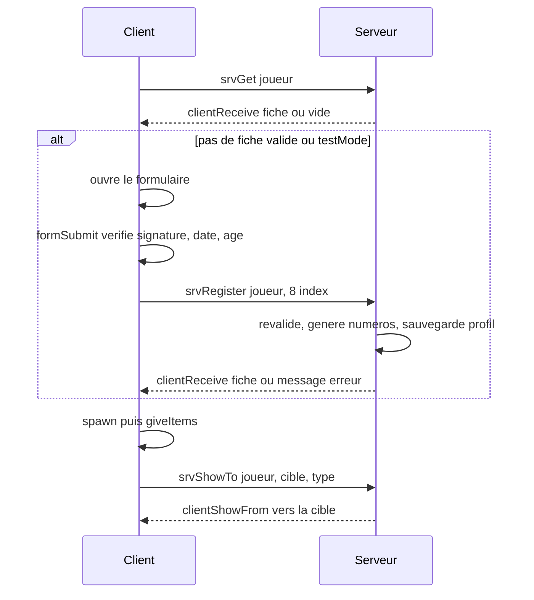

# Documents d'identité (`DOC`)

> Avant sa première apparition, le joueur remplit un formulaire officiel ; le serveur lui crée une carte d'identité (et un permis de conduire s'il en demande un), qu'il peut ensuite consulter dans son inventaire ou montrer à un autre joueur.

## Ce que ce module démontre en informatique

- **Architecture client/serveur et autorité serveur** : le client n'envoie que des numéros de choix (index de listes) ; c'est le serveur (`DOC_fnc_srvRegister`) qui construit la fiche d'identité, prend le nom depuis le profil du joueur et génère les numéros de documents.
- **Validation des entrées (anti-triche)** : chaque index reçu est revérifié côté serveur (type nombre, bornes min/max, date existante, âge ≥ 18 ans), même si le formulaire client a déjà fait les mêmes contrôles.
- **RPC avec liste blanche** : un RPC (appel de procédure à distance) n'est possible que pour les 5 fonctions déclarées dans `config/remoteExec.hpp`, et chaque fonction vérifie qui l'a appelée (`remoteExecutedOwner`).
- **Injection de callbacks (hooks)** : le module s'insère dans le module de spawn en ajoutant sa fonction au tableau `SPN_preSpawnHooks` ; le spawn est annulé si le hook renvoie `false`. Il s'insère aussi dans le menu d'interaction (module `INT`) en enregistrant deux actions.
- **Programmation événementielle (publish/subscribe)** : le module s'abonne aux événements `SPN_spawned` et `CORE_loadoutApplied` pour redonner les papiers au bon moment, sans que les autres modules le connaissent.
- **Persistance et unicité** : les fiches sont stockées dans le profil du serveur sous la clé `DOC_id_<UID>` ; la liste `DOC_usedNums` garantit qu'un numéro de document n'est jamais attribué deux fois.
- **Polling (scrutation)** : une boucle surveille toutes les 0,2 s l'ouverture de l'écran d'inventaire (display 602), puis y branche des gestionnaires de double-clic.

## Fichiers

| Fichier / dossier | Rôle |
|---|---|
| `config/functions.hpp` | Déclare les 25 fonctions `DOC_fnc_*` (`init` s'exécute automatiquement au démarrage : `postInit`). |
| `config/remoteExec.hpp` | Liste blanche RPC : `srvRegister`, `srvGet`, `srvShowTo` (vers le serveur) ; `clientReceive`, `clientShowFrom` (vers les clients). |
| `config/settings.hpp` | Pays, nationalité, `testMode`, objets utilisés comme documents (`ItemWatch` = carte, `ItemCompass` = permis), listes du formulaire (lieux de naissance, yeux, catégories de permis). |
| `functions/fn_*.sqf` | Code (voir « Fonctions »). |
| `ui/base.hpp` | Classes d'interface de base (texte, champ de saisie, liste déroulante, bouton, image) préfixées `DOC_`. |
| `ui/form.hpp` | Le formulaire « Demande de documents d'identité » (IDD 74200, contrôles 74211-74226). |
| `ui/hud.hpp` | La carte affichée en haut à gauche de l'écran pendant 12 s (`DOC_CardHUD`, contrôles 74301-74333). |

Remarque : les commentaires du code renvoient à un « README », mais le dossier ne contient pas de fichier LISEZ-MOI. L'ordre des champs de la fiche est documenté dans `fn_srvRegister.sqf` (et repris ci-dessous).

## Comment ça marche (flux)

1. Quand le joueur valide son point d'apparition, le module de spawn appelle `DOC_fnc_registrationHook`, qui demande au serveur s'il existe déjà une fiche pour ce joueur.
2. Si une fiche existe et que le nom correspond au nom de profil (et que `testMode = 0`), le spawn continue directement. Sinon le formulaire s'ouvre.
3. Le formulaire envoie seulement 8 index (sexe, jour, mois, année, lieu, taille, yeux, catégorie de permis). Le serveur revalide tout, génère un numéro unique et renvoie la fiche complète.
4. Après le spawn, le joueur reçoit les objets « carte » et « permis ». Un double-clic sur l'un d'eux dans l'inventaire affiche la carte avec une photo en direct du visage.
5. Pour montrer ses papiers, le client demande au serveur ; le serveur relit la fiche **stockée chez lui** (pas celle du client) et l'envoie au joueur ciblé.

Structure de la fiche (tableau de 15 cases) : 0 prénom, 1 nom, 2 sexe, 3 date de naissance `[j,m,a]`, 4 lieu, 5 taille, 6 yeux, 7 nationalité, 8 n° de carte, 9 délivrée le, 10 expire le, 11 catégories de permis (`""` = pas de permis), 12 n° de permis, 13 permis délivré le, 14 permis expire le.

## Fonctions

| Fonction | Côté | Rôle en une ligne |
|---|---|---|
| `DOC_fnc_init` | Les deux | Initialise les variables, branche les hooks, événements, surveillance d'inventaire et actions d'interaction. |
| `DOC_fnc_registrationHook` | Client | Étape obligatoire avant le spawn : vérifie l'identité ou ouvre le formulaire. |
| `DOC_fnc_formOnLoad` | Client | Remplit le formulaire (nom, listes, date du jour). |
| `DOC_fnc_formSubmit` | Client | Vérifie le formulaire et envoie la demande au serveur. |
| `DOC_fnc_srvRegister` | Serveur | Valide la demande et crée la fiche d'identité. |
| `DOC_fnc_srvGet` | Serveur | Renvoie la fiche stockée d'un joueur. |
| `DOC_fnc_clientReceive` | Client | Reçoit la fiche (ou un message d'erreur) du serveur. |
| `DOC_fnc_onSpawned` | Client | Réagit à l'apparition du joueur : donne les papiers. |
| `DOC_fnc_giveItems` | Client | Ajoute la carte (et le permis) dans l'inventaire s'ils manquent. |
| `DOC_fnc_initUnit` | Client | Marque l'unité comme initialisée (vide, réservé). |
| `DOC_fnc_inventoryHook` | Client | Tant que l'inventaire est ouvert : branche le double-clic et renomme les objets. |
| `DOC_fnc_invUse` | Client | Si l'objet cliqué est un document, ferme l'inventaire et affiche la carte. |
| `DOC_fnc_showCard` | Client | Affiche la carte ou le permis avec la photo en direct. |
| `DOC_fnc_srvShowTo` | Serveur | Envoie ses papiers à un joueur proche, après vérifications. |
| `DOC_fnc_clientShowFrom` | Client | Affiche les papiers qu'un autre joueur nous montre. |
| `DOC_fnc_invDblClick` | Client | Ancien gestionnaire de double-clic (non branché). |
| `DOC_fnc_invClickUp` | Client | Ancien détecteur de double-clic « fait maison » (non branché). |
| `DOC_fnc_selClass` | Client | Objet sélectionné dans l'inventaire (utilisé seulement par `invClickUp`). |
| `DOC_fnc_dbg` | Client | Journal de diagnostic (utilisé seulement par `invClickUp`). |
| `DOC_fnc_normName` | Les deux | Utilitaire : nettoie les espaces d'un nom. |
| `DOC_fnc_parseName` | Les deux | Utilitaire : découpe « Prénom Nom ». |
| `DOC_fnc_daysInMonth` | Les deux | Utilitaire : nombre de jours d'un mois (années bissextiles). |
| `DOC_fnc_fmtDate` | Client | Utilitaire : `[j,m,a]` → `"JJ.MM.AAAA"`. |
| `DOC_fnc_ctrlItemClass` | Client | Utilitaire : classe d'objet d'une ligne de liste d'inventaire. |
| `DOC_fnc_deepControls` | Client | Utilitaire : tous les contrôles d'un écran, y compris imbriqués. |

### `DOC_fnc_init`
- **Côté :** les deux (lancée automatiquement au démarrage, `postInit`). Partie serveur : charge `DOC_usedNums` depuis le profil. Partie client : le reste.
- **Dans le jeu :** prépare le module : formulaire obligatoire avant le spawn, papiers redonnés après le spawn, actions « Montrer ma carte d'identité » / « Montrer mon permis de conduire » dans le menu TAB.
- **En informatique :** c'est le point d'entrée qui fait l'**injection de dépendances** : il ajoute `DOC_fnc_registrationHook` au tableau `SPN_preSpawnHooks` (en le créant s'il n'existe pas), s'abonne aux événements `SPN_spawned` et `CORE_loadoutApplied` avec `BIS_fnc_addScriptedEventHandler`, et enregistre ses actions avec `INT_fnc_registerAction`. Il lance aussi une boucle de polling qui attend l'ouverture de l'inventaire (display 602) puis appelle `DOC_fnc_inventoryHook`. En `devMode` (réglage du noyau), il ajoute une action de test « me montrer ma carte » pour tester seul. Note : `DOC_photoCam` est initialisée deux fois, et `DOC_photoToken` / `DOC_lastTrigger` ne sont utilisées nulle part.
- **Paramètres → retour :** aucun → rien.

### `DOC_fnc_registrationHook`
- **Côté :** client (appelée par le module de spawn dans `SPN_fnc_confirm`, en environnement « scheduled », c'est-à-dire un script qui a le droit d'attendre).
- **Dans le jeu :** au moment d'apparaître, si le joueur n'a pas encore de papiers, le formulaire s'ouvre ; s'il annule, il revient à l'écran de spawn.
- **En informatique :** c'est un **appel asynchrone transformé en attente bornée** : il envoie `DOC_fnc_srvGet` au serveur, puis attend (`waitUntil`) que le drapeau `DOC_identityReady` passe à vrai, avec un **délai d'expiration de 10 s**. Ensuite il décide : fiche existante + nom identique au nom de profil + `testMode = 0` → `true` ; sinon il ouvre `DOC_FormDialog` et attend sa fermeture. Il renvoie `true` seulement si le formulaire a été signé (`DOC_formResult == "signed"`).
- **Paramètres → retour :** `[point de spawn] → booléen` (vrai = le spawn peut continuer).

### `DOC_fnc_formOnLoad`
- **Côté :** client (appelée par `onLoad` du formulaire).
- **Dans le jeu :** affiche le nom et le prénom du joueur, la date du jour, et remplit les listes (jour, mois, années, lieux, taille 150-205 cm, yeux, permis).
- **En informatique :** **génération de contenu à partir de la configuration** : les listes de lieux, de couleurs d'yeux et de catégories de permis sont lues dans `DOC_Settings`, les années sont calculées (âge 18 à 80 ans à partir de l'année courante). Une petite fonction locale `_fill` évite de répéter le remplissage. Si le nom de profil n'est pas au format « Prénom Nom », le bouton « Signer » est désactivé et un message explique pourquoi.
- **Paramètres → retour :** `[display] → rien`.

### `DOC_fnc_formSubmit`
- **Côté :** client (bouton « Signer et déposer la demande »).
- **Dans le jeu :** vérifie la signature, la date et l'âge, puis envoie la demande ; affiche une erreur ou ferme le formulaire si c'est accepté.
- **En informatique :** **validation côté client pour le confort** (message immédiat) : la signature tapée doit égaler le nom de profil après nettoyage des espaces, le jour doit exister dans le mois (`DOC_fnc_daysInMonth`), l'âge calculé au jour près doit être ≥ 18. Elle n'envoie que la liste des 8 index sélectionnés (`lbCurSel`), pas de texte libre. Le bouton est désactivé pendant l'envoi (évite les doubles envois), puis la fonction attend la réponse 10 s maximum.
- **Paramètres → retour :** aucun (lit le formulaire ouvert) → rien.

### `DOC_fnc_srvRegister`
- **Côté :** serveur, **appelée à distance** par le client propriétaire de l'unité (liste blanche `allowedTargets = 2` : exécution sur le serveur uniquement).
- **Dans le jeu :** crée officiellement la carte d'identité (et le permis), valables 10 ans.
- **En informatique :** c'est le cœur **autorité serveur + validation des entrées** : (1) vérifie que l'appelant est bien le propriétaire de l'unité (`remoteExecutedOwner == owner _unit`) ; (2) prend le nom avec `name _unit` côté serveur, pas une valeur envoyée par le client ; (3) si une fiche existe déjà avec le même nom (et `testMode = 0`), la renvoie sans la régénérer (**idempotence** : envoyer deux fois la même demande ne crée pas deux identités) ; (4) vérifie qu'il y a exactement 8 nombres et que chacun est dans ses bornes ; (5) revérifie la date et la majorité ; (6) génère un numéro « 2 lettres + 7 chiffres » et recommence tant qu'il est déjà dans `DOC_usedNums` (**unicité par tirage avec rejet**) ; (7) calcule la date d'expiration en ramenant le jour au dernier jour du mois si besoin (ex. 29 février) ; (8) sauvegarde dans `profileNamespace` puis renvoie la fiche.
- **Paramètres → retour :** `[unité, [8 index]] → rien` (la réponse part par `DOC_fnc_clientReceive`).

### `DOC_fnc_srvGet`
- **Côté :** serveur, **appelée à distance** par le client propriétaire de l'unité.
- **Dans le jeu :** retrouve les papiers d'un joueur qui revient sur le serveur.
- **En informatique :** lecture d'une **clé dérivée de l'identifiant unique** du joueur (`DOC_id_<UID Steam>`) dans le profil du serveur, après vérification de l'appelant. En `testMode = 1`, elle renvoie volontairement une fiche vide pour forcer le formulaire à chaque spawn (mode test).
- **Paramètres → retour :** `[unité] → rien` (réponse via `DOC_fnc_clientReceive`).

### `DOC_fnc_clientReceive`
- **Côté :** client, **appelée à distance** par le serveur (la fonction rejette tout appel dont l'origine n'est pas le serveur, ID 2, ou un appel local, ID 0).
- **Dans le jeu :** reçoit ses papiers ou le message d'erreur du serveur.
- **En informatique :** c'est le **canal de réponse** d'un échange requête/réponse asynchrone : elle remplit `DOC_identity`, `DOC_identityMsg` puis lève le drapeau `DOC_identityReady`, que les fonctions en attente (`registrationHook`, `formSubmit`) surveillent.
- **Paramètres → retour :** `[fiche, message] → rien`.

### `DOC_fnc_onSpawned`
- **Côté :** client (abonnée à l'événement `SPN_spawned`).
- **Dans le jeu :** dès que le joueur apparaît, il reçoit ses papiers.
- **En informatique :** simple **gestionnaire d'événement** qui enchaîne `DOC_fnc_giveItems` puis `DOC_fnc_initUnit`.
- **Paramètres → retour :** `[unité, id du point] → rien`.

### `DOC_fnc_giveItems`
- **Côté :** client (appelée après le spawn et après l'événement `CORE_loadoutApplied`, quand le noyau restaure l'équipement sauvegardé).
- **Dans le jeu :** met la carte d'identité (et le permis si le joueur en a un) dans l'uniforme, ou ailleurs dans l'inventaire si l'uniforme est plein.
- **En informatique :** opération **idempotente** : chaque objet n'est ajouté que s'il n'est pas déjà présent (`_x in items _unit`), donc l'appeler deux fois ne duplique rien. Les documents sont représentés par des objets du jeu de base « prêtés » (montre et boussole), configurables dans `DOC_Settings`.
- **Paramètres → retour :** `[unité] → rien`.

### `DOC_fnc_initUnit`
- **Côté :** client.
- **Dans le jeu :** rien de visible actuellement.
- **En informatique :** fonction **réservée pour plus tard** : elle pose seulement un marqueur `DOC_init` sur l'unité pour ne s'exécuter qu'une fois. Le commentaire indique que les anciennes actions de la molette ont été retirées au profit du double-clic dans l'inventaire.
- **Paramètres → retour :** `[unité] → rien`.

### `DOC_fnc_inventoryHook`
- **Côté :** client (appelée par la boucle de `DOC_fnc_init` à l'ouverture de l'inventaire).
- **Dans le jeu :** dans l'inventaire, la montre et la boussole s'affichent comme « Carte d'identité » et « Permis de conduire », et un double-clic dessus les ouvre.
- **En informatique :** **parcours de l'arbre d'interface + programmation événementielle** : toutes les 0,4 s tant que l'inventaire est ouvert, elle récupère tous les contrôles (y compris imbriqués, via `DOC_fnc_deepControls`), garde les listes (types 102 et 5), leur ajoute une seule fois (marqueur `DOC_hooked`) des gestionnaires `LBDblClick` et `MouseButtonDblClick`, puis renomme les lignes concernées. La boucle est nécessaire car le jeu recrée le contenu des listes quand l'inventaire change.
- **Paramètres → retour :** aucun → rien.

### `DOC_fnc_invUse`
- **Côté :** client.
- **Dans le jeu :** double-clic sur la carte ou le permis : l'inventaire se ferme et le document s'affiche.
- **En informatique :** retrouve la ligne sélectionnée selon le type de liste, en déduit la classe d'objet, la compare aux classes configurées, puis lance `DOC_fnc_showCard`. Un **verrou anti-rebond** (`DOC_dblLock`, 0,6 s) évite le double déclenchement, car deux gestionnaires peuvent réagir au même clic.
- **Paramètres → retour :** `[contrôle, ligne (-1 = sélection courante)] → booléen` (vrai si c'est un document).

### `DOC_fnc_showCard`
- **Côté :** client (lancée avec `spawn`).
- **Dans le jeu :** affiche en haut à gauche une carte bilingue français/russe, avec numéro, champs, ligne de lecture automatique (MRZ) et la photo animée du visage du porteur.
- **En informatique :** remplit un **HUD** (affichage tête haute) `DOC_CardHUD` en attendant au plus 2 s qu'il soit créé. Elle formate une **MRZ** (zone de lecture automatique des passeports) en complétant à 36 caractères avec `<`. La photo est un **rendu vers texture** (render-to-texture) : une caméra est placée devant la tête du porteur (position calculée avec `selectionPosition "head"` et `modelToWorldVisual`, géométrie 3D) et réactualisée toutes les 0,1 s tant que la carte est visible, puis détruite.
- **Paramètres → retour :** `["id"|"licence", fiche (facultatif), porteur (facultatif)] → rien`.

### `DOC_fnc_srvShowTo`
- **Côté :** serveur, **appelée à distance** par le client propriétaire de l'unité.
- **Dans le jeu :** « Montrer ma carte d'identité / mon permis » à un joueur à moins de 6 m.
- **En informatique :** vérifie l'appelant, que la cible est un joueur différent de soi (sauf en `devMode`), que le type est `"id"` ou `"licence"` (**liste de valeurs autorisées**), que la distance est ≤ 6 m, et que le joueur a bien un permis. Les données envoyées à la cible sont **relues dans le stockage du serveur**, pas fournies par le client : il ne peut donc pas montrer de faux papiers.
- **Paramètres → retour :** `[unité, cible, "id"|"licence"] → rien`.

### `DOC_fnc_clientShowFrom`
- **Côté :** client, **appelée à distance** par le serveur (refuse toute autre origine).
- **Dans le jeu :** un message « X vous montre sa carte d'identité » puis la carte s'affiche avec le visage du porteur.
- **En informatique :** réutilise `DOC_fnc_showCard` en lui passant la fiche et le porteur reçus (**réutilisation de code** : un seul affichage pour ses propres papiers et ceux des autres).
- **Paramètres → retour :** `[type, fiche, porteur] → rien`.

### `DOC_fnc_invDblClick`, `DOC_fnc_invClickUp`, `DOC_fnc_selClass`, `DOC_fnc_dbg` (code de diagnostic non utilisé)
- **Côté :** client.
- **Dans le jeu :** aucun effet actuellement : aucune de ces fonctions n'est branchée sur un événement dans le projet.
- **En informatique :** ce sont des **restes de mise au point** du double-clic. `invDblClick` était prévue pour l'événement d'écran `MouseButtonDblClick` (le commentaire de `inventoryHook` indique que cet événement n'existe pas au niveau de l'écran). `invClickUp` détectait soi-même un double-clic (deux clics sur le même objet à moins de 0,5 s), en s'appuyant sur `selClass` (renvoie `[contrôle, ligne, classe]` de l'objet sélectionné) et en journalisant avec `dbg` (ajoute au tableau `DOC_dbg` et au fichier journal si `DOC_debug` est vrai ; il est à `false`).
- **Paramètres → retour :** `invDblClick [display, bouton] → booléen` ; `invClickUp [display, bouton] → booléen` ; `selClass [display] → [contrôle, ligne, classe]` ; `dbg [message] → rien`.

### Utilitaires
- **`DOC_fnc_normName`** (les deux) : `[texte] → texte` ; découpe sur les espaces puis recolle avec un seul espace (supprime les espaces doubles et en bordure). Sert à **normaliser** la signature et le nom avant comparaison.
- **`DOC_fnc_parseName`** (les deux) : `[texte] → [prénom, nom]` ou `[]` ; le premier mot est le prénom, le reste le nom (gère les noms composés). Renvoie `[]` s'il y a moins de deux mots.
- **`DOC_fnc_daysInMonth`** (les deux) : `[mois, année] → nombre` ; applique la règle des **années bissextiles** (divisible par 4, sauf par 100, sauf par 400).
- **`DOC_fnc_fmtDate`** (client) : `[[j,m,a]] → "JJ.MM.AAAA"` avec ajout d'un zéro devant les nombres < 10.
- **`DOC_fnc_ctrlItemClass`** (client) : `[contrôle, ligne] → classe` ; lit la donnée cachée de la ligne selon le type de liste (pour une liste multi-colonnes, prend la première colonne non vide).
- **`DOC_fnc_deepControls`** (client) : `[parent] → [contrôles]` ; **parcours récursif d'un arbre** : quand un contrôle est un groupe (type 15), la fonction s'appelle elle-même sur ce groupe.

## Sécurité et robustesse

- Chaque fonction serveur vérifie `remoteExecutedOwner` : un client ne peut agir qu'au nom de sa propre unité ; chaque fonction client n'accepte que le serveur comme expéditeur.
- Le serveur n'accepte que 8 nombres, tous bornés (sexe 0-1, jour 0-30, mois 0-11, année 0-62, taille 0-55, lieux/yeux/permis dans la taille des listes) ; date et âge sont recalculés côté serveur.
- Le nom vient de `name _unit` côté serveur, jamais du client ; les numéros sont générés par le serveur et uniques (`DOC_usedNums`, sauvegardé).
- Montrer ses papiers : distance ≤ 6 m revérifiée côté serveur, type limité à `"id"`/`"licence"`, données relues dans le stockage du serveur.
- Les attentes réseau ont un délai maximum de 10 s avec un message clair (« Serveur injoignable », « Le serveur n'a pas répondu »).
- Anti-doublons : bouton « Signer » désactivé pendant l'envoi, verrou de 0,6 s sur le double-clic, `giveItems` n'ajoute pas un objet déjà présent.

## Limites et pistes d'amélioration

- **Mode test actif** : `testMode = 1` dans `settings.hpp` force le formulaire à chaque spawn et ignore la fiche existante ; à chaque passage, de nouveaux numéros sont générés et ajoutés à `DOC_usedNums`. À mettre à 0 en production.
- **Stockage dans le profil du serveur** (`profileNamespace` + `saveProfileNamespace`) au lieu de passer par `CORE_fnc_dbLoad`/`CORE_fnc_dbSave` comme le préconise `CORE_API.md` ; une base de données serait plus adaptée.
- **Objets « prêtés »** : la carte et le permis sont une montre et une boussole du jeu de base, simplement renommées dans l'inventaire ; tout autre affichage du jeu les montre sous leur vrai nom.
- **Code mort** : `invDblClick`, `invClickUp`, `selClass`, `dbg`, ainsi que les variables `DOC_photoToken`, `DOC_lastTrigger`, à nettoyer. `ctrlItemClass` et `deepControls` existent aussi en double dans le module CORE.
- **Polling** : la surveillance de l'inventaire (0,2 s) et la boucle de renommage (0,4 s) tournent en continu ; c'est léger mais un événement natif serait plus propre.
- Les dates de délivrance/expiration sont stockées mais jamais contrôlées (pas d'expiration effective).
