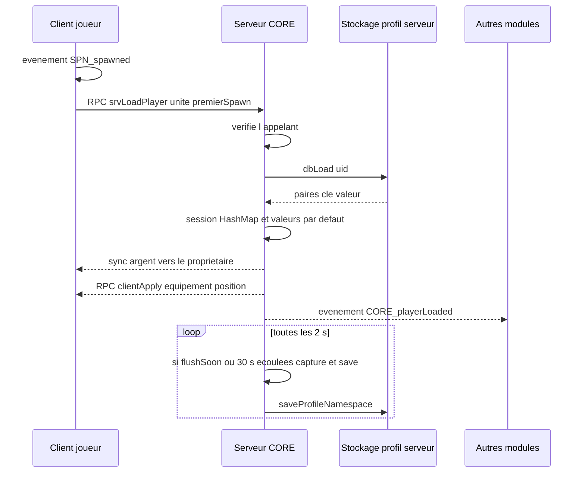

# Noyau (`CORE`)

> Le cœur du serveur : il charge, garde en mémoire et sauvegarde les données de chaque joueur (argent, équipement, position et valeurs des autres modules), affiche l'argent dans l'inventaire et offre aux autres modules des services communs.

## Ce que ce module démontre en informatique

- **Architecture client/serveur et autorité serveur** : les données des joueurs n'existent que sur le serveur, dans `CORE_sessions` ; le client ne reçoit qu'une copie en lecture (`CORE_cash`, `CORE_bank`) et ne peut jamais modifier son argent lui-même.
- **Table de hachage (HashMap)** : `CORE_sessions` associe l'identifiant Steam du joueur (UID) à une autre HashMap clé → valeur (`cash`, `bank`, `loadout`, `pos`, `dir`, et toute clé ajoutée par un autre module, comme `hunger`).
- **Couche d'abstraction du stockage** : tout passe par deux fonctions, `CORE_fnc_dbLoad` et `CORE_fnc_dbSave`. Aujourd'hui elles écrivent dans le profil du serveur (`profileNamespace`) ; demain on pourra les remplacer par une base MariaDB (via l'extension extDB3) sans toucher au reste du code.
- **Persistance / sérialisation et migration de format** : la HashMap est convertie en liste de paires `[clé, valeur]` pour être enregistrée, et `dbLoad` sait convertir un ancien format erroné vers le nouveau.
- **Validation des entrées et RPC avec liste blanche** : les fonctions appelables à distance (RPC, appel de procédure à distance) sont déclarées dans `remoteExec.hpp`, et chacune vérifie qui l'a appelée (`remoteExecutedOwner`).
- **Programmation événementielle (publish/subscribe)** : CORE publie `CORE_playerLoaded` (serveur) et `CORE_loadoutApplied` (client), et s'abonne à `SPN_menuOpened` / `SPN_spawned`.
- **Registre de plugins / injection de callbacks** : `CORE_fnc_registerItemUse` permet à un module d'enregistrer du code à exécuter quand on double-clique sur un objet dans l'inventaire (utilisé par NEED pour boire et manger).

## Fichiers

| Fichier / dossier | Rôle |
|---|---|
| `coreSystem/config/functions.hpp` | Déclare les 24 fonctions `CORE_fnc_*` (`init` est lancée automatiquement en `postInit`). |
| `coreSystem/config/remoteExec.hpp` | Liste blanche des RPC : `srvLoadPlayer` (exécutable seulement sur le serveur), `clientMsg` et `clientApply` (exécutables partout, mais elles vérifient elles-mêmes que l'appel vient du serveur). |
| `coreSystem/config/settings.hpp` | Classe `CORE_Settings` : monnaie (Couronne, `Kr`), argent de départ (500 en espèces, 2000 en banque), intervalle d'autosauvegarde (300 s), restauration à la connexion, nom de la base, test de base, `storage`, `debug`, `devMode`. |
| `coreSystem/functions/fn_*.sqf` | Le code (24 fonctions déclarées + `fn_srvDevGive.sqf`, voir plus bas). |
| `coreSystem/ui/base.hpp` | Classe d'interface `CORE_RscStructuredText` (texte riche aligné à droite) utilisée pour l'argent dans l'inventaire. |
| `db/01_create_database.sql`, `db/02_schema.sql`, `db/03_migration_inventaire_physique.sql` | Scripts SQL prévus pour la future base MariaDB : création de la base `eastrp` et de l'utilisateur, table `players` (uid, name, cash, bank, loadout, pos, dir, updated), migration d'une ancienne colonne `items`. |
| `docs/DATABASE_SETUP.md`, `docs/CORE_API.md` | Procédure d'installation MariaDB + extDB3, et API publique du noyau pour les autres modules. |

## Comment ça marche (flux)

Quand le joueur apparaît, son client envoie une demande de chargement au serveur. Le serveur vérifie que la demande vient bien du propriétaire de l'unité, lit les données sauvegardées (ou crée un nouveau joueur avec l'argent de départ) et les garde en mémoire dans une HashMap. Il envoie ensuite l'argent au seul client concerné et, s'il s'agit d'une connexion (pas d'une réapparition), lui renvoie son équipement et sa position. L'événement `CORE_playerLoaded` permet aux autres modules (besoins, métiers, téléphone) d'initialiser leurs propres valeurs. Côté sauvegarde, une boucle serveur vérifie toutes les 2 secondes s'il faut écrire sur le disque : soit parce qu'un module a signalé un changement important (`CORE_flushSoon`), soit parce que 30 secondes sont passées ; une deuxième boucle fait une sauvegarde complète toutes les 300 secondes, et la déconnexion déclenche aussi une sauvegarde.

## Fonctions

| Fonction | Côté | Rôle en une ligne |
|---|---|---|
| `CORE_fnc_init` | Les deux | Démarre le noyau : sessions, sauvegardes, mort, déconnexion, masquage du décor ; côté client, argent et double-clic inventaire. |
| `CORE_fnc_dbLoad` | Serveur | Lit les données d'un joueur dans le stockage (avec conversion de l'ancien format). |
| `CORE_fnc_dbSave` | Serveur | Écrit les données d'un joueur dans le stockage. |
| `CORE_fnc_dbTest` | Serveur | Diagnostic : teste la connexion à MariaDB via extDB3 et écrit le résultat dans le journal. |
| `CORE_fnc_srvLoadPlayer` | Serveur (RPC) | Charge ou crée la session d'un joueur après son spawn. |
| `CORE_fnc_sync` | Serveur | Envoie l'argent au client propriétaire uniquement. |
| `CORE_fnc_capture` | Serveur | Relève l'équipement et la position d'un joueur dans sa session. |
| `CORE_fnc_savePlayer` | Serveur | Sérialise la session d'un joueur et l'envoie au stockage. |
| `CORE_fnc_saveAll` | Serveur | Capture et sauvegarde tous les joueurs. |
| `CORE_fnc_changeMoney` | Serveur | Ajoute ou retire de l'argent avec contrôles. |
| `CORE_fnc_getMoney` | Serveur | Lit un solde. |
| `CORE_fnc_getValue` | Serveur | Lit une valeur quelconque de la session d'un joueur. |
| `CORE_fnc_setValue` | Serveur | Écrit une valeur quelconque dans la session d'un joueur. |
| `CORE_fnc_registerItemUse` | Client | Enregistre un objet utilisable par double-clic dans l'inventaire. |
| `CORE_fnc_invWatch` | Client | Surveille l'inventaire, branche le double-clic et renomme les objets enregistrés. |
| `CORE_fnc_invUse` | Client | Traite un double-clic et appelle le code de l'objet. |
| `CORE_fnc_onSpawned` | Client | Réagit à `SPN_spawned` en demandant le chargement au serveur. |
| `CORE_fnc_clientApply` | Client (RPC) | Applique l'équipement et la position envoyés par le serveur. |
| `CORE_fnc_clientMsg` | Client (RPC) | Affiche un message envoyé par le serveur. |
| `CORE_fnc_invMoney` | Client | Affiche les espèces dans la barre de titre de l'inventaire. |
| `CORE_fnc_fmt` | Les deux | Formate un nombre avec des espaces (1 234 567). |
| `CORE_fnc_cornerPos` | Client | Calcule la position d'un bloc dans un coin de l'écran. |
| `CORE_fnc_deepControls` | Client | Liste récursivement tous les contrôles d'une fenêtre. |
| `CORE_fnc_ctrlItemClass` | Client | Trouve la classe de l'objet sur une ligne d'une liste d'inventaire. |

### `CORE_fnc_init`
- **Côté :** les deux (lancée automatiquement en `postInit` sur chaque machine ; la partie serveur est protégée par `isServer`, la partie client par `hasInterface`).
- **Dans le jeu :** prépare tout ce qui fait qu'un joueur retrouve son argent et son équipement, perd son équipement à la mort, et que certains arbres, rochers ou bâtiments de la carte disparaissent là où l'auteur l'a décidé.
- **En informatique :** côté serveur, crée la HashMap `CORE_sessions` et installe :
  - un gestionnaire `HandleDisconnect` : capture de l'état, sauvegarde, suppression de la session (`deleteAt`), écriture disque si nécessaire ;
  - un gestionnaire `EntityKilled` : vide `loadout` et `pos` (l'argent est conservé), sauvegarde, et marque l'unité `CORE_active = false` ;
  - le **masquage du décor** : parcourt tous les marqueurs de la carte ; ceux dont le nom commence par `hide_` masquent la végétation et les rochers (`TREE`, `SMALL TREE`, `BUSH`, `ROCK`, `ROCKS`, `STONE`, `HIDE`), ceux en `hideall_` masquent tous les objets de terrain (bâtiments, murs, clôtures compris). Le rayon est la plus grande des deux dimensions du marqueur (minimum 2 m), les objets sont trouvés avec `nearestTerrainObjects` puis masqués pour tout le monde avec `hideObjectGlobal` ; le nombre d'objets masqués est écrit dans le journal ;
  - une boucle de **sauvegarde rapide** (vérification toutes les 2 s : écriture si `CORE_flushSoon` est levé, avec 1 s d'attente pour laisser l'objet acheté arriver, ou toutes les 30 s s'il y a au moins un joueur) ;
  - une boucle d'**autosauvegarde** toutes les `autosaveSeconds` (minimum 60 s) via `CORE_fnc_saveAll` ;
  - le lancement de `CORE_fnc_dbTest` si `dbTest = 1`.
  Côté client : variables `CORE_firstSpawn` et `CORE_dblLock`, registre `CORE_itemUse` (HashMap), abonnements à `SPN_menuOpened` (pour savoir si c'est une connexion ou une réapparition) et `SPN_spawned`, puis lancement des boucles `invMoney` et `invWatch`.
- **Paramètres → retour :** `aucun → rien`.

### `CORE_fnc_dbLoad`
- **Côté :** serveur (appelée par `srvLoadPlayer`).
- **Dans le jeu :** retrouve l'argent, l'équipement et les autres données d'un joueur qui revient.
- **En informatique :** c'est la couche de lecture du stockage. Elle lit la variable `CORE_p_<uid>` dans `profileNamespace` (un fichier de profil du serveur). Si les données sont dans l'**ancien format** `[[clés...],[valeurs...]]` (deux tableaux parallèles de même longueur, plus de 2 clés, toutes des chaînes), elle les convertit en paires `[clé, valeur]` et l'écrit dans le journal. Enfin elle **filtre** le résultat pour ne garder que des paires valides (tableau de 2 éléments dont le premier est une chaîne), ce qui protège contre des données corrompues.
- **Paramètres → retour :** `[uid] → [[clé, valeur], ...]` ou `[]`.

### `CORE_fnc_dbSave`
- **Côté :** serveur.
- **Dans le jeu :** enregistre les données d'un joueur.
- **En informatique :** couche d'écriture du stockage : stocke les paires dans `profileNamespace` sous la clé `CORE_p_<uid>` et lève le drapeau `CORE_dirty` (« données modifiées non encore écrites sur le disque »). L'écriture physique (`saveProfileNamespace`) est faite plus tard, par lots, par les boucles de sauvegarde ou la déconnexion. Le commentaire du fichier indique qu'elle doit être remplacée plus tard par une vraie base de données.
- **Paramètres → retour :** `[uid, paires] → rien`.

### `CORE_fnc_dbTest`
- **Côté :** serveur. **Outil de diagnostic**, lancé seulement si `dbTest = 1` dans les réglages (0 par défaut).
- **Dans le jeu :** aucun effet visible ; sert à l'administrateur pour vérifier l'installation de la base de données.
- **En informatique :** dialogue avec la DLL extDB3 par `callExtension` : demande la version (vide = extension non chargée, on s'arrête avec un message d'aide), déclare la base (`ADD_DATABASE`) et le protocole SQL, puis exécute deux requêtes de test `SELECT 1` et `SELECT COUNT(*) FROM players`. Chaque résultat est écrit dans le journal du serveur (`.rpt`) avec le préfixe `[CORE][DB]`. **Le reste du noyau n'utilise pas encore la base** : c'est une étape de préparation.
- **Paramètres → retour :** `aucun → rien`.

### `CORE_fnc_srvLoadPlayer`
- **Côté :** serveur, **appelée à distance** (déclarée dans `remoteExec.hpp` avec `allowedTargets = 2`, donc exécutable uniquement sur le serveur ; envoyée par le client du joueur via `CORE_fnc_onSpawned`).
- **Dans le jeu :** au spawn, le joueur récupère son argent ; à la connexion, il retrouve aussi son équipement et l'endroit où il était.
- **En informatique :** valide les paramètres (type objet, unité non nulle, contrôlée par un joueur) puis vérifie que l'appelant (`remoteExecutedOwner`) est bien le propriétaire de l'unité : un joueur ne peut pas charger la session d'un autre. Si aucune session n'existe en mémoire, elle charge les paires depuis le stockage (`createHashMapFromArray`) puis **complète uniquement les clés manquantes** avec les valeurs par défaut (argent de départ, équipement vide…), ce qui rend l'ajout de nouveaux champs compatible avec les anciennes sauvegardes ; la session est sauvegardée immédiatement. Ensuite elle marque l'unité `CORE_active`, synchronise l'argent, renvoie l'équipement et la position au client si c'est la connexion et que `restoreOnLogin = 1`, et publie `CORE_playerLoaded [unité, uid]`.
- **Paramètres → retour :** `[unité, premierSpawn] → rien`.

### `CORE_fnc_sync`
- **Côté :** serveur.
- **Dans le jeu :** l'argent affiché chez le joueur se met à jour.
- **En informatique :** lit `cash` et `bank` dans la session et les place sur l'unité avec `setVariable [..., ..., owner]` : la valeur n'est envoyée qu'à la machine du propriétaire (et pas à tous les joueurs), ce qui limite le trafic réseau et la fuite d'informations. Le client n'a qu'une copie en lecture ; la vérité reste sur le serveur.
- **Paramètres → retour :** `[unité] → rien`.

### `CORE_fnc_capture`
- **Côté :** serveur.
- **Dans le jeu :** mémorise ce que le joueur porte et où il se trouve, pour le lui rendre à la prochaine connexion.
- **En informatique :** ignore les unités nulles, mortes ou non chargées (`CORE_active` faux, par exemple juste après une mort) afin de ne pas écraser des données valides. Sinon, enregistre dans la session `getUnitLoadout` (tout l'équipement physique sous forme de tableau), la position `getPosATL` et la direction.
- **Paramètres → retour :** `[unité] → rien`.

### `CORE_fnc_savePlayer`
- **Côté :** serveur.
- **Dans le jeu :** sauvegarde un joueur.
- **En informatique :** **sérialisation** : transforme la HashMap de la session en liste de paires `[[clé, valeur], ...]` (format que `createHashMapFromArray` sait relire), puis appelle `CORE_fnc_dbSave`. Ne fait rien si la session n'existe pas.
- **Paramètres → retour :** `[uid] → rien`.

### `CORE_fnc_saveAll`
- **Côté :** serveur (appelée par la boucle d'autosauvegarde).
- **Dans le jeu :** sauvegarde générale régulière.
- **En informatique :** capture l'état de tous les joueurs connectés, sauvegarde chaque session (parcours des clés de `CORE_sessions`), écrit sur le disque seulement si `CORE_dirty` est vrai, puis journalise le nombre de joueurs.
- **Paramètres → retour :** `aucun → rien`.

### `CORE_fnc_changeMoney`
- **Côté :** serveur uniquement (renvoie `false` ailleurs). Appelée par les modules économie, métiers et téléphone, jamais directement par un client.
- **Dans le jeu :** le joueur gagne ou dépense de l'argent (espèces ou banque).
- **En informatique :** **validation stricte** : le compte doit être `"cash"` ou `"bank"`, le montant doit être un nombre, il est arrondi à l'entier inférieur (`floor`) et un montant nul est refusé. Le nouveau solde doit rester entre 0 et 1 000 000 000 (pas de solde négatif ni de dépassement). En cas de succès : mise à jour de la session, synchronisation vers le client et demande de sauvegarde rapide (`CORE_flushSoon = true`, écriture disque dans les 2 à 3 secondes).
- **Paramètres → retour :** `[unité, "cash"|"bank", delta] → booléen` (`false` si impossible, par exemple solde insuffisant).

### `CORE_fnc_getMoney`
- **Côté :** serveur (renvoie 0 ailleurs).
- **Dans le jeu :** connaître le solde d'un joueur (ex. avant un achat).
- **En informatique :** lecture dans la HashMap avec `getOrDefault`, donc 0 si le joueur ou la clé est inconnu au lieu d'une erreur.
- **Paramètres → retour :** `[unité, "cash"|"bank"] → nombre`.

### `CORE_fnc_getValue`
- **Côté :** serveur.
- **Dans le jeu :** sert aux autres modules pour lire une donnée du joueur (faim, métier, numéro de téléphone…).
- **En informatique :** stockage clé/valeur **générique** : n'importe quel module peut lire une clé dans la session du joueur, avec une valeur par défaut (0 si non précisée) quand la session ou la clé n'existe pas. Sur une machine qui n'est pas le serveur, la fonction ne renvoie rien. C'est ce qui permet aux autres modules d'avoir leurs données sauvegardées sans écrire leur propre système de stockage.
- **Paramètres → retour :** `[unité, clé, défaut] → valeur`.

### `CORE_fnc_setValue`
- **Côté :** serveur (renvoie `false` ailleurs).
- **Dans le jeu :** sert aux autres modules pour enregistrer une donnée du joueur.
- **En informatique :** écrit la clé dans la session et renvoie `true`, ou `false` si le joueur n'a pas de session chargée. Elle ne valide pas la valeur (c'est à chaque module de le faire) et ne déclenche pas d'écriture immédiate : la donnée sera écrite au prochain cycle de sauvegarde (au plus 30 s) ou plus tôt si le module lève `CORE_flushSoon`.
- **Paramètres → retour :** `[unité, clé, valeur] → booléen`.

### `CORE_fnc_registerItemUse`
- **Côté :** client.
- **Dans le jeu :** rend un objet « utilisable » par double-clic dans l'inventaire et peut changer son nom affiché (ex. « Bouteille d'eau »).
- **En informatique :** **registre de callbacks** : ajoute dans la HashMap `CORE_itemUse` une entrée `classe en minuscules → [code, nom affiché]`. La clé est mise en minuscules car les noms de classes Arma ne sont pas sensibles à la casse. Utilisée par NEED pour les consommables.
- **Paramètres → retour :** `[classe, code, nom affiché (optionnel)] → rien`.

### `CORE_fnc_invWatch`
- **Côté :** client (boucle lancée par `init`).
- **Dans le jeu :** dans l'inventaire, les objets enregistrés affichent leur nom personnalisé et réagissent au double-clic.
- **En informatique :** **polling** (vérification périodique) : attend l'ouverture de l'inventaire (display 602), puis toutes les 0,4 s parcourt tous ses contrôles (via `deepControls`). Sur chaque liste (types 102 « liste à colonnes » et 5 « liste simple »), il branche **une seule fois** deux gestionnaires de double-clic (marqueur `CORE_hooked` posé sur le contrôle pour ne pas les ajouter en double), puis renomme chaque ligne dont la classe est dans le registre. Le commentaire explique pourquoi on passe par les listes : il n'existe pas d'événement de double-clic au niveau de l'écran entier.
- **Paramètres → retour :** `aucun → rien` (boucle infinie).

### `CORE_fnc_invUse`
- **Côté :** client (appelée par les gestionnaires posés par `invWatch`).
- **Dans le jeu :** double-cliquer sur une bouteille d'eau la fait boire (via NEED).
- **En informatique :** retrouve la ligne cliquée (ou la sélection courante si la ligne vaut -1), en déduit la classe de l'objet, cherche l'entrée dans le registre `CORE_itemUse` et exécute son code. Un **anti-rebond** de 0,6 s (`CORE_dblLock`) évite un double déclenchement, car les deux gestionnaires peuvent réagir au même double-clic. En mode `debug`, affiche les détails dans le chat. Renvoie `true` si l'objet est géré par un module.
- **Paramètres → retour :** `[contrôle, ligne] → booléen`.

### `CORE_fnc_onSpawned`
- **Côté :** client (abonnée à l'événement `SPN_spawned`).
- **Dans le jeu :** dès que le joueur est apparu, ses données sont demandées au serveur.
- **En informatique :** envoie le RPC `CORE_fnc_srvLoadPlayer` au serveur (cible 2) avec l'unité et le drapeau `CORE_firstSpawn` (connexion ou réapparition, mémorisé grâce à `SPN_menuOpened`). C'est le pont entre le module de spawn (côté client) et le noyau (côté serveur).
- **Paramètres → retour :** `[unité, idPoint] → rien`.

### `CORE_fnc_clientApply`
- **Côté :** client, **appelée à distance** (déclarée avec `allowedTargets = 0` ; la fonction refuse tout appel qui ne vient pas du serveur ou de la machine locale : `remoteExecutedOwner` doit valoir 0 ou 2).
- **Dans le jeu :** à la reconnexion, le joueur retrouve son équipement et réapparaît à l'endroit où il s'était déconnecté.
- **En informatique :** applique `setUnitLoadout` si l'équipement n'est pas vide et `setPosATL` / `setDir` si la position a bien 3 coordonnées, puis publie l'événement client `CORE_loadoutApplied` (le module d'identité s'en sert pour remettre les papiers dans l'inventaire).
- **Paramètres → retour :** `[équipement, position, direction] → rien`.

### `CORE_fnc_clientMsg`
- **Côté :** client, **appelée à distance** (`allowedTargets = 0`, même contrôle de l'appelant que `clientApply`). Utilisée par de nombreux modules serveur (économie, métiers, téléphone, identité, besoins).
- **Dans le jeu :** affiche un message dans le chat du joueur (ex. « Opération refusée »).
- **En informatique :** vérifie que l'appel vient du serveur (`remoteExecutedOwner` 0 ou 2), sinon l'ignore : un joueur malveillant ne peut pas afficher de faux messages « système » chez les autres.
- **Paramètres → retour :** `[texte] → rien`.

### `CORE_fnc_invMoney`
- **Côté :** client (boucle lancée par `init`).
- **Dans le jeu :** quand le joueur ouvre son inventaire, ses espèces s'affichent dans la barre de titre, à gauche de la croix de fermeture (la banque n'est visible que dans le téléphone).
- **En informatique :** l'interface d'inventaire d'Arma n'est pas modifiable directement, donc le code **analyse sa géométrie** : il cherche le contrôle dont le texte contient le nom du joueur (le titre), élargit jusqu'au bord droit de la barre (plus large contrôle sur la même ligne), puis s'arrête avant le petit bouton de fermeture. S'il ne trouve pas la barre, il utilise un coin de secours calculé par `CORE_fnc_cornerPos`. Il crée alors un contrôle texte (IDC 74401, dans la plage CORE) et le rafraîchit toutes les 0,3 s avec `CORE_cash` formaté par `CORE_fnc_fmt`, tant que l'inventaire est ouvert. La position trouvée est écrite dans le journal.
- **Paramètres → retour :** `aucun → rien` (boucle infinie).

### Utilitaires

Petites fonctions de service, réutilisées par CORE et par d'autres modules :

- **`CORE_fnc_fmt`** (les deux côtés, pas de contrôle) : formate un nombre entier avec des espaces tous les 3 chiffres (`1234567 → "1 234 567"`). Convertit le nombre en texte (`toFixed 0`) puis insère un espace quand le nombre de chiffres restants est multiple de 3, sans en mettre après un signe moins. `[nombre] → texte`. Utilisée aussi par l'économie et le téléphone.
- **`CORE_fnc_cornerPos`** (client) : calcule `[x, y, largeur, hauteur]` d'un bloc placé dans un coin de l'écran (`topleft`, `topright`, `bottomleft`, `bottomright`) en partant de la zone sûre de l'écran (`safeZone`), avec une marge (0,02 par défaut). `[coin, largeur, hauteur, [margeX, margeY]] → [x, y, l, h]`. Utilisée par `invMoney` et par le HUD de NEED.
- **`CORE_fnc_deepControls`** (client) : **parcours récursif** d'une fenêtre : renvoie tous ses contrôles, y compris ceux contenus dans des groupes de contrôles (type 15), en s'appelant elle-même sur chaque groupe. `[fenêtre ou groupe] → [contrôles]`.
- **`CORE_fnc_ctrlItemClass`** (client) : renvoie la classe de l'objet stockée sur une ligne de liste d'inventaire. Pour une liste à colonnes (type 102), parcourt les colonnes jusqu'à trouver une donnée non vide, sinon lit la donnée de la ligne ; pour une liste simple (type 5), lit directement la donnée. Ligne négative → chaîne vide. `[contrôle, ligne] → classe`.

### Fichier présent mais non déclaré : `fn_srvDevGive.sqf`

Le fichier `coreSystem/functions/fn_srvDevGive.sqf` contient un **outil de test** (ajouter/retirer de l'argent, seulement si `devMode = 1`, avec vérification du propriétaire et passage par `changeMoney`). Il n'est **pas** déclaré dans `config/functions.hpp` ni dans `remoteExec.hpp` : la fonction `CORE_fnc_srvDevGive` n'existe donc pas en jeu, et aucun autre fichier ne l'appelle. C'est du code de développement désactivé.

## Sécurité et robustesse

- **Autorité serveur sur l'argent** : `changeMoney`, `getMoney`, `getValue`, `setValue`, `sync`, `capture`, `savePlayer` sortent immédiatement si elles ne tournent pas sur le serveur (`isServer`). Le client n'a qu'une copie en lecture envoyée à lui seul.
- **Liste blanche RPC** : `description.ext` active `CfgRemoteExec` en mode 1 (seules les fonctions listées peuvent être appelées à distance) ; CORE n'en expose que trois.
- **Vérification de l'appelant** : `srvLoadPlayer` exige que `remoteExecutedOwner` soit le propriétaire de l'unité ; `clientApply` et `clientMsg` exigent que l'appel vienne du serveur (2) ou de la machine locale (0).
- **Validation des paramètres** : types imposés dans `params` (`objNull` attendu), unité non nulle et contrôlée par un joueur, compte limité à `"cash"`/`"bank"`, montant numérique arrondi, solde borné entre 0 et 1 milliard.
- **Données corrompues** : `dbLoad` filtre les paires invalides et migre l'ancien format ; `srvLoadPlayer` complète les clés manquantes.
- **Pas de perte en cas d'arrêt brutal** : écriture disque au plus 30 s après un changement, en 2-3 s après une opération d'argent ou d'inventaire (`CORE_flushSoon`), à la déconnexion et toutes les 300 s.
- **États incohérents évités** : `capture` ignore les unités mortes ou non chargées ; à la mort, `CORE_active` passe à faux jusqu'au prochain chargement.
- **Anti-rebond** du double-clic (0,6 s) et accrochage unique des gestionnaires d'événements (`CORE_hooked`).

## Limites et pistes d'amélioration

- **Stockage temporaire** : tout est écrit dans le profil du serveur (`profileNamespace`), un fichier unique réécrit en entier à chaque `saveProfileNamespace`. Cela ne passera pas bien à l'échelle et ne permet pas de requêtes. La migration vers MariaDB/extDB3 est préparée (scripts SQL, `dbTest`, guide d'installation) mais **pas encore branchée** : le réglage `storage = "profile"` n'est lu par aucune fonction.
- **Schéma SQL incomplet par rapport aux sessions** : la table `players` a des colonnes fixes (cash, bank, loadout, pos, dir), alors que les sessions contiennent aussi des clés libres ajoutées par d'autres modules (faim, soif, métier, téléphone…). Il faudra prévoir une colonne de type JSON ou une table clé/valeur.
- **Deux boucles de sauvegarde qui se recouvrent** : la sauvegarde rapide écrit déjà toutes les 30 s ; l'autosauvegarde de 300 s est donc surtout redondante.
- **Détection de l'inventaire par polling** (toutes les 0,2 à 0,4 s) et placement de l'argent par heuristique : fragile si l'interface du jeu change (d'où le coin de secours).
- **Réglages non utilisés** : `invMoneyMargin` n'est pas lu (la marge par défaut de `cornerPos` est utilisée) ; `fn_srvDevGive.sqf` n'est pas déclaré.
- **Le drapeau « première connexion »** est fourni par le client ; il ne sert qu'à restaurer ses propres données, donc sans enjeu de triche, mais ce n'est pas le serveur qui le décide.
