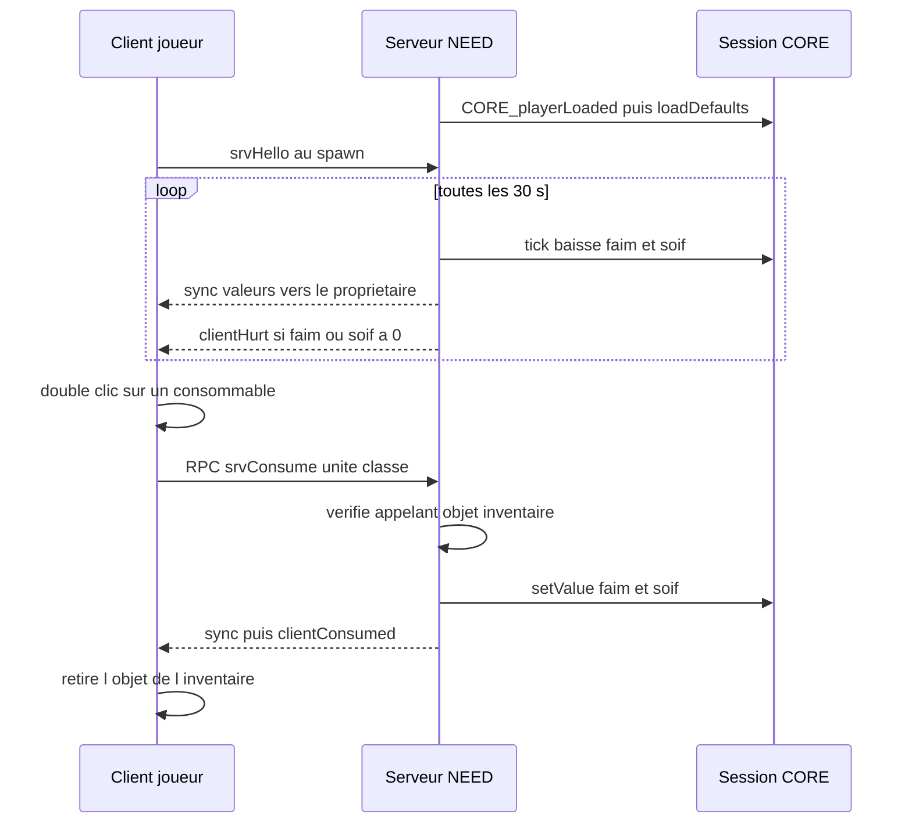

# Besoins : faim, soif, santé (`NEED`)

> Le joueur a faim et soif avec le temps ; il doit boire et manger des objets de son inventaire, sinon il perd de la santé. Trois barres (santé, faim, soif) restent affichées à l'écran.

## Ce que ce module démontre en informatique

- **Autorité serveur et validation des entrées (anti-triche)** : faim et soif sont calculées et stockées sur le serveur ; quand le joueur consomme un objet, le serveur vérifie qui demande, que l'objet est un consommable déclaré et qu'il est bien dans l'inventaire.
- **Boucle de simulation à pas fixe (tick)** : toutes les 30 s, le serveur fait baisser faim et soif de tous les joueurs ; la perte par minute est convertie en perte par tick (`perte par minute × secondes / 60`).
- **Réutilisation d'un service commun (couplage faible)** : NEED n'a pas de stockage propre ; il range `hunger` et `thirst` dans la session du joueur via `CORE_fnc_getValue` / `CORE_fnc_setValue`, et elles sont sauvegardées automatiquement avec le reste.
- **Programmation événementielle** : NEED s'abonne à `CORE_playerLoaded` (serveur) et `SPN_spawned` (client), et enregistre ses consommables dans le registre de double-clic du noyau (`CORE_fnc_registerItemUse`).
- **Gestion d'une situation de concurrence (race condition)** : au spawn, deux demandes partent vers le serveur (chargement CORE et `srvHello` NEED) sans ordre garanti ; `srvHello` attend jusqu'à 15 s que la session existe avant d'agir.
- **Séparation données / logique** : les consommables et leurs effets sont déclarés dans `NEED_CfgConsumables` ; ajouter un aliment ne demande aucune ligne de code.
- **Génération procédurale d'UI** : les barres du HUD sont créées par le code (`ctrlCreate`) à partir d'une petite table `[nom, couleur]`, et leur largeur est proportionnelle à la valeur.

## Fichiers

| Fichier / dossier | Rôle |
|---|---|
| `needSystem/config/functions.hpp` | Déclare les 12 fonctions `NEED_fnc_*` (`init` en `postInit`). |
| `needSystem/config/remoteExec.hpp` | Liste blanche RPC : `srvConsume` et `srvHello` (exécutables seulement sur le serveur), `clientConsumed` et `clientHurt` (exécutables partout, mais elles vérifient que l'appel vient du serveur). |
| `needSystem/config/settings.hpp` | `NEED_Settings` (tick de 30 s, valeur de départ 80/100, perte 0,8 faim et 1,2 soif par minute, dégâts de privation 0,03, affichages) et `NEED_CfgConsumables` (eau, sandwich, ration de l'addon `eastrp_core`). |
| `needSystem/functions/fn_*.sqf` | Le code (12 fonctions déclarées + `fn_srvDev.sqf`, voir plus bas). |
| `needSystem/ui/base.hpp` | Classes d'interface `NEED_RscText` (utilisée) et `NEED_RscProgress` (définie mais pas utilisée par le code). |
| `needSystem/ui/hud.hpp` | Ancienne version figée du HUD (`NEED_HUD`, IDC 75301-75306). **Ce fichier n'est pas inclus dans `description.ext`** : il n'est pas utilisé, le HUD actuel est créé dynamiquement par `NEED_fnc_hudLoop`. |

## Comment ça marche (flux)

Quand le noyau a chargé un joueur, NEED lui donne une faim et une soif de départ (80 sur 100) s'il n'en a pas encore ; une demande `srvHello` envoyée par le client au spawn sert de double sécurité. Ensuite, toutes les 30 secondes, le serveur fait baisser les deux valeurs pour chaque joueur chargé et vivant, envoie les nouvelles valeurs au seul client concerné, et inflige des dégâts si l'une des deux est à zéro. Quand le joueur double-clique sur une bouteille d'eau, son client envoie une demande au serveur, qui vérifie tout, met à jour les valeurs, puis demande au client de retirer l'objet. Le client se contente d'afficher les barres à partir des valeurs reçues.

## Fonctions

| Fonction | Côté | Rôle en une ligne |
|---|---|---|
| `NEED_fnc_init` | Les deux | Branche les événements, lance la boucle serveur et l'affichage client, enregistre les consommables. |
| `NEED_fnc_loadDefaults` | Serveur | Donne faim/soif de départ à un joueur qui n'en a pas. |
| `NEED_fnc_sync` | Serveur | Envoie faim et soif au client propriétaire. |
| `NEED_fnc_tick` | Serveur | Fait baisser faim et soif de tous les joueurs actifs, applique la privation. |
| `NEED_fnc_srvConsume` | Serveur (RPC) | Valide et applique la consommation d'un objet. |
| `NEED_fnc_srvHello` | Serveur (RPC) | Double sécurité au spawn : attend la session CORE puis initialise. |
| `NEED_fnc_clientConsumed` | Client (RPC) | Retire l'objet consommé de l'inventaire. |
| `NEED_fnc_clientHurt` | Client (RPC) | Applique les dégâts de faim/soif. |
| `NEED_fnc_useItem` | Client | Envoie la demande de consommation au serveur. |
| `NEED_fnc_onSpawned` | Client | Au spawn, envoie `srvHello` (et un diagnostic en mode debug). |
| `NEED_fnc_hudLoop` | Client | Affiche en permanence les barres santé/faim/soif. |
| `NEED_fnc_invPanel` | Client | Affiche les mêmes barres dans l'inventaire (désactivé par défaut). |

### `NEED_fnc_init`
- **Côté :** les deux (lancée en `postInit` ; partie serveur protégée par `isServer`, partie client par `hasInterface`).
- **Dans le jeu :** met en route la faim et la soif, rend l'eau, le sandwich et la ration consommables, et affiche les barres.
- **En informatique :** côté serveur : abonnement à l'événement `CORE_playerLoaded` (appelle `loadDefaults`), gestionnaire `EntityKilled` qui remet faim et soif à la valeur de départ à la mort d'un joueur, et boucle infinie qui appelle `NEED_fnc_tick` toutes les `tickSeconds` (minimum 5 s). Côté client : pour chaque classe de `NEED_CfgConsumables`, enregistre auprès du noyau un code de double-clic qui appelle `NEED_fnc_useItem` et le nom à afficher ; abonnement à `SPN_spawned` ; lancement des boucles d'affichage `hudLoop` et `invPanel`.
- **Paramètres → retour :** `aucun → rien`.

### `NEED_fnc_loadDefaults`
- **Côté :** serveur (appelée par l'événement `CORE_playerLoaded` et par `srvHello`).
- **Dans le jeu :** un nouveau joueur commence à 80/100 de faim et de soif ; un joueur existant garde ses valeurs.
- **En informatique :** lit `hunger` et `thirst` avec la valeur par défaut **-1** (valeur sentinelle qui signifie « absent »), et n'écrit la valeur de départ que dans ce cas. La fonction est donc **idempotente** : l'appeler deux fois (événement + `srvHello`) ne remet pas les valeurs à zéro. Elle synchronise ensuite le client et écrit dans le journal (deux lignes presque identiques, la seconde est redondante).
- **Paramètres → retour :** `[unité, (uid)] → rien`.

### `NEED_fnc_sync`
- **Côté :** serveur.
- **Dans le jeu :** les barres du joueur se mettent à jour.
- **En informatique :** lit faim et soif dans la session CORE et les copie sur l'unité avec `setVariable [..., ..., owner]`, c'est-à-dire uniquement vers la machine du joueur concerné. Le client n'a qu'une copie en lecture.
- **Paramètres → retour :** `[unité] → rien`.

### `NEED_fnc_tick`
- **Côté :** serveur (appelée par la boucle de `init`).
- **Dans le jeu :** la faim et la soif baissent avec le temps (100 → 0 en environ 2 h pour la faim, 1 h 20 pour la soif) ; à zéro, le joueur perd de la santé.
- **En informatique :** calcule la perte par tick à partir de la perte par minute (`perte/min × durée du tick / 60`). Pour chaque joueur **chargé** (`CORE_active`) et vivant, soustrait cette perte en bornant à 0 (`max 0`), enregistre via `CORE_fnc_setValue`, synchronise, et si une des deux valeurs est à 0 et que les dégâts de privation sont activés, envoie le RPC `NEED_fnc_clientHurt` au joueur.
- **Paramètres → retour :** `aucun → rien`.

### `NEED_fnc_srvConsume`
- **Côté :** serveur, **appelée à distance** (`allowedTargets = 2`, envoyée par le client via `NEED_fnc_useItem`).
- **Dans le jeu :** le joueur boit ou mange ; s'il n'en a pas besoin, l'objet n'est pas gaspillé et un message le prévient.
- **En informatique :** chaîne de contrôles avant toute modification :
  1. types des paramètres imposés (`params` avec objet et chaîne), unité non nulle et contrôlée par un joueur ;
  2. l'appelant (`remoteExecutedOwner`) doit être le propriétaire de l'unité ;
  3. le joueur doit être chargé par le noyau (`CORE_active`) et vivant ;
  4. la classe doit exister dans `NEED_CfgConsumables` (liste blanche) ;
  5. **limitation de fréquence** : une consommation au plus toutes les 1,5 s (`NEED_next`) ;
  6. l'objet doit être présent dans l'inventaire tel que le serveur le voit (`magazines` + `items`, comparaison en minuscules) ;
  7. il doit y avoir quelque chose à gagner (sinon refus, l'objet est conservé).
  Ensuite : nouvelles valeurs bornées à 100, synchronisation, RPC `clientConsumed` pour retirer l'objet, et `CORE_flushSoon = true` pour une sauvegarde rapide. Une petite fonction locale `_say` écrit chaque étape dans le journal et, en mode debug, l'envoie aussi au joueur.
- **Paramètres → retour :** `[unité, classe] → rien`.

### `NEED_fnc_srvHello`
- **Côté :** serveur, **appelée à distance** (`allowedTargets = 2`, envoyée par `NEED_fnc_onSpawned`).
- **Dans le jeu :** garantit que les barres du joueur ont des valeurs dès son arrivée.
- **En informatique :** même vérification d'appelant que `srvConsume`. Comme cette demande peut arriver **avant** que CORE ait créé la session (deux RPC envoyés au même moment, ordre non garanti), elle attend avec `waitUntil` que la session existe, avec un **délai maximal de 15 s** pour ne pas attendre indéfiniment. Si la session n'apparaît pas, elle l'écrit dans le journal et abandonne ; sinon elle appelle `loadDefaults`.
- **Paramètres → retour :** `[unité] → rien`.

### `NEED_fnc_clientConsumed`
- **Côté :** client, **appelée à distance** (`allowedTargets = 0` ; ignore tout appel qui ne vient pas du serveur ou de la machine locale).
- **Dans le jeu :** l'objet disparaît de l'inventaire et le message « Vous utilisez : … » s'affiche.
- **En informatique :** l'inventaire d'une unité est géré par la machine du joueur, donc le retrait est fait côté client après validation serveur. Le code cherche d'abord l'objet parmi les chargeurs (`magazines`, comparaison insensible à la casse) et utilise `removeMagazine`, sinon `removeItem`.
- **Paramètres → retour :** `[classe, nom] → rien`.

### `NEED_fnc_clientHurt`
- **Côté :** client, **appelée à distance** (`allowedTargets = 0`, même contrôle de l'appelant).
- **Dans le jeu :** le joueur perd de la santé quand il meurt de faim ou de soif.
- **En informatique :** si le joueur est vivant, ajoute les dégâts reçus à ses dégâts actuels en bornant à 1 (mort). Comme pour le retrait d'objet, l'opération est faite sur la machine du joueur.
- **Paramètres → retour :** `[dégâts] → rien`.

### `NEED_fnc_useItem`
- **Côté :** client (code enregistré dans le registre de double-clic de CORE).
- **Dans le jeu :** double-cliquer sur un consommable lance la consommation.
- **En informatique :** ne modifie rien localement : envoie seulement le RPC `NEED_fnc_srvConsume` au serveur (cible 2) avec le joueur et la classe. Message de diagnostic en mode debug.
- **Paramètres → retour :** `[classe] → rien`.

### `NEED_fnc_onSpawned`
- **Côté :** client (abonnée à `SPN_spawned`).
- **Dans le jeu :** au spawn, s'assure que le serveur initialise les besoins du joueur.
- **En informatique :** envoie le RPC `NEED_fnc_srvHello`. En mode debug (`NEED_Settings >> debug = 1`), lance aussi un **contrôle de diagnostic** 12 s plus tard qui indique dans le chat si les valeurs ont bien été reçues.
- **Paramètres → retour :** `[unité, idPoint] → rien`.

### `NEED_fnc_hudLoop`
- **Côté :** client (boucle infinie lancée par `init`). **Lecture seule.**
- **Dans le jeu :** trois barres colorées (santé rouge, faim orange, soif bleue) avec leur pourcentage, en permanence dans un coin de l'écran (en bas à gauche par défaut).
- **En informatique :** toutes les 0,5 s, vérifie s'il faut afficher (réglage `showOnScreen`, écran principal présent, joueur vivant, données reçues). Si oui et que les contrôles n'existent pas encore (ou ont été détruits), il les **génère** sur l'écran principal (display 46) à partir de la table `[nom, couleur]` : fond, libellé, fond de barre et barre de remplissage pour chaque ligne, positionnés via `CORE_fnc_cornerPos`. Ensuite il met à jour le texte et la largeur de chaque barre, proportionnelle à la valeur (bornée entre 0,3 % et 100 %). La santé est calculée à partir des dégâts du jeu (`(1 - damage) × 100`). Si l'affichage n'est plus voulu (mort…), les contrôles sont supprimés.
- **Paramètres → retour :** `aucun → rien`.

### `NEED_fnc_invPanel`
- **Côté :** client (boucle infinie lancée par `init`). **Désactivé par défaut** (`showInInventory = 0`), car redondant avec le HUD permanent.
- **Dans le jeu :** si activé, affiche les mêmes trois barres dans un coin de l'écran d'inventaire.
- **En informatique :** attend l'ouverture de l'inventaire (display 602, polling 0,2 s). Si l'option est active, crée les contrôles avec des IDC fixes dans la plage du module (75310 à 75319, calculés `75311 + index × 3`…) et les rafraîchit toutes les 0,3 s tant que l'inventaire est ouvert ; sinon attend simplement sa fermeture. Même logique d'affichage que `hudLoop` (code en partie dupliqué).
- **Paramètres → retour :** `aucun → rien`.

### Fichier présent mais non déclaré : `fn_srvDev.sqf`

`needSystem/functions/fn_srvDev.sqf` est un **outil de test** (modifier faim ou soif d'un joueur, seulement si `CORE_Settings >> devMode = 1`, avec vérification du propriétaire et bornes 0-100). Il n'est **pas** déclaré dans `functions.hpp` ni dans `remoteExec.hpp`, et aucun fichier ne l'appelle : la fonction `NEED_fnc_srvDev` n'existe pas en jeu.

## Sécurité et robustesse

- Faim et soif sont stockées et calculées **uniquement sur le serveur** ; le client reçoit une copie envoyée à lui seul.
- Liste blanche RPC : seuls `srvConsume`, `srvHello` (serveur) et `clientConsumed`, `clientHurt` (client) sont appelables à distance.
- `srvConsume` et `srvHello` vérifient que l'appelant est le propriétaire de l'unité (`remoteExecutedOwner == owner`) ; `clientConsumed` et `clientHurt` n'acceptent que le serveur (2) ou la machine locale (0).
- `srvConsume` : types des paramètres imposés, consommable obligatoirement déclaré en config, présence de l'objet vérifiée par le serveur, limitation à une consommation toutes les 1,5 s, refus si rien à gagner (pas de gaspillage).
- Valeurs toujours bornées : faim/soif entre 0 et 100, dégâts plafonnés à 1.
- `tick` ignore les joueurs non chargés ou morts ; à la mort, les valeurs sont remises au départ.
- Attente bornée (15 s) dans `srvHello` pour éviter un blocage si le noyau n'a pas chargé le joueur.
- Après une consommation, `CORE_flushSoon` force une sauvegarde rapide (objet retiré + valeurs).

## Limites et pistes d'amélioration

- **Retrait de l'objet confié au client** : le serveur vérifie que l'objet est présent, mais c'est le client qui le retire (`clientConsumed`). Un client modifié pourrait ignorer ce retrait et réutiliser le même objet (limité à une fois toutes les 1,5 s). Une piste : après `clientConsumed`, faire revérifier par le serveur que l'objet a bien disparu de l'inventaire, et sinon refuser les consommations suivantes.
- **Fichiers morts ou inutilisés** : `ui/hud.hpp` (non inclus dans `description.ext`), la classe `NEED_RscProgress`, et `fn_srvDev.sqf` (non déclaré).
- **Code dupliqué** entre `hudLoop` et `invPanel` (même table de lignes, même calcul des barres) : pourrait être factorisé en une fonction de dessin commune.
- **Affichage par polling** (0,5 s pour le HUD, 0,2-0,3 s pour l'inventaire) plutôt que par événement de changement de valeur.
- **Petites incohérences** : une ligne de journal en double dans `loadDefaults` ; deux réglages `debug` différents utilisés (`NEED_Settings` et `CORE_Settings` pour le message d'init).
- Les dégâts de privation sont un pas fixe (0,03 par tick de 30 s) : un joueur à zéro meurt en environ 17 minutes s'il ne mange pas, ce qui est un choix d'équilibrage à valider en jeu.
