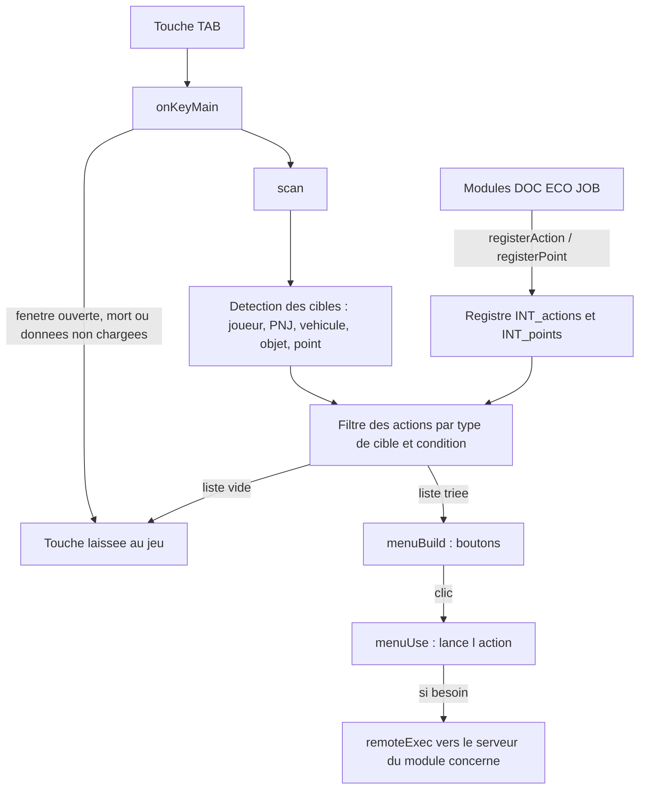

# Système d'interaction (`INT`)

> Une seule touche (TAB par défaut) ouvre un menu contextuel qui propose ce que le joueur peut faire avec ce qui l'entoure : un joueur, un personnage non joueur, un véhicule, un objet ou un lieu précis (distributeur, lieu de travail…).

## Ce que ce module démontre en informatique

- **Registre de plugins / injection de callbacks** : le module ne contient aucune action « métier » ; les autres modules (DOC, ECO, JOB) enregistrent leurs actions avec `INT_fnc_registerAction` en fournissant du code (une condition et une action) que INT appellera plus tard.
- **Séparation mécanisme / contenu** : INT sait détecter des cibles et afficher un menu ; il ignore ce que font les actions. Ajouter une fonctionnalité ne demande aucune modification d'INT.
- **Géométrie et lancer de rayon** : la cible regardée est trouvée avec `lineIntersectsSurfaces` (un segment de 3,5 m partant des yeux du joueur dans la direction du regard), ce qui fonctionne mieux qu'une distance au centre pour les grands objets.
- **Table de hachage (HashMap)** : les types de points d'intérêt, le cache des marqueurs et les cibles détectées sont stockés dans des `HashMap` (accès direct par clé, ex. `"player"`, `"point:atm"`).
- **Mise en cache** : la liste des marqueurs de la carte n'est recalculée que toutes les 15 secondes, au lieu de parcourir tous les marqueurs à chaque détection.
- **Programmation événementielle** : un gestionnaire `KeyDown` sur l'écran principal ne « consomme » la touche que s'il y a quelque chose à faire, sinon la touche garde son rôle normal.
- **Génération procédurale d'UI** : la fenêtre `INT_Menu` est vide dans la configuration ; le menu (fond, titre, boutons) est construit par script selon le nombre d'options.

## Fichiers

| Fichier / dossier | Rôle |
|---|---|
| `LISEZ-MOI.md` | Mode d'emploi : touche, création d'actions et de points d'intérêt. |
| `config/functions.hpp` | Déclare les 10 fonctions `INT_fnc_*` (`init` en `postInit`). |
| `config/remoteExec.hpp` | Vide (commentaire seulement) : INT n'utilise aucun appel à distance ; chaque module déclare les siens. |
| `config/settings.hpp` | `defaultKey = 15` (TAB), `showPrompt = 0`, `debug = 1`, `scanSeconds = 0.25`. |
| `functions/fn_*.sqf` | Code (voir « Fonctions »). |
| `ui/base.hpp` | Classes d'interface de base : texte, texte enrichi, bouton (préfixe `INT_`). |
| `ui/dialog.hpp` | Fenêtre vide `INT_Menu` (IDD 75500) qui appelle `INT_fnc_menuBuild` à l'ouverture et `INT_fnc_menuKey` sur les touches. |

## Comment ça marche (flux)

1. Au démarrage, chaque module enregistre ses actions (identifiant, libellé, type de cible, condition, action, ordre) et éventuellement des types de points d'intérêt (préfixe de marqueur + rayon).
2. Quand le joueur appuie sur la touche, `INT_fnc_onKeyMain` appelle `INT_fnc_scan`, qui détecte les cibles autour du joueur, puis garde les actions dont le type de cible est présent et dont la condition est vraie.
3. S'il n'y a rien, la touche n'est pas bloquée. Sinon le menu s'ouvre, construit dynamiquement, trié par ordre croissant.
4. Un clic exécute l'action choisie avec la cible en paramètre. INT tourne uniquement côté client : les actions sensibles (argent, papiers) passent par un appel au serveur dans le module concerné, qui revérifie tout.

## Fonctions

| Fonction | Côté | Rôle en une ligne |
|---|---|---|
| `INT_fnc_init` | Client | Initialise le registre, branche la touche, lance l'indication à l'écran et les exemples. |
| `INT_fnc_registerAction` | Client | API publique : enregistre (ou remplace) une action du menu. |
| `INT_fnc_registerPoint` | Client | API publique : déclare un type de point d'intérêt basé sur des marqueurs. |
| `INT_fnc_scan` | Client | Détecte les cibles et renvoie la liste triée des actions possibles. |
| `INT_fnc_onKeyMain` | Client | Gère l'appui sur la touche d'interaction dans le jeu. |
| `INT_fnc_promptLoop` | Client | Affiche « [TAB] Interagir - cible » quand une action est possible (désactivé par réglage). |
| `INT_fnc_menuBuild` | Client | Construit le menu par script. |
| `INT_fnc_menuKey` | Client | Ferme le menu avec la touche d'interaction. |
| `INT_fnc_menuUse` | Client | Exécute l'action cliquée. |
| `INT_fnc_demo` | Client | Actions et point de test (devMode uniquement). |

### `INT_fnc_init`
- **Côté :** client uniquement (`postInit`, quitte immédiatement sur le serveur dédié, qui n'a pas d'interface).
- **Dans le jeu :** active la touche d'interaction.
- **En informatique :** crée les structures du registre seulement si elles n'existent pas encore (`isNil`), ce qui **tolère l'ordre d'initialisation** : un module qui enregistre une action avant INT ne perd rien. Il crée `INT_markers` (HashMap, cache), lit la touche dans le profil du joueur (`INT_key`) avec repli sur `defaultKey`, attend l'écran principal (display 46) pour y ajouter un gestionnaire `KeyDown`, lance `INT_fnc_promptLoop` en parallèle et appelle `INT_fnc_demo`.
- **Paramètres → retour :** aucun → rien.

### `INT_fnc_registerAction`
- **Côté :** client ; appelée par n'importe quel module (DOC, ECO, JOB, et INT lui-même pour les tests).
- **Dans le jeu :** ajoute une ligne au menu TAB, par exemple « Montrer ma carte d'identité » ou « Distributeur ».
- **En informatique :** c'est l'**API d'enregistrement d'un plugin**. Elle reçoit `[id, libellé, type de cible, condition, action, ordre]` ; la condition et l'action sont des **blocs de code** (fonctions passées en paramètre, comme des callbacks). Le libellé peut être un texte fixe ou un code qui calcule le texte selon la cible (ECO s'en sert pour afficher le nom de la boutique). Avant d'ajouter, elle retire toute action ayant le même id : réenregistrer **remplace** au lieu de dupliquer (comportement idempotent).
- **Paramètres → retour :** `[id, libellé|code, "player"|"npc"|"vehicle"|"object"|"point:<type>", condition (défaut vrai), action (défaut vide), ordre (défaut 50)] → rien`.

### `INT_fnc_registerPoint`
- **Côté :** client.
- **Dans le jeu :** déclare un type de lieu interactif (ex. « Pôle Emploi », lieux de travail) placé par des marqueurs dans l'éditeur.
- **En informatique :** enregistre dans la HashMap `INT_points` l'entrée `type → [libellé, préfixe, rayon]`. Les positions ne sont pas codées en dur : ce sont tous les marqueurs dont le nom commence par le préfixe (`int_atm_1`, `int_atm_2`…), ce qui est une **configuration déclarative** faite par le level designer dans l'éditeur.
- **Paramètres → retour :** `[type, libellé, préfixe de marqueur, rayon en m (défaut 3)] → rien`.

### `INT_fnc_scan`
- **Côté :** client.
- **Dans le jeu :** trouve ce qui est à portée : le joueur visé (ou le plus proche), le PNJ visé, le véhicule ou objet regardé, le point d'intérêt le plus proche.
- **En informatique :** c'est l'**algorithme de détection**, en plusieurs étapes, qui remplit une HashMap `type de cible → [cible, description]` :
  - joueur : celui sous le curseur à moins de 4 m, sinon le premier joueur vivant à moins de 2,5 m (même logique pour les PNJ avec `nearestObjects`) ;
  - objet/véhicule : **lancer de rayon** de 3,5 m depuis `eyePos` dans la direction `eyeDirection` (`lineIntersectsSurfaces`) ; un véhicule sous le curseur reste détecté jusqu'à 5 m ; un objet nommé `job_…` à moins de 4 m est prioritaire (pour les objets de mods sans surface détectable) ;
  - points : recherche du **marqueur le plus proche** dans le rayon (minimum linéaire sur `distance2D`), à partir du cache rafraîchi toutes les 15 s.
  
  Ensuite elle parcourt toutes les actions, garde celles dont le type de cible a été trouvé et dont la condition renvoie vrai, calcule le libellé, puis **trie** par ordre croissant avec `BIS_fnc_sortBy`. Elle remplit aussi `INT_dbg` (texte de diagnostic).
- **Paramètres → retour :** aucun → `[[ordre, libellé, action, cible, description], …]` trié.

### `INT_fnc_onKeyMain`
- **Côté :** client (gestionnaire `KeyDown` de l'écran principal).
- **Dans le jeu :** ouvre le menu d'interaction quand on appuie sur TAB, seulement s'il y a quelque chose à faire.
- **En informatique :** applique une série de **conditions de garde** : bonne touche sans Maj/Ctrl/Alt, aucune fenêtre déjà ouverte, joueur vivant, données du joueur chargées par le noyau (variable `CORE_cash` présente). Elle renvoie `true` (touche consommée) seulement si le menu s'ouvre, sinon `false` : c'est ainsi qu'Arma décide si la touche garde son effet normal. Avec `debug = 1`, chaque refus est expliqué dans le chat.
- **Paramètres → retour :** `[display, touche, maj, ctrl, alt] → booléen`.

### `INT_fnc_promptLoop`
- **Côté :** client (lancée en tâche parallèle par `init`).
- **Dans le jeu :** affiche « [TAB] Interagir - cible (n) » en bas de l'écran. **Actuellement désactivé** : `showPrompt = 0` dans les réglages.
- **En informatique :** **boucle de polling** cadencée par `scanSeconds` (0,25 s, minimum 0,1 s) ; si l'indication est activée et que les conditions sont réunies, elle appelle `INT_fnc_scan`, crée le contrôle d'affichage à la volée la première fois, met à jour son texte, et le supprime quand il n'y a plus rien. Le nom de la touche est obtenu avec `keyName` en retirant les guillemets (caractère 34).
- **Paramètres → retour :** aucun → ne se termine jamais (boucle infinie).

### `INT_fnc_menuBuild`
- **Côté :** client (appelée par `onLoad` de `INT_Menu`).
- **Dans le jeu :** affiche un menu centré avec un titre (la description de la première cible), « Cliquez sur une option » et un bouton par action.
- **En informatique :** **génération procédurale d'interface** avec `ctrlCreate` : la hauteur de la fenêtre est calculée selon le nombre d'options (limité à 10), les positions sont centrées à partir de `safeZone` (zone visible de l'écran). Chaque bouton stocke son index (`setVariable "INT_i"`) et un gestionnaire `ButtonClick` appelle `INT_fnc_menuUse` avec cet index.
- **Paramètres → retour :** `[display] → rien`.

### `INT_fnc_menuKey`
- **Côté :** client (gestionnaire de touches du menu).
- **Dans le jeu :** la touche d'interaction referme le menu (Échap aussi, par défaut).
- **En informatique :** compare la touche à `INT_key` ; si c'est elle, ferme la fenêtre et renvoie `true` pour consommer l'appui.
- **Paramètres → retour :** `[display, touche, …] → booléen`.

### `INT_fnc_menuUse`
- **Côté :** client (clic sur un bouton du menu).
- **Dans le jeu :** exécute l'option choisie.
- **En informatique :** vérifie que l'index est dans les bornes de `INT_menuItems`, ferme le menu, puis lance le code de l'action **en parallèle** (`spawn`) avec la cible en paramètre, ce qui permet à l'action d'attendre (ouvrir une fenêtre, patienter) sans bloquer l'interface.
- **Paramètres → retour :** `[index] → rien`.

### `INT_fnc_demo`
- **Côté :** client ; **fonction de test**, active seulement si `devMode = 1` dans `CORE_Settings` (actuellement 0).
- **Dans le jeu :** ajoute « Test d'interaction (point) » près d'un marqueur `int_test_*`, « Inspecter (test) » sur un objet, « Parler (test) » sur un PNJ ; chacune écrit simplement un message dans le chat.
- **En informatique :** sert d'**exemple d'utilisation de l'API** et de test manuel des trois chemins de détection (point, objet, PNJ).
- **Paramètres → retour :** aucun → rien.

## Sécurité et robustesse

- INT est purement client et n'expose **aucune** fonction appelable à distance (`remoteExec.hpp` vide) : il ne peut pas servir de porte d'entrée à un tricheur.
- Le module délègue explicitement la sécurité aux modules : le LISEZ-MOI impose que les actions importantes passent par le serveur, qui revérifie distance et droits (c'est le cas de `DOC_fnc_srvShowTo`, `ECO_fnc_srvAtm`, `ECO_fnc_srvBuy`).
- Le menu ne s'ouvre pas si une autre fenêtre est ouverte, si le joueur est mort ou si ses données ne sont pas encore chargées.
- Les touches modifiées (Maj/Ctrl/Alt + TAB) ne sont pas interceptées, et la touche n'est jamais bloquée inutilement.
- `menuUse` vérifie les bornes de l'index ; `registerAction` remplace une action de même id au lieu de la dupliquer.
- Le cache des marqueurs (15 s) et la limite de 10 boutons bornent le coût du scan et la taille du menu.

## Limites et pistes d'amélioration

- **Réglages de test** : `debug = 1` (messages dans le chat à chaque appui) ; à remettre à 0. L'indication à l'écran est désactivée (`showPrompt = 0`) alors que le LISEZ-MOI la décrit comme active.
- **Une seule cible par type** : si deux joueurs sont proches, seul le premier trouvé (ou celui visé) est proposé ; le titre du menu n'affiche que la cible de la première option.
- **Touche personnalisable non exposée** : `INT_key` est lue dans le profil du joueur, mais aucun code du projet ne permet de la modifier.
- **Hors des conventions** : le tag `INT` et l'IDD 75500 ne figurent pas dans le registre des tags et plages de `docs/CONVENTIONS.md`.
- **Pas d'échappement des valeurs** : `promptLoop` insère la description de la cible dans du texte enrichi (`parseText`) sans filtrage.
- Les nouveaux marqueurs n'apparaissent qu'au rafraîchissement suivant du cache (jusqu'à 15 s).
