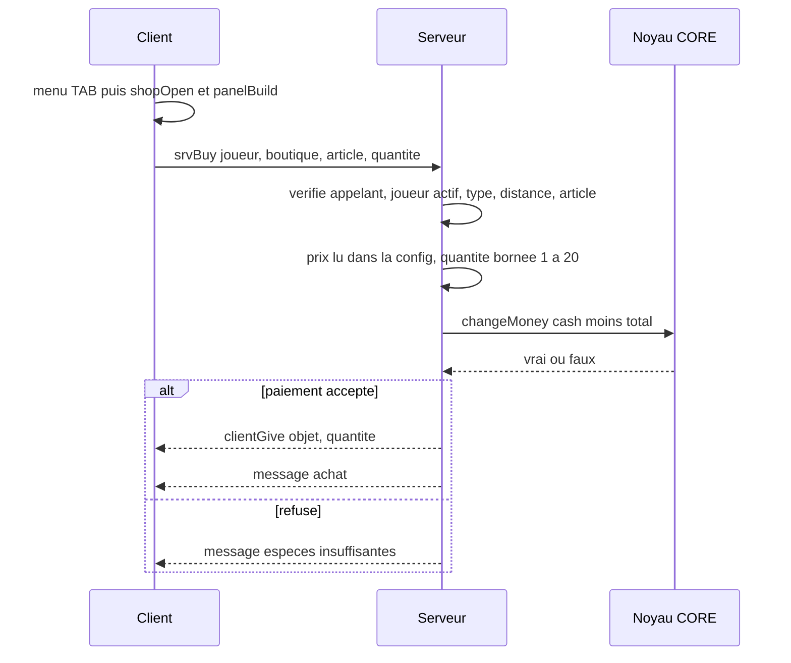

# Économie : distributeurs et boutiques (`ECO`)

> Le joueur peut déposer ou retirer de l'argent à un distributeur, et acheter des objets dans des boutiques ; chaque opération est validée par le serveur.

## Ce que ce module démontre en informatique

- **Autorité serveur et validation des entrées (anti-triche)** : le client envoie seulement une intention (« déposer 100 », « acheter l'article `water` x2 ») ; le serveur revérifie l'appelant, le type d'objet, la distance, le montant, puis lit lui-même le prix dans la configuration.
- **RPC avec liste blanche** : seules `ECO_fnc_srvAtm`, `ECO_fnc_srvBuy` (vers le serveur) et `ECO_fnc_clientGive` (vers un client) sont appelables à distance.
- **Séparation données / logique (configuration déclarative)** : catalogues, prix, classes de distributeurs, distances et plafonds sont dans `config/settings.hpp` ; ajouter un article ou une boutique ne demande pas de code.
- **Géométrie / maths vectorielles** : `ECO_fnc_boxDist` calcule la distance entre le joueur et la **surface** de la boîte englobante d'un objet (projection du point sur la boîte), plus juste que la distance au centre pour un bâtiment.
- **Registre de plugins / injection de callbacks** : ECO s'intègre au menu TAB en enregistrant deux actions auprès du module INT, avec des conditions (« est-ce un distributeur ? », « est-ce une boutique ? ») et des libellés calculés.
- **Génération procédurale d'UI** : une seule fenêtre vide (`ECO_Panel`) devient soit un distributeur, soit une boutique, construite par script à partir du catalogue.
- **Mise en cache (mémoïsation)** : le type d'une caisse de magasin, déduit du bâtiment le plus proche, est calculé une seule fois puis mémorisé sur l'objet.

## Fichiers

| Fichier / dossier | Rôle |
|---|---|
| `LISEZ-MOI.md` | Mode d'emploi : utilisation, objets reconnus, ajout d'articles, test rapide en devMode. |
| `config/functions.hpp` | Déclare les 15 fonctions `ECO_fnc_*` (`init` et `devSpawn` en `postInit`). |
| `config/remoteExec.hpp` | Liste blanche : `srvAtm`, `srvBuy` (serveur uniquement), `clientGive` (clients). |
| `config/settings.hpp` | `ECO_Settings` (debug, classes de distributeurs, plafond 10 000 par opération, distances 6 m / 7 m, caisses, rayon 30 m, `buildingShops`), `ECO_ShopClasses` (bâtiment → type), `ECO_Shops` (7 catalogues : épicerie, station, supermarché, bricolage, restauration, presse, général). |
| `functions/fn_*.sqf` | Code (voir « Fonctions »). |
| `ui/base.hpp` | Classes de base : texte, texte aligné à droite, champ de saisie, bouton (préfixe `ECO_`). |
| `ui/dialog.hpp` | Fenêtre vide `ECO_Panel` (IDD 74500, dans la plage ECO) qui appelle `ECO_fnc_panelBuild`. |

## Comment ça marche (flux)

1. Le joueur vise un distributeur ou une caisse et choisit l'action dans le menu TAB (module INT). Le client ouvre le panneau correspondant.
2. Distributeur : le joueur saisit un montant (ou clique un montant rapide) puis « Déposer » / « Retirer » ; le client envoie `[joueur, distributeur, opération, montant]` au serveur.
3. Boutique : le joueur choisit une quantité et clique « Acheter » sur un article ; le client envoie seulement l'**identifiant** de l'article, jamais le prix.
4. Le serveur revérifie tout et modifie l'argent uniquement via `CORE_fnc_changeMoney`, qui refuse un solde négatif. Pour un achat, l'objet n'est remis (`clientGive`) qu'après un paiement réussi.
5. Les soldes affichés dans le panneau sont relus toutes les 0,3 s depuis les variables synchronisées par le noyau (`CORE_cash`, `CORE_bank`).

## Fonctions

| Fonction | Côté | Rôle en une ligne |
|---|---|---|
| `ECO_fnc_init` | Client | Enregistre les actions « Distributeur » et « Boutique » dans le menu TAB. |
| `ECO_fnc_devSpawn` | Serveur | Crée un distributeur et une boutique de test (devMode uniquement). |
| `ECO_fnc_isAtm` | Les deux | Dit si un objet est un distributeur. |
| `ECO_fnc_shopType` | Les deux | Renvoie le type de catalogue d'une boutique (ou vide). |
| `ECO_fnc_boxDist` | Les deux | Distance joueur ↔ surface d'un objet. |
| `ECO_fnc_atmOpen` | Client | Ouvre le panneau en mode distributeur. |
| `ECO_fnc_shopOpen` | Client | Ouvre le panneau en mode boutique. |
| `ECO_fnc_panelBuild` | Client | Construit l'interface du distributeur ou de la boutique. |
| `ECO_fnc_atmQuick` | Client | Bouton de montant rapide. |
| `ECO_fnc_atmDo` | Client | Envoie un dépôt ou un retrait au serveur. |
| `ECO_fnc_shopBuy` | Client | Envoie une demande d'achat au serveur. |
| `ECO_fnc_srvAtm` | Serveur | Valide et exécute un dépôt / retrait. |
| `ECO_fnc_srvBuy` | Serveur | Valide et exécute un achat. |
| `ECO_fnc_clientGive` | Client | Remet les objets achetés (ou les pose au sol). |
| `ECO_fnc_dbg` | Les deux | Message de diagnostic si `debug = 1`. |

### `ECO_fnc_init`
- **Côté :** client (`postInit`, quitte sur une machine sans interface).
- **Dans le jeu :** fait apparaître « Distributeur » ou le nom de la boutique (ex. « Epicerie ») dans le menu TAB quand on vise l'objet.
- **En informatique :** **injection de callbacks** dans le registre INT : deux actions de type `"object"`, dont les conditions appellent `ECO_fnc_isAtm` et `ECO_fnc_shopType`. Le libellé de la boutique est un **code** évalué au moment du scan, qui lit le `displayName` du catalogue. Il initialise aussi l'état du panneau (`ECO_obj`, `ECO_mode`, `ECO_type`). Il dépend de l'existence de `INT_actions` (il en compte la taille), ce qui fonctionne parce que `interactSystem` est déclaré avant `ecoSystem` dans `description.ext`.
- **Paramètres → retour :** aucun → rien.

### `ECO_fnc_devSpawn`
- **Côté :** serveur, `postInit` ; **fonction de test**, active seulement si `devMode = 1` dans `CORE_Settings` (actuellement 0).
- **Dans le jeu :** crée un distributeur à 6 m et un kiosque « épicerie » à 12 m à l'est du marqueur `spn_port`, pour tester sans rien placer dans l'éditeur.
- **En informatique :** attend 5 s, vérifie que le marqueur existe (sinon écrit dans le journal et s'arrête), crée les objets par décalage vectoriel (`vectorAdd`), les pose au sol, et donne au kiosque la variable publique `eastrp_shop = "epicerie"`.
- **Paramètres → retour :** aucun → rien.

### `ECO_fnc_isAtm`
- **Côté :** les deux (condition du menu côté client, revérification côté serveur dans `srvAtm`).
- **Dans le jeu :** reconnaît les distributeurs du mod EastRP et ceux du jeu de base.
- **En informatique :** trois règles testées dans l'ordre : variable `eastrp_role == "atm"` posée sur l'objet, propriété `eastrp_role` dans la configuration de la classe (mod), ou classe présente dans la liste `atmClasses` (comparaison **insensible à la casse** en passant tout en minuscules).
- **Paramètres → retour :** `[objet] → booléen`.

### `ECO_fnc_shopType`
- **Côté :** les deux (condition et libellé côté client, revérification côté serveur dans `srvBuy`).
- **Dans le jeu :** détermine quel catalogue proposer selon la boutique visée.
- **En informatique :** **chaîne de résolution par priorité** : (1) variable `eastrp_shop` de l'objet ; (2) propriété `eastrp_shop` de la classe (mod) ; (3) si l'objet est une caisse (`counterClasses`, correspondance sur le **début** du nom de classe), recherche du bâtiment-boutique le plus proche dans un rayon de 30 m (`nearestObjects` + minimum de distance), sinon `"general"`, résultat **mémorisé** sur l'objet (`eastrp_shopAuto`) ; (4) le bâtiment lui-même, seulement si `buildingShops = 1` (actuellement 0). Enfin, elle renvoie `""` si le type n'existe pas dans `ECO_Shops` (**validation contre la configuration**).
- **Paramètres → retour :** `[objet] → type de catalogue | ""`.

### `ECO_fnc_boxDist`
- **Côté :** les deux (utilisée par `srvAtm`, `srvBuy`, et aussi par le module JOB via `JOB_fnc_pointDist`).
- **Dans le jeu :** permet d'utiliser un grand bâtiment ou une caisse depuis son bord, pas seulement depuis son centre.
- **En informatique :** **géométrie** : la position du joueur est convertie dans le repère de l'objet (`worldToModel`), puis chaque coordonnée est **bornée** (« clamp ») entre le minimum et le maximum de la boîte englobante (`boundingBoxReal`) ; on obtient le point de la boîte le plus proche, et la distance à ce point. Renvoie 1 000 000 si un des objets est nul.
- **Paramètres → retour :** `[objet, joueur] → distance en mètres`.

### `ECO_fnc_atmOpen`
- **Côté :** client (action du menu TAB).
- **Dans le jeu :** ouvre l'écran du distributeur.
- **En informatique :** mémorise l'objet visé et le mode `"atm"` dans des variables globales, puis ouvre `ECO_Panel` ; c'est un **état partagé** lu ensuite par `panelBuild` et `atmDo`.
- **Paramètres → retour :** `[objet] → rien`.

### `ECO_fnc_shopOpen`
- **Côté :** client (action du menu TAB).
- **Dans le jeu :** ouvre le catalogue de la boutique visée.
- **En informatique :** même principe qu'`atmOpen`, avec le mode `"shop"` et le type de catalogue calculé par `ECO_fnc_shopType`.
- **Paramètres → retour :** `[objet] → rien`.

### `ECO_fnc_panelBuild`
- **Côté :** client (appelée par `onLoad` de `ECO_Panel`).
- **Dans le jeu :** distributeur : soldes du compte et des espèces, champ « Montant », boutons 50/100/500/1000/5000, « Déposer », « Retirer » ; boutique : espèces, champ « Quantité », une ligne par article avec prix et bouton « Acheter ».
- **En informatique :** **génération procédurale d'interface** avec `ctrlCreate` via une petite fonction locale `_mk`. En mode boutique, les articles sont lus avec `configClasses` dans le catalogue (8 au maximum) et la hauteur du panneau en dépend. Chaque bouton stocke sa valeur (`setVariable "ECO_v"`) et un gestionnaire `ButtonClick` la transmet à la bonne fonction. Une tâche parallèle rafraîchit l'affichage des soldes toutes les 0,3 s tant que la fenêtre est ouverte (formatage `CORE_fnc_fmt`, ex. « 1 234 »). Ces soldes sont **uniquement affichés** : ils viennent des variables synchronisées par le serveur.
- **Paramètres → retour :** `[display] → rien`.

### `ECO_fnc_atmQuick`
- **Côté :** client.
- **Dans le jeu :** un clic sur « 500 » écrit 500 dans le champ Montant.
- **En informatique :** récupère le champ de saisie mémorisé dans `uiNamespace` (espace de variables propre à l'interface) et y écrit la valeur du bouton.
- **Paramètres → retour :** `[montant] → rien`.

### `ECO_fnc_atmDo`
- **Côté :** client.
- **Dans le jeu :** envoie le dépôt ou le retrait.
- **En informatique :** convertit le texte saisi en nombre entier (`parseNumber` + `floor`), refuse localement un montant ≤ 0 (confort), puis fait un **RPC** `ECO_fnc_srvAtm` vers le serveur. Le client ne touche jamais lui-même à l'argent.
- **Paramètres → retour :** `["deposit"|"withdraw"] → rien`.

### `ECO_fnc_shopBuy`
- **Côté :** client.
- **Dans le jeu :** clic sur « Acheter ».
- **En informatique :** borne la quantité entre 1 et 20, vérifie que l'article existe dans le catalogue courant, puis envoie au serveur `[joueur, boutique, identifiant, quantité]`. **Le prix n'est pas envoyé** : il sera lu par le serveur.
- **Paramètres → retour :** `[identifiant d'article] → rien`.

### `ECO_fnc_srvAtm`
- **Côté :** serveur, **appelée à distance** par le client propriétaire de l'unité.
- **Dans le jeu :** effectue le dépôt ou le retrait et affiche « 100 Kr déposés » ou la raison du refus ; l'opération est ajoutée à l'historique de l'application bancaire du téléphone.
- **En informatique :** enchaîne des **clauses de garde** : types des paramètres imposés par `params`, joueur valide, appelant = propriétaire de l'unité (`remoteExecutedOwner == owner _unit`), joueur chargé par le noyau (`CORE_active`), objet réellement distributeur (`ECO_fnc_isAtm`), distance à la surface ≤ 6 m, montant arrondi et compris entre 1 et 10 000. Ensuite, deux appels à `CORE_fnc_changeMoney` : d'abord le **débit** (qui échoue si le solde est insuffisant), puis le **crédit** seulement si le débit a réussi. En cas de succès, elle appelle `PHN_fnc_srvLog` **si le module téléphone existe** (`isNil`), un couplage optionnel. Une opération inconnue est ignorée.
- **Paramètres → retour :** `[unité, distributeur, "deposit"|"withdraw", montant] → rien` (messages via `CORE_fnc_clientMsg`).

### `ECO_fnc_srvBuy`
- **Côté :** serveur, **appelée à distance** par le client propriétaire de l'unité.
- **Dans le jeu :** encaisse l'achat et fait apparaître l'objet dans l'inventaire.
- **En informatique :** mêmes vérifications d'identité et d'état que `srvAtm`, puis : type de boutique **recalculé côté serveur** (`ECO_fnc_shopType`), distance ≤ 7 m, article existant dans **ce** catalogue (`isClass`), quantité bornée 1-20, **prix lu dans la configuration du serveur**, total = prix × quantité. Le paiement (`CORE_fnc_changeMoney` en négatif sur les espèces) doit réussir **avant** l'envoi de l'objet au client (`ECO_fnc_clientGive`). L'achat est inscrit dans le journal du serveur.
- **Paramètres → retour :** `[unité, boutique, identifiant, quantité] → rien`.

### `ECO_fnc_clientGive`
- **Côté :** client, **appelée à distance** par le serveur (refuse toute autre origine via `remoteExecutedOwner`).
- **Dans le jeu :** les objets achetés arrivent dans l'inventaire, ou à vos pieds si l'inventaire est plein.
- **En informatique :** distingue les chargeurs/consommables (`CfgMagazines`) des autres objets pour utiliser la bonne commande d'ajout, vérifie la place avec `canAdd`, sinon crée un conteneur au sol (`GroundWeaponHolder`) avec un ajout **global** (visible par tous). L'exécution se fait côté client car, dans Arma, l'inventaire d'un joueur est géré par sa machine ; mais c'est le serveur qui décide quoi donner.
- **Paramètres → retour :** `[classe d'objet, quantité, nom] → rien`.

### `ECO_fnc_dbg`
- **Côté :** les deux ; **utilitaire de debug**.
- **Dans le jeu :** rien si `debug = 0` (valeur actuelle) ; sinon messages « [ECO debug] » dans le chat et le journal.
- **En informatique :** écrit dans le fichier journal (`diag_log`, fichier .rpt) et, s'il y a une interface, dans le chat. Les fonctions serveur ont leur propre variante locale `_dbg` qui renvoie aussi le message au joueur concerné.
- **Paramètres → retour :** `[texte] → rien`.

## Sécurité et robustesse

- **Vérification de l'appelant** : `srvAtm` et `srvBuy` refusent si `remoteExecutedOwner` n'est pas le propriétaire de l'unité ; `clientGive` n'accepte que le serveur.
- **Types imposés** dans `params` (objet, texte, nombre) et joueur obligatoirement « actif » (`CORE_active`, données chargées par le noyau).
- **Distances revérifiées côté serveur**, mesurées à la surface de l'objet (6 m distributeur, 7 m boutique).
- **Bornes** : montant 1-10 000 par opération au distributeur, quantité 1-20 en boutique, arrondis à l'entier côté serveur.
- **Prix et catalogue côté serveur uniquement** ; l'article doit appartenir au catalogue de la boutique visée (pas d'achat d'un article d'une autre boutique).
- **Argent modifié uniquement par `CORE_fnc_changeMoney`**, qui refuse un solde négatif ou supérieur à 1 000 000 000 ; le débit est fait avant le crédit ou la livraison.

## Limites et pistes d'amélioration

- **Opérations en deux étapes non atomiques** : un dépôt fait un débit puis un crédit sans vérifier le résultat du crédit ; si le compte dépassait le plafond de 1 000 000 000, les espèces seraient retirées sans être créditées. De même, un achat payé n'est pas remboursé si le joueur se déconnecte avant de recevoir l'objet. Une vraie transaction (ou un retour arrière) serait plus sûre.
- **Variables d'objet modifiables** : un objet devient distributeur ou boutique via les variables publiques `eastrp_role` / `eastrp_shop`, qu'un client modifié pourrait poser sur n'importe quel objet. Les prix restant ceux du serveur, l'impact est limité à l'emplacement d'achat.
- **Pas de stock** : les boutiques ont des quantités illimitées et des prix fixes.
- **Couplage implicite** à l'ordre de chargement (INT avant ECO) et au module téléphone (`PHN_fnc_srvLog`, appelé seulement s'il existe).
- **Affichage par polling** : les soldes sont relus toutes les 0,3 s au lieu de réagir à un événement de changement.
- **Objets « réservés »** : le LISEZ-MOI interdit de vendre `ItemWatch` / `ItemCompass` (ils représentent les papiers du module DOC), mais rien dans le code ne l'empêche.
