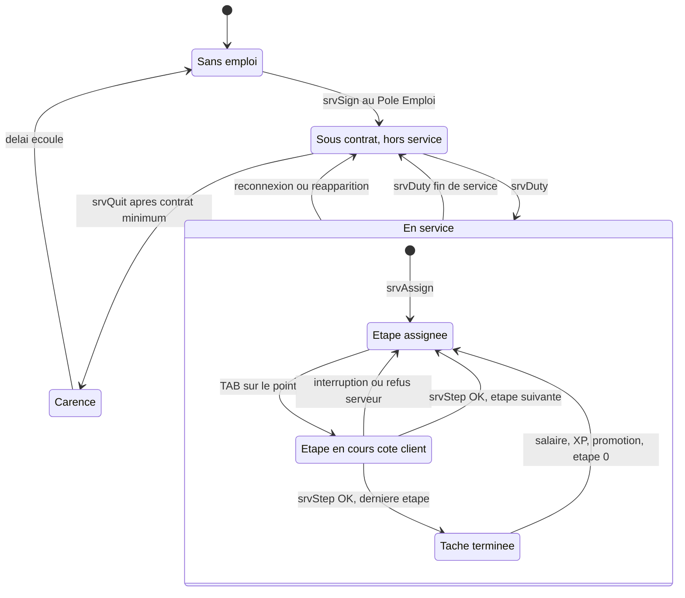
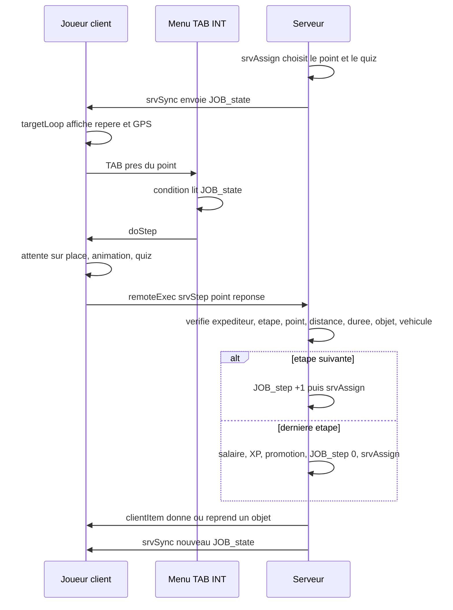

# Métiers (`JOB`)

> Permet au joueur de signer un contrat au Pôle Emploi, de prendre son service et d'enchaîner des tâches (usine de pompes, électricien, ferme) payées sur son compte bancaire, avec de l'expérience (XP) et trois niveaux par métier.

## Ce que ce module démontre en informatique

- **Machine à états pilotée par le serveur** : l'avancement d'un joueur (métier, en service ou non, numéro d'étape, point imposé, question en cours) vit sur le serveur ; le client ne fait que demander « j'ai fini l'étape », et le serveur décide de l'état suivant (`JOB_fnc_srvAssign` → `JOB_fnc_srvStep` → `JOB_fnc_srvSync`).
- **Autorité serveur et validation des entrées (anti-triche)** : chaque demande du client est revérifiée côté serveur : expéditeur réel (`remoteExecutedOwner`), distance au point, durée minimale écoulée, objet requis dans l'inventaire, bonne réponse au quiz, présence à bord du bon véhicule.
- **Séparation données / logique (configuration déclarative)** : les métiers, niveaux et étapes sont décrits dans `settings.hpp` sous forme de tableaux `{préfixe, libellé, durée, mode, anim, objets, spécial, objetRequis, objetDonné}` ; le même code exécute les trois métiers sans aucun `if métier == ...`.
- **Synchronisation d'état client/serveur** : le serveur envoie au seul joueur concerné un tableau de 21 cases (`JOB_state`) ; l'interface (repère, téléphone, Pôle Emploi, conditions d'actions TAB) se contente de lire ce tableau.
- **Registre de plugins / injection de callbacks** : le module ne gère pas lui-même la touche TAB ; il enregistre ses actions (libellé, condition, action en code) dans le registre du module d'interaction (`INT_fnc_registerAction`) et une application dans le téléphone (`PHN_fnc_registerApp`).
- **Génération procédurale** : la fiche de contrôle qualité d'une pompe est tirée au hasard (une pompe sur deux défectueuse, mesures dans ou hors tolérance), et les fenêtres (Pôle Emploi, quiz, fiche) sont construites par script.
- **Boucles de surveillance (polling)** : une boucle serveur compte le temps de contrat chaque minute, une autre surveille les véhicules de service toutes les 2 s, une boucle client met à jour le repère et le GPS chaque seconde.

## Fichiers

| Fichier / dossier | Rôle |
|---|---|
| `config/functions.hpp` | Déclare les 34 fonctions `JOB_fnc_*` (dont `init` lancée automatiquement après le chargement de la mission : `postInit`). |
| `config/remoteExec.hpp` | Liste blanche des RPC (appels de procédure à distance) : 6 fonctions appelables vers le serveur, 3 vers les clients. |
| `config/settings.hpp` | `JOB_Settings` (délais, rayons, GPS, pénalité), `JOB_Jobs` (3 métiers × 3 niveaux × étapes), `JOB_Quiz` (questions des mini-jeux). |
| `functions/fn_*.sqf` | Le code (client, serveur, communs). |
| `ui/base.hpp` | Classes de base des contrôles d'interface (texte, bouton, texte riche, image) + import de la mini-carte du jeu. |
| `ui/dialog.hpp` | Fenêtres vides `JOB_Pole` (IDD 75600) et `JOB_QuizDlg` (IDD 75620), remplies par script à l'ouverture. |
| `ui/hud.hpp` | Calque `JOB_GpsHud` (IDD 75610) : fond, titre et mini-carte du GPS. |
| `LISEZ-MOI.md` | Guide de mise en place : noms des objets/marqueurs à poser dans l'éditeur. |

**Points de travail.** Un « point » est soit un marqueur de l'éditeur, soit un objet nommé dans l'éditeur, dont le nom commence par un préfixe (`job_usine_stock_1`, `job_elec_compteur_3`…). Les fonctions `pointList / pointPos / pointDist / pointTop` cachent cette différence au reste du code.

## Comment ça marche (flux)

### La machine à états d'un joueur

Où est stocké chaque morceau de l'état :

| Donnée | Où | Persistée ? |
|---|---|---|
| Métier (`job`), temps de contrat (`job_contract`, en s), XP par métier (`job_xp` = `[[métier, xp], ...]`), date de démission (`job_quitAt`, en minutes réelles) | Valeurs du joueur dans le noyau (`CORE_fnc_getValue/setValue`) | Oui (sauvegarde du noyau) |
| En service (`JOB_duty`), étape (`JOB_step`), point imposé (`JOB_assigned`), dernier point (`JOB_lastMarker`), heure de la dernière validation (`JOB_stepT`, `JOB_lastTask`), question (`JOB_quizQ`) et **bonne réponse** (`JOB_quizOk`), pénalité, décision qualité (`JOB_qcDecision`), remplacement d'étape (`JOB_stepOverride`), véhicule (`JOB_veh`) | Variables sur l'unité, côté serveur uniquement | Non (remises à zéro à la connexion) |
| Stock de pompes `JOB_pumpStock`, liste des véhicules `JOB_vehs` | Variables globales du serveur | Non |
| `JOB_state` (copie lisible par le client) | Variable de l'unité envoyée au seul propriétaire | Recalculée à chaque `srvSync` |

### Le cycle assign → step → sync

1. **Assignation** (`srvAssign`) : le serveur lit l'étape courante du niveau du joueur et prépare ce qui doit être fixé à l'avance : le point imposé (mode `random` = tiré au hasard en évitant le précédent, `same` = le même point qu'à l'étape d'avant, `any` = n'importe quel point du bon préfixe), la question de quiz (dont la bonne réponse ne quitte jamais le serveur), la fiche qualité, ou la destination du dépôt (expédition / rebut).
2. **Synchronisation** (`srvSync`) : le serveur fabrique le tableau `JOB_state` et l'envoie au joueur seul (`setVariable [..., owner _unit]`).
3. **Exécution côté client** (`doStep`) : déclenchée par TAB (ou automatiquement en véhicule), elle impose de rester sur place pendant la durée de l'étape, joue l'animation, affiche le quiz, puis envoie `srvStep`.
4. **Validation** (`srvStep`) : le serveur revérifie tout, applique les effets (stock de pompes, objets, véhicule, décision qualité), puis avance l'index d'étape. À la fin de la liste, la tâche est payée et l'index revient à 0.
5. Chaque transition se termine par un nouveau `srvSync` : le client n'a jamais à « deviner » l'état.

### Tableau `JOB_state` (21 cases, construit par `srvSync`)

| # | Contenu | # | Contenu |
|---|---|---|---|
| 0 | métier (`""` = sans emploi) | 11 | XP de tous les métiers |
| 1 | numéro de niveau | 12 | carence restante (min) |
| 2 | titre du poste | 13 | préfixe des points de l'étape |
| 3 | XP du métier | 14 | durée de l'étape (s) |
| 4 | XP du niveau suivant (-1 = max) | 15 | nombre d'étapes |
| 5 | index de l'étape | 16 | nom du métier |
| 6 | libellé de l'étape | 17 | salaire par tâche |
| 7 | point imposé (`""` = libre) | 18 | spécial (`veh`, `vehget`, `quiz:…`, `pumpIn`…) |
| 8 | en service (booléen) | 19 | question du quiz `[texte, réponses, lignes de fiche]` |
| 9 | contrat effectué (s) | 20 | GPS activé (1/0) |
| 10 | contrat minimum (s) | | |

### Les métiers configurés

| Métier | N1 | N2 | N3 |
|---|---|---|---|
| Usine (`usine`) | Stock → chaîne | Pièce brute → CNC → pièce usinée → ligne → corps de pompe → chaîne (`pumpIn`) | Caisse (`pumpOut`) → bureau qualité (`quiz:fiche`) → expédition ou rebut (`qcDrop`) |
| Électricien (`elec`, GPS) | Relever un compteur au hasard (animation + carnet et crayon en main) | Camionnette (`vehget`) → diagnostic (`quiz:elec`) → réparation au même point | Camionnette → poteau → transformateur → réparation au même point ; prime d'équipe 20 % |
| Ferme (`ferme`) | Champ au hasard → hangar | Tracteur → 4 points de labour au volant (`veh`) → retour au hangar | Camion (GPS) → chargement au hangar → livraison à la coopérative |

**Chaîne de production de l'usine.** Les objets sont de vrais objets d'inventaire (« magazines » de l'addon `eastrp_core`) : l'étape « stock » donne `EastRP_PieceBrute`, la CNC la reprend puis donne `EastRP_PieceUsinee`, la ligne la transforme en `EastRP_CorpsPompe`, et la chaîne la consomme en incrémentant `JOB_pumpStock` (plafonné à `pumpStockMax` = 50). Le contrôleur (N3) décrémente ce stock pour obtenir `EastRP_PompeEau` (ou reçoit une « pompe de réserve » si la caisse est vide), la garde pendant la fiche, puis la dépose : la destination (`job_usine_expedition` ou `job_usine_rebut`) dépend de **sa** décision, et la justesse de la décision détermine la pénalité.

## Fonctions

| Fonction | Côté | Rôle en une ligne |
|---|---|---|
| `JOB_fnc_init` | Les deux | Démarre le module : boucles serveur, enregistrement des actions TAB, repère, téléphone. |
| `JOB_fnc_srvAssign` | Serveur | Prépare l'étape courante : point imposé, quiz, fiche qualité, destination du dépôt. |
| `JOB_fnc_srvStep` | Serveur (RPC) | Valide une étape terminée, applique ses effets, paie et promeut en fin de tâche. |
| `JOB_fnc_srvSync` | Serveur | Construit et envoie `JOB_state` au joueur. |
| `JOB_fnc_srvAskSync` | Serveur (RPC) | Le client redemande son état à jour. |
| `JOB_fnc_srvSign` | Serveur (RPC) | Signer un contrat au Pôle Emploi. |
| `JOB_fnc_srvQuit` | Serveur (RPC) | Démissionner après le contrat minimum. |
| `JOB_fnc_srvDuty` | Serveur (RPC) | Prendre / terminer son service. |
| `JOB_fnc_srvOnLoaded` | Serveur | À la connexion / réapparition : hors service, étape 0, vieux véhicule rangé. |
| `JOB_fnc_srvVehSpawn` | Serveur | Sort le véhicule de service sur une place de parking libre. |
| `JOB_fnc_srvVehClear` | Serveur | Range le véhicule de service (éjecte les occupants puis supprime). |
| `JOB_fnc_srvAnim` | Serveur (RPC) | Relaie une animation de travail aux autres joueurs. |
| `JOB_fnc_clientAnim` | Client (RPC depuis le serveur) | Joue / termine l'animation d'un joueur. |
| `JOB_fnc_clientItem` | Client (RPC depuis le serveur) | Donne ou reprend un objet de travail. |
| `JOB_fnc_clientEject` | Client (RPC depuis le serveur) | Fait descendre le joueur d'un véhicule. |
| `JOB_fnc_doStep` | Client | Exécute l'étape sur place (durée, animation, objets en main, quiz) puis demande la validation. |
| `JOB_fnc_targetLoop` | Client | Boucle du repère : marqueur carte, flèche 3D, GPS, déclenchement auto en véhicule. |
| `JOB_fnc_gps` | Client | Affiche / masque la mini-carte GPS et la distance restante. |
| `JOB_fnc_route` | Client | Dessine l'itinéraire en segments de marqueurs et efface la partie parcourue. |
| `JOB_fnc_poleOpen` | Client | Ouvre le Pôle Emploi après avoir demandé un état frais. |
| `JOB_fnc_poleBuild` | Client | Construit la fenêtre du Pôle Emploi. |
| `JOB_fnc_quizAsk` | Client | Ouvre le quiz et attend la réponse. |
| `JOB_fnc_quizBuild` | Client | Construit la fenêtre du quiz ou de la fiche qualité. |
| `JOB_fnc_pgPhone` | Client | Page « Emploi » du téléphone. |
| `JOB_fnc_cfgLevel` | Les deux | Niveau atteint selon l'XP. |
| `JOB_fnc_getXp` | Serveur | XP d'un joueur dans un métier. |
| `JOB_fnc_nowMin` | Serveur | Heure réelle UTC en minutes (pour la carence). |
| `JOB_fnc_nearPole` | Serveur | Le joueur est-il près d'un Pôle Emploi ? |
| `JOB_fnc_pointList` | Les deux | Noms des points (marqueurs + objets) d'un préfixe. |
| `JOB_fnc_pointPos` | Les deux | Position d'un point. |
| `JOB_fnc_pointDist` | Les deux | Distance joueur ↔ point. |
| `JOB_fnc_pointTop` | Les deux (utilisée côté client) | Position juste au-dessus d'un point (pour la flèche). |
| `JOB_fnc_fmtDur` | Les deux | Durée lisible (« 1 h 05 », « 12 min »). |
| `JOB_fnc_dbg` | Les deux | Message de debug si `debug = 1`. |

### `JOB_fnc_init`
- **Côté :** les deux (lancée automatiquement après le chargement de la mission, `postInit = 1`).
- **Dans le jeu :** met en place tout le module : les bureaux, caisses et compteurs deviennent utilisables avec TAB, le repère orange apparaît, l'appli « Emploi » est ajoutée au téléphone.
- **En informatique :** commun : repère tous les objets nommés `job_…` dans l'éditeur (`JOB_objs`). Serveur : s'abonne à l'événement `CORE_playerLoaded` (publish/subscribe), lance une boucle de 60 s qui ajoute 60 s de contrat aux joueurs en service ayant fini une tâche dans les `afkMinutes` dernières minutes (anti-AFK, « away from keyboard » = inactif), verrouille l'inventaire des objets de travail (`lockInventory`), initialise `JOB_pumpStock`, lance une boucle de 2 s qui éjecte les non-propriétaires des véhicules de service et supprime les épaves après 120 s, et range le véhicule à la déconnexion (`HandleDisconnect`). Client : parcourt la config de tous les métiers pour collecter les préfixes d'étapes, et enregistre pour chacun une action TAB dont la **condition** lit `JOB_state` (en service, bon préfixe, bon point imposé, pas une étape « veh ») ; ajoute un gestionnaire `Draw3D` qui dessine le texte du repère.
- **Paramètres → retour :** aucun → rien.

### `JOB_fnc_srvAssign`
- **Côté :** serveur (appelée par les autres fonctions serveur, pas par RPC).
- **Dans le jeu :** décide où le joueur doit aller pour son étape et quelle question il aura.
- **En informatique :** c'est la transition « entrer dans un état » de la machine à états. Elle remet à zéro `JOB_assigned`, `JOB_quizQ`, `JOB_stepOverride`, saute l'étape `vehget` si le véhicule est déjà sorti et intact, applique le mode (`random` : `selectRandom` parmi les points en retirant le précédent ; `same` : réutilise `JOB_lastMarker` s'il a le bon préfixe), réécrit l'étape `qcDrop` vers l'expédition ou le rebut selon `JOB_qcDecision`. Pour `quiz:fiche`, elle génère 5 mesures (diamètres A/B à ±0,25 mm, température 52-67 °C, pression 3,1-3,9 bar) puis, avec 50 % de chance, en fausse une hors tolérance ; pour les autres quiz, elle tire une question et mélange l'ordre des réponses (`BIS_fnc_arrayShuffle`) en recalculant l'index de la bonne réponse. La bonne réponse est stockée dans `JOB_quizOk`, qui n'est jamais envoyée au client.
- **Paramètres → retour :** `[unité] → rien` (modifie les variables de l'unité).

### `JOB_fnc_srvStep`
- **Côté :** serveur, appelée à distance par le client (`doStep`).
- **Dans le jeu :** valide l'étape que le joueur vient de faire ; en fin de tâche, verse le salaire et l'XP, et annonce une éventuelle promotion.
- **En informatique :** cœur de l'anti-triche. Vérifications dans l'ordre : l'expéditeur réel (`remoteExecutedOwner`) est bien le propriétaire de l'unité ; joueur vivant et chargé (`CORE_active`) ; il a un métier et est en service ; le point envoyé a le préfixe de l'étape courante et correspond au point imposé ; l'objet requis est dans `magazines _unit` (sinon la tâche reprend à l'étape 0) ; distance ≤ rayon + 3 m ; au moins `durée − 0,5 s` depuis la dernière validation (`JOB_stepT`) ; pour `veh`, le joueur est dans **son** véhicule vivant. Puis effets selon le champ « spécial » : sortie de véhicule, correction du quiz (mauvaise réponse → `JOB_penalty`), `pumpIn`/`pumpOut` sur le compteur partagé, enregistrement de la décision qualité, échange d'objets via `clientItem`. Enfin l'index d'étape avance ; en fin de liste : salaire × `quizPenalty` (0,5) si pénalité, prime d'équipe (`teamBonus` × collègues du même métier en service à moins de 150 m, max 3), crédit bancaire par `CORE_fnc_changeMoney`, ajout au journal du téléphone, mise à jour de la liste `job_xp`, sauvegarde rapide (`CORE_flushSoon`), comparaison de niveau avant/après pour la promotion (qui range le véhicule, car le nouveau niveau peut en utiliser un autre).
- **Paramètres → retour :** `[unité, nom du point, réponse au quiz (-1 = aucune)] → rien`.

### `JOB_fnc_srvSync`
- **Côté :** serveur.
- **Dans le jeu :** met à jour ce que le joueur voit (repère, téléphone, Pôle Emploi, actions TAB).
- **En informatique :** sérialise l'état serveur en un tableau positionnel de 21 cases (voir tableau plus haut) : lit le métier, l'XP, le niveau via `cfgLevel`, l'étape (en appliquant `JOB_stepOverride`), la carence restante calculée avec `nowMin`, et choisit le GPS du niveau ou, à défaut, du métier. Le tableau est publié avec `setVariable ["JOB_state", _st, owner _unit]` : seule la machine du joueur le reçoit. Sans métier, un tableau « vide » contenant quand même l'XP et la carence est envoyé.
- **Paramètres → retour :** `[unité] → rien`.

### `JOB_fnc_srvAskSync`
- **Côté :** serveur, appelée à distance par le client (`poleOpen`).
- **Dans le jeu :** rafraîchit l'état avant d'ouvrir le Pôle Emploi (temps de contrat, carence).
- **En informatique :** vérifie que l'appelant est le propriétaire de l'unité, puis appelle `srvSync`. Modèle « pull » (le client tire l'information) en complément du modèle « push » des autres fonctions.
- **Paramètres → retour :** `[unité] → rien`.

### `JOB_fnc_srvSign`
- **Côté :** serveur, appelée à distance (bouton « Signer » du Pôle Emploi).
- **Dans le jeu :** signe un contrat pour un métier.
- **En informatique :** vérifie l'expéditeur, que le métier existe dans la config (`isClass`), que le joueur est près d'un Pôle Emploi (`nearPole`, revérifié côté serveur), qu'il n'a pas déjà un emploi, et que la carence est écoulée (`job_quitAt + quitCooldownMinutes − nowMin`). Puis enregistre le métier, remet le contrat à 0, met hors service, étape 0, `srvAssign`, `srvSync`, sauvegarde rapide. L'XP par métier est conservée : on retrouve son niveau en revenant.
- **Paramètres → retour :** `[unité, identifiant du métier] → rien`.

### `JOB_fnc_srvQuit`
- **Côté :** serveur, appelée à distance (bouton « Démissionner »).
- **Dans le jeu :** démission, possible seulement après le contrat minimum, au Pôle Emploi.
- **En informatique :** vérifie l'expéditeur, l'emploi, la proximité du Pôle Emploi et `minContractMinutes × 60 − job_contract ≤ 0`. Efface le métier et le contrat, enregistre `job_quitAt` en minutes **réelles** (pour que la carence survive à un redémarrage du serveur), met hors service, range le véhicule, synchronise et sauvegarde.
- **Paramètres → retour :** `[unité] → rien`.

### `JOB_fnc_srvDuty`
- **Côté :** serveur, appelée à distance (action TAB sur le lieu de service).
- **Dans le jeu :** « Prendre mon service » / « Terminer mon service ».
- **En informatique :** bascule (toggle) de l'état `JOB_duty`. Vérifie l'expéditeur, l'emploi, que le point est bien `job_<son métier>_service…` et la distance. Fin de service : range le véhicule. Prise de service : étape 0, réinitialise les horodatages (`JOB_lastTask`, `JOB_stepT`) et la pénalité, puis `srvAssign`. Termine toujours par `srvSync`.
- **Paramètres → retour :** `[unité, nom du point de service] → rien`.

### `JOB_fnc_srvOnLoaded`
- **Côté :** serveur, abonnée à l'événement `CORE_playerLoaded` du noyau.
- **Dans le jeu :** à la connexion ou après une mort, le joueur est hors service et son ancien véhicule de service disparaît.
- **En informatique :** programmation événementielle : le noyau publie l'événement, le module réagit sans que le noyau le connaisse. Remet l'état éphémère à zéro, retrouve un éventuel véhicule appartenant à ce joueur (par UID, identifiant unique du joueur) dans une **copie** de `JOB_vehs` (car `srvVehClear` modifie la liste), le range, puis `srvAssign` + `srvSync`.
- **Paramètres → retour :** `[unité, uid] → rien`.

### `JOB_fnc_srvVehSpawn`
- **Côté :** serveur (appelée par `srvStep` pour une étape `vehget`).
- **Dans le jeu :** la camionnette, le tracteur ou le camion apparaît sur une place de parking libre.
- **En informatique :** si le véhicule actuel est vivant, ne fait rien (idempotence : appeler deux fois donne le même résultat). Sinon, utilise la classe du niveau (ou `vehFallback` si le mod n'est pas chargé), filtre les places `vehicleSpawn` sans véhicule ni personne dans 4 m, les trie par distance au point (`BIS_fnc_sortBy`) et prend la plus proche, orientée comme le marqueur/objet. Si des places existent mais sont toutes prises, renvoie `false` (le joueur doit libérer le parking) ; s'il n'y a aucune place définie, cherche une position vide près du point. Vide le coffre, marque le propriétaire (UID et nom, diffusés) et ajoute le véhicule à `JOB_vehs`.
- **Paramètres → retour :** `[unité, point, config du niveau] → booléen`.

### `JOB_fnc_srvVehClear`
- **Côté :** serveur.
- **Dans le jeu :** le véhicule de service est rangé en fin de service, à la démission, à la promotion, à la déconnexion.
- **En informatique :** oublie le véhicule sur l'unité, le retire de `JOB_vehs`, demande à chaque joueur à bord de descendre (`clientEject`), puis, 1,5 s plus tard (le temps que les clients descendent), supprime les occupants non joueurs et le véhicule.
- **Paramètres → retour :** `[unité] → rien`.

### `JOB_fnc_srvAnim`
- **Côté :** serveur, appelée à distance par le client (`doStep`).
- **Dans le jeu :** les autres joueurs voient l'électricien relever le compteur.
- **En informatique :** relais (pattern « client → serveur → autres clients ») : vérifie l'expéditeur et que l'animation existe dans `CfgMovesMaleSdr` (liste blanche implicite : impossible de forcer une animation arbitraire), puis l'envoie à tous sauf au demandeur (`remoteExec` vers `-(owner)`), qui la joue déjà localement pour éviter la latence.
- **Paramètres → retour :** `[unité, animation ("" = fin)] → rien`.

### `JOB_fnc_clientAnim`
- **Côté :** client (tous), appelée à distance **uniquement par le serveur** (le code refuse si `remoteExecutedOwner` n'est ni 2, le serveur, ni 0, un appel local).
- **Dans le jeu :** joue l'animation de travail sur un autre joueur, ou le fait se relever.
- **En informatique :** `switchMove` immédiat ; pour la fin, ne relève le joueur que si son animation actuelle est une animation `eastrp_…` (évite d'interrompre autre chose). Le `playMoveNow` final n'est fait que sur la machine propriétaire de l'unité (`local`).
- **Paramètres → retour :** `[unité, animation] → rien`.

### `JOB_fnc_clientItem`
- **Côté :** client, appelée à distance uniquement par le serveur (`remoteExecutedOwner` doit valoir 2 ou 0).
- **Dans le jeu :** reçoit ou perd une pièce, un corps de pompe, une pompe.
- **En informatique :** vérifie que la classe existe ; `remove` → `removeMagazine` ; `add` → `addMagazine` si la place le permet (`canAdd`), sinon crée un conteneur au sol (`GroundWeaponHolder`) pour ne pas perdre l'objet. L'inventaire étant physique (voir l'API du noyau), l'objet est ensuite sauvegardé avec l'équipement.
- **Paramètres → retour :** `["add"|"remove", classe] → rien`.

### `JOB_fnc_clientEject`
- **Côté :** client, appelée à distance uniquement par le serveur.
- **Dans le jeu :** fait descendre un joueur d'un véhicule de service qui n'est pas le sien, ou qu'on range.
- **En informatique :** `moveOut` doit s'exécuter sur la machine propriétaire de l'unité, d'où ce RPC ; vérifie l'expéditeur et que le joueur est bien dans ce véhicule.
- **Paramètres → retour :** `[véhicule] → rien`.

### `JOB_fnc_doStep`
- **Côté :** client (lancée par l'action TAB, ou par `targetLoop` pour les étapes au volant ; à exécuter avec `spawn`).
- **Dans le jeu :** le joueur reste sur place pendant le compte à rebours, avec animation et objets en main, répond au quiz éventuel, puis l'étape est envoyée au serveur.
- **En informatique :** un verrou `JOB_busy` empêche deux exécutions simultanées. Pré-contrôle client de l'objet requis (confort : le serveur revérifie). Oriente le joueur vers le point, joue l'animation de l'étape si elle existe (sinon une animation générique), et attache les objets de `props` à un os de la main (`attachTo` sur `lefthand`/`righthand`) entre deux instants donnés, chacun dans son propre fil (`spawn`). Boucle de compte à rebours : chaque seconde, échec si le joueur meurt, s'éloigne au-delà du rayon + 2 m, ou n'est pas dans le bon mode (à pied / en véhicule). Ensuite, quiz via `quizAsk` (fermer la fenêtre = annuler), puis `remoteExec` de `srvStep` avec la réponse. Nettoyage final des objets en main.
- **Paramètres → retour :** `[nom du point] → rien`.

### `JOB_fnc_targetLoop`
- **Côté :** client (boucle infinie lancée par `init`, période 1 s).
- **Dans le jeu :** affiche où aller : marqueur orange sur la carte, flèche jaune 3D au-dessus du point, texte avec la distance, GPS pour certains niveaux.
- **En informatique :** lit `JOB_state` ; si aucun point n'est imposé, choisit le point le plus proche du bon préfixe (recherche du minimum). Crée une flèche **locale** (`createVehicleLocal`, invisible des autres). Pour le GPS, demande au moteur un itinéraire routier avec `calculatePath` (qui crée un agent invisible et répond par l'événement `PathCalculated`, donc de façon asynchrone) seulement quand la cible change ou que le joueur s'écarte de plus de 40 m du tracé, au plus toutes les 4 s ; l'agent est supprimé 15 s après. Enfin, pour une étape `veh`, déclenche automatiquement `doStep` quand le joueur conduit et arrive à moins de `vehRadius` du point.
- **Paramètres → retour :** aucun → ne se termine pas.

### `JOB_fnc_gps`
- **Côté :** client.
- **Dans le jeu :** mini-carte en bas à droite, centrée sur le joueur, avec la distance restante.
- **En informatique :** affiche le calque `JOB_GpsHud` (`cutRsc`) et lance un fil qui recentre la carte toutes les 20 ms (`ctrlMapAnimAdd`) et déplace la flèche « moi ». La distance restante est la somme des longueurs des segments restants de l'itinéraire à partir de l'indice courant `JOB_rK`, sinon la distance à vol d'oiseau.
- **Paramètres → retour :** `[afficher : booléen] → rien`.

### `JOB_fnc_route`
- **Côté :** client.
- **Dans le jeu :** trait bleu de l'itinéraire, qui s'efface au fur et à mesure qu'on avance.
- **En informatique :** `set` : simplifie le chemin (garde un point tous les 15 m environ, plus le dernier), puis dessine chaque segment comme un marqueur rectangle (centre = milieu des deux points, longueur = distance/2, angle = direction `getDir`) — de la géométrie 2D simple. `update` : cherche le point le plus proche **à partir de l'indice courant uniquement** (on ne revient jamais en arrière), supprime les segments dépassés et redessine le segment de tête depuis le joueur. `clear` : supprime tout.
- **Paramètres → retour :** `["set", points] | ["update"] | ["clear"] → rien`.

### `JOB_fnc_poleOpen`
- **Côté :** client (action TAB au Pôle Emploi, avec `spawn`).
- **Dans le jeu :** ouvre la fenêtre du Pôle Emploi avec des informations à jour.
- **En informatique :** demande un rafraîchissement (`srvAskSync`), puis attend que `JOB_state` change **ou** 1,5 s (délai maximal, pour ne pas bloquer si rien ne change), et ouvre la fenêtre. Empêche une double ouverture.
- **Paramètres → retour :** aucun → rien.

### `JOB_fnc_poleBuild`
- **Côté :** client (`onLoad` de la fenêtre `JOB_Pole`).
- **Dans le jeu :** affiche la situation (sans emploi / emploi, contrat effectué), le bouton « Démissionner » et la liste des métiers avec son niveau dans chacun.
- **En informatique :** génération procédurale d'UI : les contrôles sont créés par `ctrlCreate`, une ligne par classe de `JOB_Jobs`, hauteur calculée selon le nombre de métiers. Les boutons sont activés/désactivés selon `JOB_state` (démission si contrat fait ; signature si sans emploi et carence écoulée) et envoient `srvQuit` / `srvSign`. L'identifiant du métier est attaché au bouton (`setVariable` sur le contrôle).
- **Paramètres → retour :** `[display] → rien`.

### `JOB_fnc_quizAsk`
- **Côté :** client (dans un `spawn`).
- **Dans le jeu :** pose la question de diagnostic ou affiche la fiche de contrôle.
- **En informatique :** stocke les données dans `JOB_quizData`, met `JOB_quizRes` à une valeur sentinelle (-2), ouvre la fenêtre et attend un clic ou la fermeture. Renvoie l'indice choisi, ou -1 si la fenêtre a été fermée sans réponse.
- **Paramètres → retour :** `[titre, [texte, réponses, lignes de fiche]] → nombre (-1 = annulé)`.

### `JOB_fnc_quizBuild`
- **Côté :** client (`onLoad` de `JOB_QuizDlg`).
- **Dans le jeu :** fenêtre de quiz simple, ou fiche qualité avec schéma de la pompe et tableau tolérance / mesure.
- **En informatique :** deux mises en page selon la présence de lignes de fiche ; tableau en lignes alternées, texte riche (`parseText`), un bouton par réponse dont le gestionnaire écrit l'indice dans `JOB_quizRes`. Seul l'**indice affiché** remonte au serveur, qui le compare à l'indice mélangé qu'il a gardé.
- **Paramètres → retour :** `[display] → rien`.

### `JOB_fnc_pgPhone`
- **Côté :** client (page enregistrée dans le téléphone par `PHN_fnc_registerApp`).
- **Dans le jeu :** appli « Emploi » : métier, niveau, barre d'XP, service, tâche en cours (étape x/n), salaire, contrat.
- **En informatique :** lit uniquement `JOB_state` et dessine avec les fonctions d'interface du téléphone. La barre d'XP est un pourcentage borné entre 0 et 1 : `(xp − xpNiveauActuel) / (xpNiveauSuivant − xpNiveauActuel)`.
- **Paramètres → retour :** aucun → rien.

### `JOB_fnc_cfgLevel`
- **Côté :** les deux.
- **Dans le jeu :** détermine si l'on est apprenti, dépanneur ou chef de chantier.
- **En informatique :** parcourt les classes `Levels` dans l'ordre et garde la dernière dont `xpRequired ≤ xp` ; renvoie aussi le seuil du niveau suivant (-1 au maximum). Le niveau n'est donc jamais stocké : il est **dérivé** de l'XP, ce qui évite toute incohérence.
- **Paramètres → retour :** `[métier, xp] → [numéro, config du niveau, xp du niveau suivant]`.

### `JOB_fnc_nowMin`
- **Côté :** serveur.
- **Dans le jeu :** sert à la carence après démission en temps réel.
- **En informatique :** convertit la date UTC du système (`systemTimeUTC`) en nombre de minutes depuis le 01/01/2025, avec l'algorithme classique « jours depuis l'époque civile » (années commençant en mars pour gérer les années bissextiles, cycles de 400 ans), puis décale de 20 089 jours (1970 → 2025).
- **Paramètres → retour :** aucun → nombre (minutes).

### `JOB_fnc_nearPole`
- **Côté :** serveur.
- **Dans le jeu :** vérifie qu'on est bien au Pôle Emploi pour signer ou démissionner.
- **En informatique :** vrai si un point `job_pole…` est à moins de `poleDistance` (30 m), ou si un objet proche a une classe commençant par l'une des `poleClasses` (liste vide actuellement). Utilise `findIf` pour s'arrêter au premier trouvé.
- **Paramètres → retour :** `[unité] → booléen`.

### Utilitaires
- **`JOB_fnc_getXp`** (serveur) : cherche `[métier, xp]` dans la liste `job_xp` du joueur avec `findIf`, renvoie 0 si absent ou si la donnée n'est pas un tableau (robustesse face à une donnée corrompue). `[unité, métier] → nombre`.
- **`JOB_fnc_pointList`** (les deux) : `[préfixe] → [noms]`, union des marqueurs de la carte et des objets `JOB_objs` dont le nom commence par le préfixe (insensible à la casse).
- **`JOB_fnc_pointPos`** (les deux) : `[nom] → position`, du marqueur ou de l'objet (`[0,0,0]` si introuvable).
- **`JOB_fnc_pointDist`** (les deux) : `[unité, nom] → mètres` ; distance 2D au centre d'un marqueur, ou à la **surface** de la boîte englobante d'un objet (via `ECO_fnc_boxDist` du module économie), ce qui est juste aussi pour un gros objet ; 1e6 si introuvable.
- **`JOB_fnc_pointTop`** (les deux, utilisée côté client) : `[nom] → position` 2 m au-dessus d'un marqueur, ou 0,6 m au-dessus du sommet de la boîte englobante d'un objet (`boundingBoxReal` + `modelToWorld`).
- **`JOB_fnc_fmtDur`** (les deux) : `[secondes] → texte` (« 12 min » ou « 1 h 05 »).
- **`JOB_fnc_dbg`** (les deux) : utilitaire de **debug** ; écrit `[JOB debug] …` dans le journal (et le chat s'il y a une interface) seulement si `debug = 1`. Utilisé pour signaler une étape refusée car trop rapide.

## Sécurité et robustesse

- **Liste blanche RPC** : seules 6 fonctions serveur (`srvSign`, `srvQuit`, `srvDuty`, `srvStep`, `srvAskSync`, `srvAnim`, `allowedTargets = 2`) peuvent être appelées par un client ; `clientEject` et `clientItem` ne peuvent viser que des clients.
- **Anti-usurpation** : toutes les RPC serveur comparent `remoteExecutedOwner` à `owner _unit` ; un joueur ne peut pas signer, démissionner ou valider une étape à la place d'un autre. Les RPC client (`clientAnim`, `clientItem`, `clientEject`) refusent tout appel qui ne vient pas du serveur (ID 2) ou de la machine locale (0) — important pour `clientAnim` dont `allowedTargets = 0` autoriserait sinon un client à viser d'autres clients.
- **Revalidation complète de l'étape** (`srvStep`) : bon préfixe, bon point imposé, distance (rayon + 3 m de marge), durée minimale depuis la dernière validation, objet requis présent, véhicule de service conduit, quiz corrigé côté serveur. Une requête envoyée deux fois de suite est rejetée par le contrôle de durée.
- **Secrets côté serveur** : la bonne réponse (`JOB_quizOk`) et l'état détaillé restent sur l'unité côté serveur ; `JOB_state` n'est envoyé qu'au joueur concerné.
- **Objets et argent** : le salaire passe par `CORE_fnc_changeMoney` (serveur) ; les objets de travail sont donnés/repris sur ordre du serveur ; les caisses et bureaux ont leur inventaire verrouillé (`lockInventory`) pour qu'on ne puisse pas y prendre des pièces directement.
- **Anti-AFK** : le temps de contrat ne s'accumule que si une tâche a été validée récemment ; **règles revérifiées** : carence et contrat minimum sont contrôlés dans `srvSign`/`srvQuit`, pas seulement par l'état des boutons.
- **Véhicules réservés** : boucle d'éjection des non-propriétaires (identifiés par UID), nettoyage des épaves, rangement à la déconnexion, à la mort/reconnexion, à la promotion ; animations limitées à celles qui existent dans la config du jeu.
- **Valeurs de repli** : véhicule `vehFallback` si la classe manque, « pompe de réserve » si le stock est vide, objet posé au sol si l'inventaire est plein, messages dans le journal serveur si des points manquent sur la carte.

## Limites et pistes d'amélioration

- **Valeurs de TEST en place** : `minContractMinutes = 2` (production prévue : 240 = 4 h), `quitCooldownMinutes = 1` (conseillé : 15), et les `xpRequired` des niveaux 2 et 3 abaissés à 20 et 40 au lieu de 300 et 900 (marqués `/*TEST! ...*/` dans `settings.hpp`). À remettre avant l'ouverture.
- **État non persistant** : `JOB_pumpStock` (stock partagé de pompes), l'étape en cours et le service sont en mémoire et repartent de zéro au redémarrage ou à la reconnexion ; seules les données du noyau (métier, XP, contrat, date de démission) sont sauvegardées.
- **Contrôle de durée approximatif** : `srvStep` mesure le temps depuis la **dernière validation**, pas depuis le début de l'étape ; c'est une borne inférieure qui bloque les envois en rafale, mais pas une preuve que le joueur est resté sur place tout le long (cela n'est vérifié que côté client).
- **Provenance des objets** : le serveur vérifie qu'un objet requis est dans l'inventaire, pas qu'il a été obtenu par la bonne étape ; un objet donné par un autre joueur serait accepté.
- **Écarts aux conventions** : les IDD utilisés (75600, 75610-75613, 75620) sortent de la plage réservée au tag JOB dans `docs/CONVENTIONS.md` (74600-74699) ; dans `settings.hpp`, le commentaire de `quizPenalty` a glissé sur la ligne de `pumpStockMax` ; le commentaire de `targetLoop` (« toutes les 10 s ») ne correspond pas au code.
- **Tableau positionnel** : `JOB_state` repose sur des indices (0 à 20) ; une table de hachage (HashMap) avec des clés nommées serait plus lisible et moins fragile si l'on ajoute des champs.
