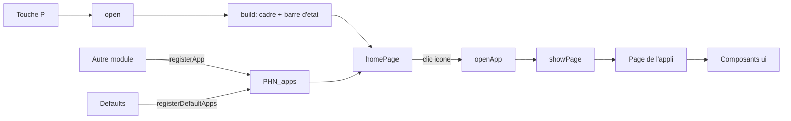
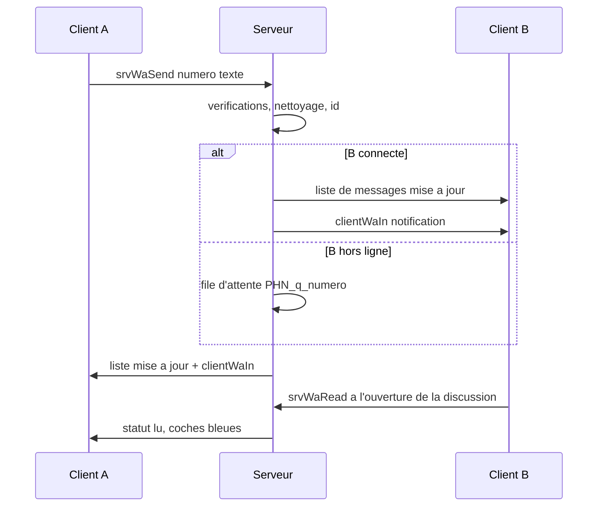
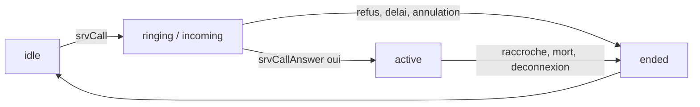

# Téléphone (`PHN`)

> Un smartphone en jeu (touche P) avec écran d'accueil, applications Téléphone (appels vocaux), Chat (messagerie avec profils, contacts et statuts), Banque (virements, historique), Réglages et Admin, et auquel les autres modules peuvent ajouter leurs propres applications.

## Ce que ce module démontre en informatique

- **Registre de plugins (injection de callbacks)** : `PHN_fnc_registerApp` range chaque application dans une liste `PHN_apps` avec le *code* à exécuter pour l'ouvrir. Le module Emplois (`jobSystem/functions/fn_init.sqf`) ajoute ainsi son application « Emploi » sans modifier une seule ligne du téléphone.
- **Génération procédurale d'interface** : la fenêtre déclarée dans `ui/dialog.hpp` est vide ; tout (cadre, icônes, boutons, bulles de messages) est créé par script avec `ctrlCreate`, à partir d'une petite bibliothèque de composants réutilisables (`PHN_fnc_uiText`, `PHN_fnc_uiButton`, `PHN_fnc_uiEdit`…).
- **Architecture client/serveur et autorité serveur** : le client ne fait qu'afficher et envoyer des demandes ; argent, messages, appels et actions admin sont décidés par le serveur, qui revérifie l'expéditeur (`remoteExecutedOwner`), le type et les bornes de chaque paramètre.
- **Modèle « push » et synchronisation d'état** : le serveur est la seule source de vérité des messages. Il les stocke, puis *pousse* la liste à jour vers le client concerné uniquement (`setVariable [..., owner]`) et lui envoie un signal (`PHN_fnc_clientWaIn`) pour qu'il redessine l'écran.
- **Contrôle d'accès par rôles (RBAC)** : les rôles et leurs permissions sont déclarés dans `config/settings.hpp` (`PHN_Roles`) ; le serveur recalcule les permissions à chaque action admin et journalise les acceptations comme les refus.
- **Machine à états** : un appel passe par les états `idle → ringing/incoming → active → ended → idle`. Le serveur garde une table de hachage des appels en cours et un *pool* (réserve) de canaux radio réutilisables.
- **Géométrie et interpolation** : `PHN_fnc_roundRect` dessine des coins arrondis avec l'équation du cercle, et `PHN_fnc_lerpColor` fait des dégradés par interpolation linéaire.

## Fichiers

| Fichier / dossier | Rôle |
|---|---|
| `config/functions.hpp` | Déclare les 92 fonctions du module (`PHN_fnc_init` en `postInit` : lancée automatiquement au démarrage). |
| `config/remoteExec.hpp` | Liste blanche des RPC : 12 fonctions serveur appelables par les clients (`allowedTargets = 2`), 3 fonctions client que le serveur peut appeler (`clientCall`, `clientAdmin`, `clientWaIn`). |
| `config/settings.hpp` | Réglages (`PHN_Settings` : touche, taille, durée de sonnerie, nombre de canaux d'appel, noms des applications, `devAllAdmin`) et rôles (`PHN_Roles` : SteamID64 + permissions). |
| `ui/base.hpp` | Classes de base des contrôles (texte, texte riche, champ de saisie, bouton plat, image). |
| `ui/dialog.hpp` | La fenêtre `PHN_Phone` (IDD 75400), vide : son `onLoad` appelle `PHN_fnc_build`. |
| `functions/fn_*.sqf` | Le code (92 fichiers). Préfixe `srv` = serveur, `client` = événement reçu du serveur, `pg` = une page d'application, `ui` = composant graphique. |
| `img/` | 14 images `.paa` (cadre, fonds d'écran, icônes, dock, île dynamique). Facultatives : sans elles, un dessin vectoriel de secours est utilisé. |
| `LISEZ-MOI.md` | Mode d'emploi pour joueurs et développeurs (création d'une application). Attention : sa section « Limites connues » est en retard sur le code (voir plus bas). |

## Comment ça marche (flux)

**1. Ouverture du téléphone et registre d'applications**

**2. Envoi d'un message (modèle push)**

**3. États d'un appel**

Au démarrage, `PHN_fnc_init` prépare l'état du client (variables globales `PHN_*`), enregistre les applications de base et écoute la touche d'ouverture. Côté serveur, `PHN_fnc_srvInit` charge les profils du chat, crée les canaux radio des appels et s'abonne à l'événement `CORE_playerLoaded` : à chaque connexion, le joueur reçoit un numéro de téléphone unique, ses messages en attente et ses données (`PHN_fnc_srvSyncAll`, `PHN_fnc_srvWaSync`). Quand le joueur ouvre le téléphone, `PHN_fnc_build` dessine le cadre puis l'écran d'accueil, qui affiche une icône par application autorisée. Chaque page est une simple fonction qui appelle les composants `ui*` ; changer de page efface tous les contrôles de la précédente. Toute action importante part au serveur par `remoteExec` ; le serveur répond en mettant à jour des variables réservées au joueur, puis le client redessine sa page.

## Fonctions

### Index

| Fonction | Côté | Rôle en une ligne |
|---|---|---|
| `PHN_fnc_init` | Les deux | Démarrage automatique : état client, applications de base, écoute de la touche ; lance `srvInit` côté serveur. |
| `PHN_fnc_open` | Client | Ouvre la fenêtre du téléphone (une seule fois à la fois). |
| `PHN_fnc_build` | Client | Dessine le cadre (images ou vectoriel) puis l'accueil ou l'écran d'appel. |
| `PHN_fnc_onKeyMain` | Client | Touche pressée en jeu : ouvre le téléphone si c'est la bonne touche. |
| `PHN_fnc_onKey` | Client | Touche pressée téléphone ouvert : fermeture, ou capture d'une nouvelle touche. |
| `PHN_fnc_clockLoop` | Client | Boucle d'une seconde : horloge et chronomètre d'appel. |
| `PHN_fnc_showPage` | Client | Efface la page courante et exécute le code de la nouvelle. |
| `PHN_fnc_refresh` | Client | Redessine la page courante, éventuellement après un délai. |
| `PHN_fnc_registerApp` | Client | Ajoute ou remplace une application dans le registre `PHN_apps`. |
| `PHN_fnc_registerDefaultApps` | Client | Enregistre les 5 applications de base. |
| `PHN_fnc_hasPermClient` | Client | Teste une permission pour l'affichage seulement. |
| `PHN_fnc_homePage` | Client | Écran d'accueil : grille d'icônes + dock. |
| `PHN_fnc_openApp` | Client | Ouvre une application par son identifiant. |
| `PHN_fnc_appName` | Client | Nom affiché d'une application. |
| `PHN_fnc_img` | Client | Chemin d'une image `.paa` (avec cache), ou `""`. |
| `PHN_fnc_imgStatus` | Client | Compte les images présentes / manquantes. |
| `PHN_fnc_pgSettings` | Client | Page Réglages : numéro, touche, fond d'écran. |
| `PHN_fnc_srvInit` | Serveur | Initialisation serveur : profils, canaux d'appel, événements. |
| `PHN_fnc_srvOnLoaded` | Serveur | Joueur chargé : numéro unique, messages en attente, synchronisation. |
| `PHN_fnc_srvSyncAll` | Serveur | Envoie au joueur son numéro, son journal bancaire et son rôle. |
| `PHN_fnc_roundRect` | Client | Rectangle à coins arrondis (et dégradé) fait de bandes. |
| `PHN_fnc_lerpColor` | Client | Interpolation linéaire entre deux couleurs. |
| `PHN_fnc_uiRect` | Client | Rectangle en coordonnées relatives à la zone de contenu. |
| `PHN_fnc_uiText` | Client | Texte. |
| `PHN_fnc_uiButton` | Client | Bouton arrondi qui exécute un code avec une donnée. |
| `PHN_fnc_uiEdit` | Client | Champ de saisie, retrouvable par une clé. |
| `PHN_fnc_uiHeader` | Client | En-tête standard : titre + « < Retour ». |
| `PHN_fnc_squareH` | Client | Hauteur relative qui donne un carré à l'écran. |
| `PHN_fnc_uiPic` | Client | Image en coordonnées absolues. |
| `PHN_fnc_uiStatus` | Client | Île dynamique, heure, réseau/batterie, barre d'accueil cliquable. |
| `PHN_fnc_uiAppBg` | Client | Fond plein écran d'une application + barre d'état. |
| `PHN_fnc_uiAppIcon` | Client | Icône d'application (image ou dessin). |
| `PHN_fnc_iconGlyph` | Client | Pictogramme dessiné dans une icône, ou lettres. |
| `PHN_fnc_uiAvatar` | Client | Avatar rond coloré avec initiales. |
| `PHN_fnc_uiTick` | Client | Coche simple ou double (accusés de lecture). |
| `PHN_fnc_uiTabBar` | Client | Barre d'onglets en bas de page. |
| `PHN_fnc_uiPict` | Client | Petits pictogrammes (flèche, carte, infos, plus). |
| `PHN_fnc_pgBank` | Client | Banque : solde, actions, 5 dernières transactions. |
| `PHN_fnc_pgBankPay` | Client | Banque : virement vers un joueur. |
| `PHN_fnc_pgBankCard` | Client | Banque : carte virtuelle (affichage). |
| `PHN_fnc_pgBankDetails` | Client | Banque : détails du compte. |
| `PHN_fnc_srvBank` | Serveur (RPC) | Exécute un virement validé. |
| `PHN_fnc_srvLog` | Serveur | Ajoute une ligne au journal bancaire (12 max). |
| `PHN_fnc_pgWa` | Client | Point d'entrée du Chat (inscription ou onglet mémorisé). |
| `PHN_fnc_pgWaWelcome` | Client | Chat : écran de bienvenue. |
| `PHN_fnc_pgWaNumber` | Client | Chat : saisie du numéro. |
| `PHN_fnc_pgWaProfile` | Client | Chat : création / modification du profil. |
| `PHN_fnc_pgWaChats` | Client | Chat : liste des discussions. |
| `PHN_fnc_pgWaChat` | Client | Chat : une conversation + saisie. |
| `PHN_fnc_pgWaNew` | Client | Chat : nouveau contact / nouvelle discussion. |
| `PHN_fnc_pgWaStatus` | Client | Chat : onglet Statuts. |
| `PHN_fnc_pgWaStatusNew` | Client | Chat : publier un statut. |
| `PHN_fnc_pgWaStatusView` | Client | Chat : voir le statut d'un autre. |
| `PHN_fnc_pgWaYou` | Client | Chat : onglet « Vous » (mon profil). |
| `PHN_fnc_waInitials` | Client | Initiales d'un nom. |
| `PHN_fnc_waProfileOf` | Client | Profil d'un numéro dans l'annuaire reçu. |
| `PHN_fnc_waName` | Client | Nom à afficher pour un numéro. |
| `PHN_fnc_waTimeLabel` | Client | « HH:MM », « Hier » ou « il y a N j ». |
| `PHN_fnc_waTmpRead` | Client | Mémorise les champs du formulaire de profil. |
| `PHN_fnc_clientWaIn` | Client (RPC, depuis le serveur) | Notification de message / demande de rafraîchissement. |
| `PHN_fnc_srvWaRegister` | Serveur (RPC) | Inscription au Chat. |
| `PHN_fnc_srvWaProfile` | Serveur (RPC) | Modification du profil. |
| `PHN_fnc_srvWaSend` | Serveur (RPC) | Envoi d'un message. |
| `PHN_fnc_srvWaRead` | Serveur (RPC) | Marque une discussion comme lue. |
| `PHN_fnc_srvWaSetStatus` | Serveur | Met à jour l'état d'un message chez l'expéditeur. |
| `PHN_fnc_srvWaStatusPost` | Serveur (RPC) | Publie un statut (24 h). |
| `PHN_fnc_srvWaStatusDel` | Serveur (RPC) | Supprime son statut. |
| `PHN_fnc_srvWaContact` | Serveur (RPC) | Ajoute / renomme un contact. |
| `PHN_fnc_srvWaSync` | Serveur | Envoie au joueur tout son état du Chat. |
| `PHN_fnc_srvWaPushOne` | Serveur | Envoie annuaire + statuts valides à un joueur. |
| `PHN_fnc_srvWaPush` | Serveur | Même chose pour tous les joueurs connectés. |
| `PHN_fnc_srvWaSave` | Serveur | Sauvegarde profils et statuts. |
| `PHN_fnc_pgDialer` | Client | Application Téléphone : clavier. |
| `PHN_fnc_pgCall` | Client | Écran d'appel (entrant, sortant, en cours). |
| `PHN_fnc_clientCall` | Client (RPC, depuis le serveur) | Applique un changement d'état d'appel. |
| `PHN_fnc_srvCall` | Serveur (RPC) | Lance un appel. |
| `PHN_fnc_srvCallAnswer` | Serveur (RPC) | Répondre / refuser. |
| `PHN_fnc_srvCallEnd` | Serveur (RPC) | Raccrocher. |
| `PHN_fnc_srvEndCall` | Serveur | Termine un appel et libère le canal. |
| `PHN_fnc_srvRole` | Serveur | Calcule rôle et permissions d'un joueur. |
| `PHN_fnc_hasPerm` | Serveur | Le joueur a-t-il cette permission ? |
| `PHN_fnc_srvAdmin` | Serveur (RPC) | Exécute une action admin après vérification. |
| `PHN_fnc_pgAdmin` | Client | Page Admin (boutons selon les permissions). |
| `PHN_fnc_adminSend` | Client | Lit le formulaire admin et envoie la demande. |
| `PHN_fnc_clientAdmin` | Client (RPC, depuis le serveur) | Exécute localement une action admin validée. |
| `PHN_fnc_giveClass` | Client | Ajoute un objet à l'inventaire selon sa classe. |
| `PHN_fnc_findByNumber` | Serveur | Joueur connecté qui possède un numéro. |
| `PHN_fnc_fmtPhone` | Les deux | « 5551234 » → « 555-1234 ». |
| `PHN_fnc_nowStr` | Les deux | Heure du jeu « HH:MM ». |
| `PHN_fnc_esc` | Client | Échappe `<`, `>`, `&` pour le texte riche. |
| `PHN_fnc_epochMin` | Les deux | Minutes réelles écoulées depuis le 01/01/2020. |
| `PHN_fnc_cleanText` | Serveur | Nettoie et tronque un texte saisi. |

---

### Noyau du téléphone

#### `PHN_fnc_init`
- **Côté :** les deux (lancée automatiquement par `postInit = 1`).
- **Dans le jeu :** prépare le téléphone au chargement de la mission et active la touche P.
- **En informatique :** point d'entrée unique du module. Sur le serveur il délègue à `PHN_fnc_srvInit` ; sur une machine sans interface (serveur dédié) il s'arrête là. Sur le client, il initialise l'état global (page courante, `PHN_refs` = table de hachage des contrôles nommés, `PHN_call = ["idle"]`, couleurs des thèmes Chat et Banque), relit la touche et le fond d'écran mémorisés dans le profil du joueur (`profileNamespace`), enregistre les applications de base, puis attend l'écran principal du jeu (display 46) pour y brancher un gestionnaire d'événement `KeyDown`. Un commentaire précise qu'aucun contrôle d'interface n'est stocké ici, pour éviter les erreurs de sérialisation d'Arma.
- **Paramètres → retour :** aucun → rien.

#### `PHN_fnc_open`
- **Côté :** client.
- **Dans le jeu :** ouvre le téléphone.
- **En informatique :** garde simple contre la double ouverture : le drapeau `PHN_open` passe à `true` avant `createDialog`, et revient à `false` si la création échoue. La fermeture (`onUnload` de la fenêtre) le remet à `false`.
- **Paramètres → retour :** aucun → rien.

#### `PHN_fnc_build`
- **Côté :** client (appelée par le `onLoad` de la fenêtre).
- **Dans le jeu :** dessine le téléphone (cadre titane, fond d'écran, barre d'état) puis affiche l'accueil, ou directement l'écran d'appel si un appel est en cours.
- **En informatique :** calcule la taille de l'écran à partir de la hauteur disponible (`uiScale`) et du ratio 440 × 956 d'un grand smartphone, en pixels réels (`pixelW`/`pixelH`) pour éviter la déformation. Il mémorise deux rectangles : `PHN_S` (écran entier) et `PHN_C` (zone de contenu des applications), que tous les composants utilisent ensuite. Il choisit entre deux modes de rendu : images si `useImages = 1` et que les fichiers existent, sinon un dessin vectoriel de secours (cadre, boutons latéraux, fond en dégradé via `PHN_fnc_roundRect`). C'est une **dégradation gracieuse** : le téléphone fonctionne même sans les images.
- **Paramètres → retour :** `[display]` → rien.

#### `PHN_fnc_onKeyMain`
- **Côté :** client.
- **Dans le jeu :** appuyer sur P en jeu ouvre le téléphone.
- **En informatique :** gestionnaire d'événement clavier. Il ignore la touche si Maj/Ctrl/Alt est enfoncé, si une autre fenêtre est ouverte, si le joueur est mort ou si ses données ne sont pas encore chargées (variable `CORE_cash` absente). Il renvoie `true` pour « consommer » la touche (le jeu ne la traite plus).
- **Paramètres → retour :** `[display, touche, shift, ctrl, alt]` → booléen (touche consommée).

#### `PHN_fnc_onKey`
- **Côté :** client.
- **Dans le jeu :** la même touche referme le téléphone ; dans Réglages, permet de choisir une nouvelle touche.
- **En informatique :** petit **mode** de capture : si `PHN_capture` est vrai, la prochaine touche devient la touche d'ouverture (sauf Échap/Entrée qui annulent) et est sauvegardée dans le profil du joueur. Sinon, la touche d'ouverture ferme la fenêtre, sauf si le focus est dans un champ de texte (type de contrôle 2), pour qu'on puisse taper la lettre P dans un message.
- **Paramètres → retour :** `[display, touche, ...]` → booléen.

#### `PHN_fnc_clockLoop`
- **Côté :** client (lancée en tâche de fond par `build`).
- **Dans le jeu :** l'heure du jeu en haut de l'écran et la durée de l'appel en cours se mettent à jour.
- **En informatique :** boucle de **polling** (interrogation périodique) d'une seconde, qui s'arrête d'elle-même quand le téléphone est fermé. Le chronomètre est calculé à partir de l'heure de début stockée dans `PHN_call` (3ᵉ élément), le contrôle à mettre à jour étant retrouvé dans `PHN_refs` par sa clé `"callTimer"`.
- **Paramètres → retour :** aucun → rien.

#### `PHN_fnc_showPage`
- **Côté :** client.
- **Dans le jeu :** passer d'un écran à un autre.
- **En informatique :** c'est le **routeur** du téléphone. Il supprime tous les contrôles de la page précédente (liste `PHN_page`), vide `PHN_refs`, mémorise la page courante sous la forme `[code, arguments]` dans `PHN_curPage`, puis exécute le code. Les éléments permanents (cadre, barre d'état) sont dans une autre liste, `PHN_chrome`, et ne sont donc pas effacés. Une page n'est donc qu'une fonction : il n'y a rien à déclarer dans la configuration.
- **Paramètres → retour :** `[code, arguments]` → rien.

#### `PHN_fnc_refresh`
- **Côté :** client.
- **Dans le jeu :** l'écran se met à jour (nouveau message, solde modifié…).
- **En informatique :** relance `PHN_curPage` via `showPage`, éventuellement après un délai (`uiSleep`) dans un fil séparé (`spawn`). Le délai sert à laisser le temps au serveur de répondre après une requête : c'est un **rafraîchissement temporisé** plutôt qu'un vrai accusé de réception.
- **Paramètres → retour :** `[délai en secondes (optionnel)]` → rien.

#### `PHN_fnc_registerApp`
- **Côté :** client (appelable par n'importe quel module).
- **Dans le jeu :** une nouvelle icône apparaît sur l'écran d'accueil.
- **En informatique :** cœur du **pattern plugin**. Une application est un simple tableau `[id, nom, couleur, glyphe, codeOuverture, permission, dansLeDock]` ajouté à `PHN_apps`. Si une application de même `id` existe déjà, elle est d'abord retirée : l'enregistrement est **idempotent** (l'appeler deux fois ne crée pas de doublon) et permet de remplacer une application. Le téléphone ne connaît pas les applications à l'avance : il appelle le code fourni (**injection de callback**). Exemple réel : `jobSystem` enregistre `["job", "Emploi", ..., JOB_fnc_pgPhone, "", false]`.
- **Paramètres → retour :** `[id, nom, [r,g,b,a], glyphe, code, permission, dock]` → rien.

#### `PHN_fnc_registerDefaultApps`
- **Côté :** client.
- **Dans le jeu :** crée les applications Téléphone, Chat, Banque, Réglages (dans le dock) et Admin (sur la grille, réservée aux rôles).
- **En informatique :** utilise elle-même `registerApp`, comme un module externe le ferait (les applications de base ne sont pas un cas spécial). Les noms du Chat et de la Banque viennent de la configuration (`chatAppName`, `bankAppName`) avec une valeur par défaut.
- **Paramètres → retour :** aucun → rien.

#### `PHN_fnc_homePage`
- **Côté :** client.
- **Dans le jeu :** l'écran d'accueil avec la grille d'icônes et le dock en bas.
- **En informatique :** filtre `PHN_apps` deux fois : applications autorisées hors dock (grille de 4 colonnes calculée avec modulo et division entière) et applications du dock (4 au maximum). La permission est testée avec `PHN_fnc_hasPermClient`, uniquement pour l'affichage. Chaque icône reçoit un bouton transparent qui appelle `openApp` avec l'`id` de l'application.
- **Paramètres → retour :** aucun → rien.

#### `PHN_fnc_openApp`
- **Côté :** client.
- **Dans le jeu :** lance l'application touchée.
- **En informatique :** recherche linéaire (`findIf`) de l'`id` dans le registre, puis passe le code d'ouverture au routeur `showPage`.
- **Paramètres → retour :** `[id]` → rien.

#### `PHN_fnc_hasPermClient`
- **Côté :** client.
- **Dans le jeu :** cache l'application Admin aux joueurs sans rôle.
- **En informatique :** lit les permissions que le serveur a copiées sur le joueur (`PHN_perms`). `""` = tout le monde, `"admin"` = au moins une permission, sinon permission précise. Le commentaire du code le dit : c'est **uniquement cosmétique**, le serveur revérifie tout.
- **Paramètres → retour :** `[permission]` → booléen.

#### `PHN_fnc_pgSettings`
- **Côté :** client.
- **Dans le jeu :** affiche son numéro, permet de changer la touche d'ouverture et de choisir un des 3 fonds d'écran.
- **En informatique :** le bouton « Modifier la touche » active le mode capture de `PHN_fnc_onKey`. Le choix du fond d'écran est enregistré dans le profil local du joueur (`profileNamespace` + `saveProfileNamespace`), puis le téléphone est fermé et rouvert pour reconstruire le cadre. La page écrit aussi dans le journal (`.rpt`) la liste des images manquantes (`PHN_fnc_imgStatus`), utile au diagnostic.
- **Paramètres → retour :** aucun → rien.

#### `PHN_fnc_srvInit`
- **Côté :** serveur.
- **Dans le jeu :** prépare tout ce dont le téléphone a besoin sur le serveur.
- **En informatique :** charge la liste des numéros déjà attribués, les profils du Chat (convertis en table de hachage `numéro → [nom, avatar, info]`) et les statuts. Il contient une **migration de données** : un ancien format erroné `[[numéros], [profils]]` est détecté et converti en paires. Il crée ensuite `callChannels` canaux radio personnalisés (le **pool** d'appels), s'abonne à l'événement du noyau `CORE_playerLoaded` (**publish/subscribe**), et ajoute deux gestionnaires de mission (`HandleDisconnect`, `EntityKilled`) qui terminent l'appel d'un joueur qui se déconnecte ou meurt.
- **Paramètres → retour :** aucun → rien.

#### `PHN_fnc_srvOnLoaded`
- **Côté :** serveur (déclenchée par l'événement `CORE_playerLoaded`).
- **Dans le jeu :** à la première connexion, le joueur reçoit un numéro à 7 chiffres ; les messages reçus hors ligne lui sont remis.
- **En informatique :** génère un numéro (premier chiffre 5 à 9, puis 6 chiffres aléatoires) et recommence tant qu'il est déjà dans `PHN_used` (**unicité** par tirage-rejet). Le numéro est sauvegardé dans les données du joueur (`CORE_fnc_setValue`). Ensuite, il vide la **file d'attente** `PHN_q_<numéro>` : chaque message passe à l'état « distribué » (1), est ajouté à la boîte du joueur (limitée aux 200 derniers), et l'expéditeur est prévenu via `srvWaSetStatus`. Enfin, il synchronise le joueur.
- **Paramètres → retour :** `[unité, uid]` → rien.

#### `PHN_fnc_srvSyncAll`
- **Côté :** serveur.
- **Dans le jeu :** le téléphone connaît le numéro, l'historique bancaire et le rôle du joueur.
- **En informatique :** copie des données serveur vers le client avec `setVariable [nom, valeur, owner _unit]` : la variable n'est **répliquée que vers la machine du joueur**, pas vers tout le monde. Le journal bancaire est validé (type tableau) et remis à zéro s'il est corrompu.
- **Paramètres → retour :** `[unité]` → rien.

#### Images (petites fonctions)
- **`PHN_fnc_img`** (client) : renvoie le chemin d'une image `.paa` ou `""`. Essaie le chemin complet de la mission puis le chemin relatif, et met le résultat en **cache** (table de hachage `PHN_imgCache`, *mémoïsation*) : chaque fichier n'est testé et signalé dans le journal qu'une fois. `[nom] → chemin | ""`.
- **`PHN_fnc_imgStatus`** (client) : vérifie la présence des 14 images attendues. `[] → [trouvées, total, manquantes]`. Outil de diagnostic.
- **`PHN_fnc_appName`** (client) : nom affiché d'une application à partir de son `id` (renvoie l'`id` si inconnue). `[id] → texte`.

---

### Boîte à outils UI

Toutes les pages sont construites avec ces composants. Principe commun : chaque composant crée ses contrôles avec `ctrlCreate`, les ajoute à la liste `PHN_page` (pour qu'ils soient effacés au changement de page) et prend ses coordonnées en **fractions (0 à 1) de la zone de contenu** `PHN_C`. Un développeur d'un autre module peut donc construire une application sans connaître la résolution de l'écran (voir `jobSystem/functions/fn_pgPhone.sqf`, qui utilise `uiAppBg`, `uiHeader`, `uiRect`, `uiText`).

#### `PHN_fnc_roundRect`
- **Côté :** client.
- **Dans le jeu :** tous les coins arrondis du téléphone (boutons, bulles, icônes, cadre).
- **En informatique :** Arma 3 ne sait pas dessiner de coins arrondis ; la fonction les **approxime par des bandes horizontales**. Pour chaque bande d'un coin, le retrait horizontal vaut `r × (1 − √(1 − ρ²))`, tiré de l'équation du cercle x² + y² = r². Le rayon est borné à la moitié de la largeur et de la hauteur, le nombre de bandes est limité (48 par défaut) pour maîtriser le nombre de contrôles, et les bandes opaques se chevauchent légèrement (×1,7) pour éviter des lignes fines. Si une seconde couleur est donnée, chaque bande reçoit la couleur interpolée selon sa position verticale (dégradé). Renvoie la liste des contrôles créés.
- **Paramètres → retour :** `[x, y, w, h, rayonPx, couleur, couleurBas?, maxBandes?]` → tableau de contrôles.

#### `PHN_fnc_lerpColor`
- **Côté :** client.
- **Dans le jeu :** dégradés (fond d'écran, icônes).
- **En informatique :** interpolation linéaire composante par composante `a + (b − a) × t`, avec `t` borné entre 0 et 1.
- **Paramètres → retour :** `[couleur1, couleur2, t]` → couleur `[r,g,b,a]`.

#### `PHN_fnc_uiRect`
- **Côté :** client.
- **Dans le jeu :** cartes, fonds, séparateurs.
- **En informatique :** convertit les coordonnées relatives en absolues (`x = Cx + fx × Cw`, etc.) puis délègue à `roundRect`. C'est une **couche d'abstraction** au-dessus du dessin bas niveau.
- **Paramètres → retour :** `[fx, fy, fw, fh, couleur, rayonPx?, couleurBas?]` → tableau de contrôles.

#### `PHN_fnc_uiText`
- **Côté :** client.
- **Dans le jeu :** tous les textes.
- **En informatique :** choisit la classe de contrôle selon l'alignement (gauche, centré, droite), règle police, couleur et taille ; la taille est elle aussi relative à la hauteur de la zone de contenu, donc proportionnelle à l'écran. Renvoie le contrôle pour qu'une page puisse le modifier plus tard (ex. l'affichage du numéro composé).
- **Paramètres → retour :** `[fx, fy, fw, fh, texte, taille?, couleur?, alignement?, police?]` → contrôle.

#### `PHN_fnc_uiButton`
- **Côté :** client.
- **Dans le jeu :** tous les boutons (y compris les zones cliquables invisibles posées sur les icônes et les lignes de liste).
- **En informatique :** dessine un fond arrondi (sauf si transparent), crée un bouton plat, et **attache au contrôle** le code à exécuter et une donnée (`setVariable ["PHN_code"]` / `["PHN_data"]`). Un seul gestionnaire `ButtonClick` générique relit ces variables et appelle `[donnée] call code`. C'est l'équivalent d'une **fermeture** (closure) : chaque bouton transporte son propre comportement et son propre contexte (par exemple le numéro de la discussion à ouvrir).
- **Paramètres → retour :** `[fx, fy, fw, fh, texte, fond?, couleurTexte?, code?, donnée?, rayonPx?, taille?]` → contrôle.

#### `PHN_fnc_uiEdit`
- **Côté :** client.
- **Dans le jeu :** champs de saisie (montant, message, nom…).
- **En informatique :** crée un fond arrondi et un champ texte ; si une clé est fournie, le contrôle est enregistré dans la table de hachage `PHN_refs` (`PHN_refs get "amount"`). Les callbacks des boutons retrouvent ainsi les valeurs saisies sans variables globales dédiées : c'est un **annuaire de références** remis à zéro à chaque page.
- **Paramètres → retour :** `[fx, fy, fw, fh, texte?, taille?, clé?]` → contrôle.

#### `PHN_fnc_uiHeader`
- **Côté :** client.
- **Dans le jeu :** titre centré et bouton « < Retour » vers l'accueil.
- **En informatique :** composant composé de deux autres (`uiText` + `uiButton`) : réutilisation par **composition**.
- **Paramètres → retour :** `[titre, retour?]` → rien.

#### `PHN_fnc_squareH`
- **Côté :** client.
- **Dans le jeu :** icônes, avatars et touches du clavier restent bien carrés ou ronds.
- **En informatique :** la zone de contenu n'est pas carrée, donc une même fraction ne donne pas la même taille en largeur et en hauteur. La fonction convertit la largeur en pixels puis la ramène en fraction de la hauteur : `((fw × Cw) / pixelW × pixelH) / Ch`.
- **Paramètres → retour :** `[fw]` → `fh`.

#### `PHN_fnc_uiAppBg`
- **Côté :** client.
- **Dans le jeu :** fond coloré plein écran des applications (noir pour la Banque, sombre pour le Chat), avec un éventuel bandeau d'en-tête.
- **En informatique :** utilise l'image `screen_ca` teintée (1 seul contrôle) ou, à défaut, un `roundRect` aux coins de l'écran. Comme ce fond couvre la barre d'état permanente, il la redessine par-dessus (`PHN_fnc_uiStatus` avec `true`) et désactive le bouton d'accueil permanent pour qu'il ne soit pas cliqué deux fois ; `showPage` le réactive ensuite.
- **Paramètres → retour :** `[couleur?, couleurEnTête?, basDuBandeau?]` → rien.

#### `PHN_fnc_uiStatus`
- **Côté :** client.
- **Dans le jeu :** l'île dynamique, l'heure, les barres réseau et batterie (décoratives, toujours pleines) et la barre blanche en bas qui ramène à l'accueil puis ferme.
- **En informatique :** même code pour deux usages : soit dans `PHN_chrome` (permanent), soit dans `PHN_page` (redessiné avec la page). Le contrôle de l'heure est mémorisé dans `uiNamespace` pour `clockLoop`. La barre d'accueil a un comportement à deux états selon `PHN_atHome`.
- **Paramètres → retour :** `[surLaPage?]` → rien.

#### `PHN_fnc_uiAppIcon`
- **Côté :** client.
- **Dans le jeu :** l'icône d'une application.
- **En informatique :** en mode image, une base `iconbase_ca` teintée de la couleur de l'application + le pictogramme `glyph_<id>_ca` s'il existe ; sinon (ou en mode vectoriel), un carré arrondi en dégradé (couleur éclaircie de 28 % vers la couleur de base) et `PHN_fnc_iconGlyph`. Une application d'un autre module obtient donc automatiquement une icône cohérente.
- **Paramètres → retour :** `[id, x, y, w, h, couleur, glyphe?]` → rien.

#### Autres composants (petits)
- **`PHN_fnc_uiPic`** (client) : crée une image à une position absolue, éventuellement teintée ; renvoie `controlNull` si l'image n'existe pas, ce qui permet aux appelants de basculer sur le dessin. `[x, y, w, h, nom, teinte?] → contrôle`.
- **`PHN_fnc_iconGlyph`** (client) : dessine en petits rectangles arrondis le pictogramme des 5 applications de base (combiné, bulle, carte, curseurs, bouclier) ; pour toute autre application, affiche son glyphe texte (1 à 3 lettres). `[id, x, y, w, h, couleur, glyphe] → rien`. Exemple d'`switch` utilisé comme table de rendu.
- **`PHN_fnc_uiAvatar`** (client) : avatar rond (rayon = demi-largeur) parmi 8 couleurs (`index mod 8`) avec initiales, et anneau vert optionnel (statut publié). `[fx, fy, fw, indexCouleur, initiales, anneau?] → rien`.
- **`PHN_fnc_uiTick`** (client) : dessine une coche ✓ (ou deux) point par point avec de petits carrés le long de deux segments ; sert aux accusés de réception du Chat. `[x, y, taillePx, couleur, double?] → rien`.
- **`PHN_fnc_uiTabBar`** (client) : barre d'onglets en bas de l'écran ; un bouton par libellé, couleur active/inactive, et le même code reçoit l'index de l'onglet. `[libellés, actif, code, couleurs…] → rien`.
- **`PHN_fnc_uiPict`** (client) : 4 pictogrammes dessinés (« send » = flèche en escalier, « card », « info », « plus ») pour les boutons ronds de la Banque. `[genre, x, y, w, h, couleur] → rien`.

---

### Banque

Le téléphone ne fait que des **virements** entre joueurs. Le code le dit explicitement : dépôt et retrait d'espèces sont réservés aux distributeurs (module ECO, `ecoSystem/functions/fn_srvAtm.sqf`, qui réutilise `PHN_fnc_srvLog` pour l'historique). Tout mouvement d'argent passe par `CORE_fnc_changeMoney`, côté serveur.

#### `PHN_fnc_srvBank`
- **Côté :** serveur, **appelée à distance** (liste blanche, `allowedTargets = 2` : seul le serveur l'exécute ; n'importe quel client peut la demander, mais seulement pour lui-même).
- **Dans le jeu :** envoie de l'argent de son compte bancaire vers le compte d'un autre joueur, avec un message aux deux.
- **En informatique :** validations dans l'ordre : types des paramètres (`params` avec types attendus), unité joueur, **`remoteExecutedOwner` égal au propriétaire de l'unité** (un client ne peut pas agir au nom d'un autre), joueur chargé (`CORE_active`), montant arrondi à l'entier et borné entre 1 et 1 000 000 000, destinataire valide, connecté et différent de soi. Le virement est fait en deux étapes : débit (`changeMoney -montant`, qui échoue si le solde est insuffisant) puis crédit ; si le crédit échoue, le débit est **annulé par un remboursement** (transaction compensatoire). Les deux journaux sont mis à jour.
- **Paramètres → retour :** `[unité, "transfer", montant, unitéCible]` → rien (réponse par message au joueur).

#### `PHN_fnc_srvLog`
- **Côté :** serveur (appelée aussi par les modules ECO et JOB, avec une vérification `!isNil` pour ne pas dépendre du téléphone).
- **Dans le jeu :** une ligne apparaît dans « Transactions ».
- **En informatique :** ajoute `[heure du jeu, texte, montant]` au journal du joueur, garde seulement les **12 dernières lignes** (tampon de taille fixe), sauvegarde via `CORE_fnc_setValue` et pousse le journal au seul client concerné. Un journal mal formé (ancienne sauvegarde) est remplacé par un journal vide et signalé dans le `.rpt`.
- **Paramètres → retour :** `[unité, texte, montant±]` → rien.

#### `PHN_fnc_pgBankPay`
- **Côté :** client.
- **Dans le jeu :** choisir un destinataire parmi les joueurs en ligne (5 premiers affichés), saisir un montant, envoyer.
- **En informatique :** le client fait des vérifications de **confort** (montant > 0, destinataire choisi) puis envoie `remoteExec ["PHN_fnc_srvBank", 2]` ; les vraies vérifications sont refaites au serveur. Après 0,8 s, il revient à l'accueil de la banque pour afficher le nouveau solde.
- **Paramètres → retour :** aucun → rien.

#### Autres pages de la Banque
- **`PHN_fnc_pgBank`** (client) : accueil de la banque : avatar, « Bonjour, prénom », solde (variable `CORE_bank` fournie par le noyau, formatée par `CORE_fnc_fmt`), trois actions rondes et les 5 dernières transactions, la plus récente en haut. La boucle vérifie la forme de chaque ligne (tableau d'au moins 3 éléments, bons types) et ignore les lignes invalides : **programmation défensive** à l'affichage. `[] → rien`.
- **`PHN_fnc_pgBankCard`** (client) : carte bancaire purement visuelle (ratio réel d'une carte 1,586, derniers chiffres tirés du numéro de téléphone, date d'expiration fixe « 12/30 »). Le texte annonce de futurs paiements en magasin : aucune logique de paiement par carte n'existe dans ce module. `[] → rien`.
- **`PHN_fnc_pgBankDetails`** (client) : titulaire, numéro de compte fictif construit à partir du numéro de téléphone (`NR00 xxx xxxx`), type de compte, devise (`currencyName` du noyau). `[] → rien`.

---

### Messagerie (Chat)

**Modèle de données.** Un message est un tableau `[id, minute, numéroExpéditeur, numéroDestinataire, texte, état]`, où l'état vaut 0 (envoyé), 1 (distribué) ou 2 (lu). Chaque joueur a sa propre copie de ses messages (clé `wa_msgs` dans ses données, 200 au maximum) : un message est donc **dupliqué** chez l'expéditeur et chez le destinataire. Les profils (`PHN_profiles`, table de hachage numéro → `[nom, avatar, info]`) et les statuts (`[numéro, texte, couleur, minute]`) sont globaux, sauvegardés dans le profil du serveur. Les contacts sont personnels (`wa_contacts`).

**Modèle push.** Le client ne demande jamais « y a-t-il du nouveau ? ». C'est le serveur qui, à chaque changement, (1) met à jour la variable du joueur concerné avec `setVariable [..., owner]`, puis (2) appelle `PHN_fnc_clientWaIn` sur ce client pour qu'il notifie et redessine. Le client lit ensuite simplement ses variables locales (`PHN_waMsgs`, `PHN_waContacts`, `PHN_waDir`, `PHN_waStatus`).

#### `PHN_fnc_srvWaSend`
- **Côté :** serveur, **appelée à distance** par le client (pour lui-même uniquement).
- **Dans le jeu :** envoyer un message à un numéro.
- **En informatique :** validations : expéditeur authentique (`remoteExecutedOwner`), joueur chargé et inscrit au Chat, **limitation de débit** (un message toutes les 0,5 s au plus, via `PHN_next`), numéro de 7 chiffres (codes ASCII 48 à 57), texte nettoyé et tronqué à 300 caractères par `PHN_fnc_cleanText`, pas d'envoi à soi-même, destinataire inscrit. Le serveur crée un identifiant aléatoire de 12 chiffres et l'horodatage (`PHN_fnc_epochMin`). **Si le destinataire est connecté**, le message est ajouté à sa boîte avec l'état 1 et il reçoit une notification ; **sinon**, le message va dans une **file d'attente** persistante `PHN_q_<numéro>` (200 max), livrée à sa prochaine connexion par `srvOnLoaded`. Les copies sont faites avec `+_entry` (copie profonde), pour que modifier l'état chez l'un ne modifie pas l'autre.
- **Paramètres → retour :** `[unité, numéro, texte]` → rien.

#### `PHN_fnc_srvWaRead`
- **Côté :** serveur, **appelée à distance** (pour soi).
- **Dans le jeu :** ouvrir une discussion fait passer les coches de l'autre en bleu.
- **En informatique :** parcourt les messages reçus de cet interlocuteur dont l'état est < 2, les passe à 2 (« lu »), sauvegarde, puis propage le nouvel état chez l'expéditeur avec `PHN_fnc_srvWaSetStatus`. S'il n'y a rien à marquer, il s'arrête tôt (évite des écritures inutiles).
- **Paramètres → retour :** `[unité, numéroInterlocuteur]` → rien.

#### `PHN_fnc_srvWaSetStatus`
- **Côté :** serveur (interne).
- **Dans le jeu :** les coches (✓ distribué, ✓✓ lu) se mettent à jour chez l'expéditeur.
- **En informatique :** retrouve l'expéditeur par son numéro ; s'il est connecté, cherche le message par `id` et ne change l'état **que s'il augmente** (`état actuel < nouvel état`) : l'opération est **monotone et idempotente** (la rejouer ne casse rien, un « lu » ne redevient jamais « distribué »). Puis il pousse la liste et demande un rafraîchissement sans notification (`["", "", false]`).
- **Paramètres → retour :** `[numéro, idMessage, état]` → rien.

#### `PHN_fnc_srvWaRegister`
- **Côté :** serveur, **appelée à distance** (pour soi).
- **Dans le jeu :** première connexion au Chat : le joueur saisit le numéro de son téléphone, son nom, une couleur d'avatar et une info.
- **En informatique :** vérifie que le numéro saisi est bien celui du joueur, nettoie le nom (25 caractères, espaces multiples réduits) et l'info (80 caractères, « Disponible » par défaut), borne l'avatar entre 0 et 7. Il marque le joueur inscrit (`wa_reg`), enregistre son profil, sauvegarde, puis resynchronise le joueur et **diffuse** l'annuaire à jour à tous (`srvWaPush`).
- **Paramètres → retour :** `[unité, numéro, nom, avatar, info]` → rien.

#### `PHN_fnc_srvWaProfile`
- **Côté :** serveur, **appelée à distance** (pour soi).
- **Dans le jeu :** modifier son nom, son avatar ou son info.
- **En informatique :** mêmes nettoyages que l'inscription ; refusé si le joueur n'est pas inscrit. Le profil est toujours rangé sous le numéro **lu sur le serveur**, jamais sous un numéro envoyé par le client. Sauvegarde et diffusion à tous.
- **Paramètres → retour :** `[unité, nom, avatar, info]` → rien.

#### `PHN_fnc_srvWaStatusPost` / `PHN_fnc_srvWaStatusDel`
- **Côté :** serveur, **appelées à distance** (pour soi).
- **Dans le jeu :** publier un statut texte sur fond coloré (6 couleurs), visible 24 h ; ou le supprimer.
- **En informatique :** `StatusPost` vérifie l'inscription, nettoie le texte (140 caractères), borne la couleur (0 à 5), **remplace** l'éventuel statut précédent du joueur (un seul par numéro) et l'horodate. `StatusDel` le retire (sans vérifier `CORE_active`, mais il ne touche qu'au statut du demandeur). Les deux sauvegardent puis diffusent à tous.
- **Paramètres → retour :** `[unité, texte, couleur]` → rien ; `[unité]` → rien.

#### `PHN_fnc_srvWaContact`
- **Côté :** serveur, **appelée à distance** (pour soi).
- **Dans le jeu :** enregistrer un numéro sous un nom.
- **En informatique :** valide le numéro (7 chiffres), nettoie le nom, supprime l'ancien contact de même numéro puis l'ajoute (**upsert** : ajout ou mise à jour), limite la liste à 100, sauvegarde et pousse au seul joueur.
- **Paramètres → retour :** `[unité, numéro, nom]` → rien.

#### `PHN_fnc_srvWaSync`, `PHN_fnc_srvWaPushOne`, `PHN_fnc_srvWaPush`, `PHN_fnc_srvWaSave`
- **Côté :** serveur (internes).
- **Dans le jeu :** le Chat d'un joueur est à jour à la connexion et après chaque changement.
- **En informatique :**
  - `srvWaSync` : envoie au joueur **son** état privé (inscrit ?, messages, contacts) puis l'état public via `srvWaPushOne`.
  - `srvWaPushOne` : supprime d'abord les statuts de plus de 1 440 minutes (**expiration paresseuse** : on nettoie au moment où on lit, sans minuterie), transforme la table des profils en annuaire `[numéro, nom, avatar, info]` et l'envoie au joueur.
  - `srvWaPush` : appelle `srvWaPushOne` pour tous les joueurs chargés (**diffusion**).
  - `srvWaSave` : convertit la table de hachage des profils en liste de paires (format sérialisable) et l'écrit avec les statuts dans le profil du serveur, puis signale au noyau qu'il faut sauvegarder (`CORE_dirty = true`, **écriture différée**).
- **Paramètres → retour :** `[unité]` (Sync, PushOne) ou aucun (Push, Save) → rien.

#### `PHN_fnc_clientWaIn`
- **Côté :** client, **appelée à distance par le serveur** (liste blanche `allowedTargets = 0`, mais la fonction refuse tout appel dont `remoteExecutedOwner` n'est pas le serveur, 2).
- **Dans le jeu :** « Nouveau message de … » s'affiche quelques secondes et dans le chat système.
- **En informatique :** c'est le **signal** du modèle push : les données sont déjà arrivées par `setVariable` ; cette fonction affiche éventuellement la notification (nom résolu par `PHN_fnc_waName`) et, si le téléphone est ouvert, redessine la page après 0,3 s.
- **Paramètres → retour :** `[numéroÉmetteur, texte, notifier?]` → rien.

#### `PHN_fnc_pgWaChat`
- **Côté :** client.
- **Dans le jeu :** une conversation façon messagerie : bulles vertes (moi) à droite, grises à gauche, heure et coches, champ de saisie et bouton d'envoi.
- **En informatique :** filtre les messages échangés avec ce numéro, puis les dessine **du plus récent au plus ancien en remontant** depuis le bas de l'écran ; la hauteur de chaque bulle est estimée à partir du nombre de caractères (26 par ligne) et le dessin s'arrête quand il n'y a plus de place (pas de défilement). Le texte est affiché en texte riche après **échappement** (`PHN_fnc_esc`) pour empêcher l'injection de balises. Si des messages reçus ne sont pas encore « lus », la page appelle `srvWaRead`.
- **Paramètres → retour :** `[numéro]` → rien.

#### `PHN_fnc_pgWaChats`
- **Côté :** client.
- **Dans le jeu :** liste des discussions avec dernier message, heure, coches et pastille du nombre de non-lus.
- **En informatique :** **agrégation** en une passe avec une table de hachage `interlocuteur → [dernier message, nb non-lus]`, puis tri décroissant par date (`BIS_fnc_sortBy`) ; 7 discussions affichées au maximum. L'aperçu est tronqué à 28 caractères.
- **Paramètres → retour :** aucun → rien.

#### Autres pages et aides du Chat
- **`PHN_fnc_pgWa`** (client) : routeur de l'application : écran de bienvenue si le joueur n'est pas inscrit, sinon l'onglet mémorisé (`PHN_waTab` : 0 Statuts, 1 Discussions, 2 Vous).
- **`PHN_fnc_pgWaWelcome`** (client) : écran de bienvenue avec « Accepter et continuer ».
- **`PHN_fnc_pgWaNumber`** (client) : saisie du numéro ; vérification locale contre `PHN_number` (message d'erreur immédiat), le serveur revérifie à l'inscription. Pré-remplit le nom avec le prénom du personnage.
- **`PHN_fnc_pgWaProfile`** (client) : formulaire de profil en mode `"new"` (inscription → `srvWaRegister`) ou `"edit"` (→ `srvWaProfile`). Toucher l'avatar change sa couleur (`mod 8`) ; les champs sont d'abord sauvegardés dans `PHN_waTmp` pour ne pas être perdus au redessin.
- **`PHN_fnc_pgWaNew`** (client) : ajout d'un contact (numéro + nom → `srvWaContact`) puis ouverture de la discussion ; liste fusionnée des contacts et de l'annuaire (sans doublon, 5 affichés).
- **`PHN_fnc_pgWaStatus`** (client) : mon statut (anneau vert s'il existe) et les 6 statuts récents des autres.
- **`PHN_fnc_pgWaStatusNew`** (client) : aperçu en direct, choix parmi 6 couleurs, texte 140 caractères, boutons Publier / Supprimer.
- **`PHN_fnc_pgWaStatusView`** (client) : affiche un statut plein écran sur sa couleur (texte échappé).
- **`PHN_fnc_pgWaYou`** (client) : mon profil (avatar, nom, info, numéro) et bouton « Modifier le profil ».
- **`PHN_fnc_waInitials`** (client) : remplace la ponctuation par des espaces, découpe en mots et prend la première lettre des deux premiers (« ? » si vide).
- **`PHN_fnc_waProfileOf`** (client) : cherche un numéro dans l'annuaire reçu `PHN_waDir` → `[nom, avatar, info]` ou `[]`.
- **`PHN_fnc_waName`** (client) : **résolution de nom par priorité** : contact enregistré, sinon « ~nom du profil », sinon numéro formaté.
- **`PHN_fnc_waTimeLabel`** (client) : compare les jours (`minute / 1440`) : « HH:MM » aujourd'hui, « Hier », sinon « il y a N j ».
- **`PHN_fnc_waTmpRead`** (client) : copie le contenu des champs « name » et « about » dans `PHN_waTmp` (état de formulaire conservé entre deux redessins).

---

### Appels

**Gestion d'état.** Le client garde son état dans `PHN_call` : `["idle"]`, `["incoming", numéro]`, `["ringing", numéro]` ou `["active", numéro, heureDeDébut]`. Le serveur, lui, garde la vérité dans `PHN_calls`, une table de hachage `"c<id>" → [appelant, appelé, état, canal]`, et marque chaque participant avec `PHN_callId`. La voix passe par des **canaux radio personnalisés** d'Arma : `srvInit` en crée `callChannels` (6 par défaut) au démarrage et les range dans `PHN_pool` sous la forme `[idCanal, occupé]`. Le README qualifie les appels d'**expérimental**.

#### `PHN_fnc_srvCall`
- **Côté :** serveur, **appelée à distance** (pour soi).
- **Dans le jeu :** composer un numéro et appeler ; l'autre joueur voit « Appel entrant ».
- **En informatique :** vérifie l'appelant, qu'il n'est pas déjà en ligne, que le numéro fait exactement 7 chiffres, que ce n'est pas le sien, que le destinataire est connecté (`PHN_fnc_findByNumber`) et pas occupé. Il crée l'appel avec un identifiant **séquentiel** (`PHN_callSeq`), l'état `"ringing"`, sans canal (-1), et notifie les deux clients. Un fil séparé attend `callRingSeconds` (5 s minimum) puis termine l'appel **seulement s'il sonne encore** : cette relecture de l'état évite de couper un appel qui a été décroché entre-temps (**condition de course** évitée).
- **Paramètres → retour :** `[unité, numéro]` → rien.

#### `PHN_fnc_srvCallAnswer`
- **Côté :** serveur, **appelée à distance** (pour soi).
- **Dans le jeu :** répondre ou refuser.
- **En informatique :** n'accepte la réponse que si l'appel existe, est encore `"ringing"` et que le demandeur est bien **l'appelé** (l'appelant ne peut pas « décrocher » à sa place). En cas d'acceptation, il prend le premier canal libre du pool (**allocation de ressource** ; « Aucune ligne disponible » si tout est pris), y ajoute les deux joueurs (`radioChannelAdd`), passe l'appel à `"active"` et envoie à chacun le numéro de l'autre et le canal.
- **Paramètres → retour :** `[unité, accepter]` → rien.

#### `PHN_fnc_srvCallEnd`
- **Côté :** serveur, **appelée à distance** (pour soi).
- **Dans le jeu :** raccrocher ou annuler.
- **En informatique :** vérifie l'expéditeur, lit l'`id` d'appel **sur le serveur** (pas fourni par le client) et délègue à `srvEndCall`.
- **Paramètres → retour :** `[unité]` → rien.

#### `PHN_fnc_srvEndCall`
- **Côté :** serveur (interne ; appelée aussi par le délai de sonnerie, le refus, la mort et la déconnexion).
- **Dans le jeu :** l'appel se termine pour les deux, avec la raison (« Pas de réponse. », « Appel refusé. », « L'interlocuteur s'est déconnecté. »…).
- **En informatique :** point de sortie **unique** de la machine à états. Retire les joueurs du canal radio et le **rend au pool**, remet `PHN_callId` à -1, notifie les deux clients, supprime l'entrée de la table. Si l'appel n'existe plus, il ne fait rien : la fonction est **idempotente**, ce qui est important car plusieurs causes de fin peuvent arriver presque en même temps.
- **Paramètres → retour :** `[idAppel, raison]` → rien.

#### `PHN_fnc_clientCall`
- **Côté :** client, **appelée à distance par le serveur** (refuse tout autre émetteur via `remoteExecutedOwner`).
- **Dans le jeu :** l'écran d'appel s'ouvre (même téléphone fermé), le canal « Appel » est sélectionné quand on décroche, on revient au canal direct quand l'appel se termine.
- **En informatique :** applique l'événement reçu à l'état local `PHN_call`. Pour `"active"`, il mémorise l'heure de début (chronomètre) et sélectionne le canal personnalisé (`setCurrentChannel (5 + canal)`, les canaux personnalisés venant après les 6 canaux standard d'Arma) ; pour `"ended"`, il revient à l'état `idle`, au canal 5 (direct) et au clavier si l'écran d'appel était affiché.
- **Paramètres → retour :** `[événement, arguments]` → rien.

#### `PHN_fnc_pgCall`
- **Côté :** client.
- **Dans le jeu :** écran d'appel : numéro, puis « Refuser / Répondre » (entrant), « Annuler » (sortant) ou chronomètre et « Raccrocher » (en cours).
- **En informatique :** un `switch` sur l'état courant choisit les boutons à afficher (**rendu dépendant de l'état**). Chaque bouton envoie seulement une intention au serveur. La page enregistre le contrôle du chronomètre dans `PHN_refs` pour `clockLoop`.
- **Paramètres → retour :** aucun → rien.

#### `PHN_fnc_pgDialer`
- **Côté :** client.
- **Dans le jeu :** le clavier numérique (12 touches), « Appeler » et « Effacer ».
- **En informatique :** si un appel est en cours, redirige vers `pgCall`. Le numéro composé est gardé dans `PHN_dial` (10 caractères max) et l'affichage est mis à jour directement via la référence `"dial"`, sans redessiner toute la page. Le client exige au moins 3 caractères ; c'est le serveur qui impose la règle réelle (7 chiffres exactement).
- **Paramètres → retour :** aucun → rien.

---

### Administration et permissions (RBAC)

**Principe.** Un rôle est une classe de `PHN_Roles` dans `config/settings.hpp` avec un nom, une liste de SteamID64 et une liste de permissions (`money`, `item`, `arsenal`, `god`, `heal`, `tp`). Un joueur peut avoir plusieurs rôles : ses permissions sont l'**union** de celles de ses rôles. Le client reçoit une copie de ses permissions uniquement pour afficher les bons boutons ; le serveur les **recalcule depuis la configuration à chaque action**.

#### `PHN_fnc_srvRole`
- **Côté :** serveur.
- **Dans le jeu :** détermine si un joueur est Administrateur, Modérateur ou rien.
- **En informatique :** parcourt toutes les classes de `PHN_Roles` ; si le SteamID du joueur est dans `uids[]`, ajoute ses permissions sans doublon et retient le premier nom de rôle. **Mode test** : si `devMode = 1` (réglage du noyau) **et** `devAllAdmin = 1`, tout le monde reçoit les permissions du rôle `admin` (« Admin (mode test) ») ; la double condition limite le risque de laisser ce mode actif par erreur.
- **Paramètres → retour :** `[unité]` → `[nomDuRôle, permissions]`.

#### `PHN_fnc_hasPerm`
- **Côté :** serveur.
- **Dans le jeu :** —
- **En informatique :** `permission in permissions` sur le résultat frais de `srvRole`. Aucun cache : une modification de la configuration ou un rôle retiré s'applique immédiatement à l'action suivante.
- **Paramètres → retour :** `[unité, permission]` → booléen.

#### `PHN_fnc_srvAdmin`
- **Côté :** serveur, **appelée à distance** (pour soi).
- **Dans le jeu :** exécute l'action d'administration demandée (argent, objet, arsenal, invincibilité, soin, besoins, téléportations).
- **En informatique :** 1) authentifie l'expéditeur (`remoteExecutedOwner`) ; 2) **associe chaque action à une permission** (`tp_to`, `tp_bring`, `tp_pos` → `tp` ; `heal` et `needs` → `heal`) ; une action inconnue donne une permission vide, donc un refus (**liste blanche**) ; 3) vérifie la permission avec `hasPerm` et **journalise** chaque refus et chaque action acceptée dans le `.rpt` (`[PHN][ADMIN]`, nom, SteamID, action, arguments) ; 4) valide les arguments (cible = joueur existant, montant non nul, classe ≤ 80 caractères, position = nombres). L'argent passe par `CORE_fnc_changeMoney` sur l'argent liquide ; les besoins (faim/soif) par `CORE_fnc_setValue`, bornés entre 0 et 100, avec synchronisation du module NEED s'il existe. Les actions qui doivent s'exécuter sur la machine d'un joueur (objet, soin, téléportation, invincibilité, arsenal) lui sont envoyées par `PHN_fnc_clientAdmin`.
- **Paramètres → retour :** `[unité, action, arguments]` → rien.

#### `PHN_fnc_pgAdmin`
- **Côté :** client.
- **Dans le jeu :** affiche le rôle, une cible (bouton qui fait défiler les joueurs), deux champs (montant/quantité, classe d'objet) et les boutons autorisés.
- **En informatique :** la liste de 10 boutons est déclarée comme **données** (`[libellé, permission, action, couleur]`) puis filtrée par les permissions reçues : ajouter un bouton = ajouter une ligne. Le bouton « Besoins -30 (test) » est explicitement un outil de test.
- **Paramètres → retour :** aucun → rien.

#### `PHN_fnc_adminSend`
- **Côté :** client.
- **Dans le jeu :** envoie l'action du bouton cliqué.
- **En informatique :** lit les champs via `PHN_refs`, fait des vérifications de confort (montant saisi, classe saisie), puis `remoteExec ["PHN_fnc_srvAdmin", 2]`. Cas particuliers : l'invincibilité bascule un état local `PHN_god` ; « TP sur la carte » ouvre la carte et pose un gestionnaire `MapSingleClick` **à usage unique** (il se retire lui-même après le premier clic) qui envoie la position au serveur.
- **Paramètres → retour :** `[action]` → rien.

#### `PHN_fnc_clientAdmin`
- **Côté :** client, **appelée à distance par le serveur** (refuse tout émetteur autre que le serveur).
- **Dans le jeu :** l'effet de l'action sur le joueur ciblé : objet reçu, arsenal ouvert, invincibilité, soin, téléportation.
- **En informatique :** ces commandes Arma (`allowDamage`, `setDamage`, `setPosATL`, `BIS_fnc_arsenal`) agissent sur l'unité locale, donc doivent tourner sur la machine du joueur. La vérification de `remoteExecutedOwner == 2` garantit qu'un autre client ne peut pas les déclencher à distance.
- **Paramètres → retour :** `[action, arguments]` → rien.

#### `PHN_fnc_giveClass`
- **Côté :** client.
- **Dans le jeu :** donne une arme, un chargeur, un vêtement, un casque, des lunettes, un sac ou un objet.
- **En informatique :** **introspection de la configuration du jeu** : cherche la classe dans `CfgMagazines`, `CfgWeapons` puis `CfgVehicles`, et lit son type (`type` de l'arme, `ItemInfo >> type` : 801 uniforme, 701 gilet, 605/616 couvre-chef, 101 lunettes) pour choisir la bonne commande d'ajout. Quantité bornée entre 1 et 50. Les objets sont réels (inventaire physique, conforme à `CORE_API.md`).
- **Paramètres → retour :** `[classe, quantité]` → rien.

---

### Utilitaires

- **`PHN_fnc_findByNumber`** (serveur) : parcourt les joueurs chargés et renvoie celui dont le numéro (lu dans les données serveur) correspond, sinon `objNull`. `[numéro] → unité | objNull`. Recherche linéaire, utilisée par les appels et la messagerie.
- **`PHN_fnc_fmtPhone`** (les deux) : `"5551234"` → `"555-1234"` si le texte fait 7 caractères, sinon inchangé. `[numéro] → texte`.
- **`PHN_fnc_nowStr`** (les deux, utilisée par `srvLog`) : heure **du jeu** (`daytime`) au format « HH:MM » avec zéros. `[] → texte`.
- **`PHN_fnc_esc`** (client) : remplace `<`, `>` et `&` par `&lt;`, `&gt;`, `&amp;` caractère par caractère, avant tout affichage en texte riche (`parseText`). Prévient l'**injection de balises**, l'équivalent d'une faille XSS sur le web. `[texte] → texte`.
- **`PHN_fnc_cleanText`** (serveur) : garde seulement les caractères imprimables (code ≥ 32, ni 127, ni `<`, ni `>`), puis tronque à la longueur maximale. `[texte, max] → texte`. Avec `esc`, cela fait une **défense en profondeur** : nettoyage à l'entrée côté serveur, échappement à l'affichage côté client.
- **`PHN_fnc_epochMin`** (les deux, utilisée par le serveur) : nombre de minutes **réelles** depuis le 01/01/2020, calculé à partir de `systemTime` en additionnant les jours des années (règle des années bissextiles : divisible par 4 et pas par 100, ou divisible par 400) et des mois. Sert d'horodatage compact pour messages et statuts, et permet de calculer l'expiration à 24 h par simple soustraction. `[] → nombre`.

---

## Sécurité et robustesse

- **Liste blanche RPC** : seules 12 fonctions serveur et 3 fonctions client sont appelables à distance (`config/remoteExec.hpp`).
- **Authentification de l'appelant** : chaque fonction serveur appelée à distance vérifie `remoteExecutedOwner == owner _unit` ; un client ne peut pas envoyer de message, virer de l'argent ou raccrocher au nom d'un autre. Les fonctions client (`clientCall`, `clientWaIn`, `clientAdmin`) refusent tout émetteur autre que le serveur (2) ou la machine locale (0).
- **Identité lue côté serveur** : le numéro de l'expéditeur, l'appel en cours ou les permissions sont toujours relus sur le serveur, jamais pris dans les paramètres du client.
- **Validation des entrées** : types imposés par `params`, montants entiers bornés (1 à 1 000 000 000), numéros de 7 chiffres vérifiés caractère par caractère, textes nettoyés et tronqués (nom 25, info 80, statut 140, message 300), avatar et couleur bornés, classe d'objet ≤ 80 caractères, quantité 1 à 50 (bornée à la réception, côté client, par `giveClass`).
- **Anti-spam** : un message toutes les 0,5 s au maximum par joueur.
- **Tailles bornées** : 200 messages par joueur et par file d'attente, 100 contacts, 12 lignes de journal bancaire, statuts expirés après 24 h : la sauvegarde ne peut pas grossir sans limite.
- **Argent** : uniquement via `CORE_fnc_changeMoney` sur le serveur ; remboursement si le crédit du virement échoue.
- **RBAC** : permissions recalculées à chaque action, refus et actions journalisés ; mode « tout le monde admin » soumis à deux réglages.
- **Robustesse** : migration automatique d'un ancien format de profils, réparation des journaux bancaires corrompus, fin d'appel idempotente déclenchée aussi par la mort et la déconnexion, délai de sonnerie qui revérifie l'état, rendu de secours sans images.
- **Affichage** : tout texte venant d'un joueur est échappé avant `parseText`.

## Limites et pistes d'amélioration

- **Stockage** : profils, statuts, numéros attribués et files d'attente sont dans le `profileNamespace` du serveur (fichier de profil), pas dans une vraie base de données ; les messages sont dupliqués chez chaque participant. Une base relationnelle (table `messages` unique, index par interlocuteur) serait plus propre.
- **Accusés de lecture perdus si l'expéditeur est hors ligne** : `srvWaSetStatus` ne met à jour que les joueurs connectés, il n'y a pas de file pour les changements d'état.
- **Synchronisation par délai** : après une requête, le client attend un temps fixe (0,6 à 0,9 s) avant de redessiner, au lieu d'attendre une réponse explicite du serveur ; sur un serveur lent, l'écran peut s'afficher avant la mise à jour (le `clientWaIn` suivant corrige ensuite pour le Chat).
- **Interface sans défilement** : 7 discussions, 5 contacts, 5 destinataires de virement, 6 statuts, et seuls les messages qui tiennent à l'écran sont visibles. Dans `pgBankPay`, le destinataire est retrouvé par son **index** dans une liste recalculée au clic : si un joueur se connecte entre-temps, l'index peut désigner quelqu'un d'autre (le serveur valide la cible, mais pas l'intention).
- **Divers** : identifiants de message aléatoires (12 chiffres) sans vérification de collision ; recherches linéaires (`findByNumber`, numéros déjà utilisés) acceptables pour quelques dizaines de joueurs ; carte bancaire et indicateurs réseau/batterie purement décoratifs ; appels marqués « expérimental » ; l'IDD 75400 n'est pas encore inscrit dans le tableau des plages de `docs/CONVENTIONS.md`.
- **Documentation à mettre à jour** : la section « Limites connues » du `LISEZ-MOI.md` dit que les messages ne sont délivrés qu'aux joueurs connectés et qu'il n'y a pas de contacts, alors que le code contient une file d'attente hors ligne (`PHN_q_<numéro>`) et la gestion des contacts (`srvWaContact`).
