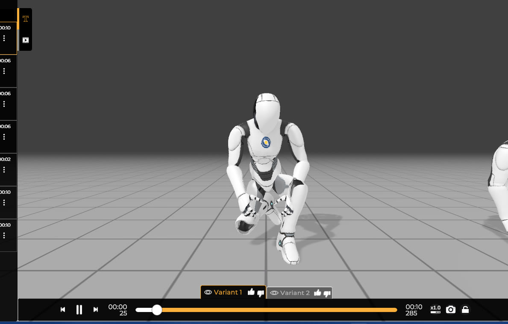
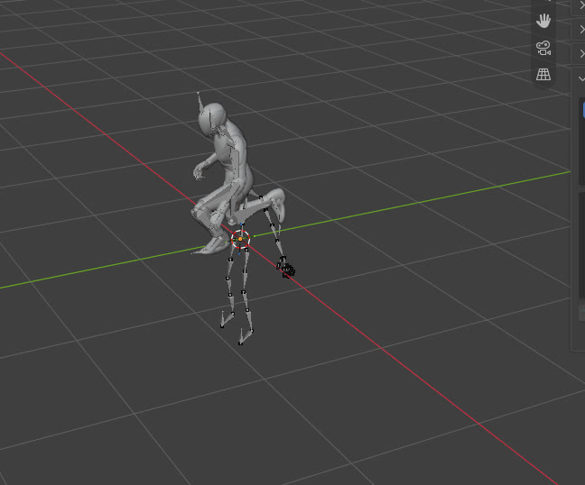
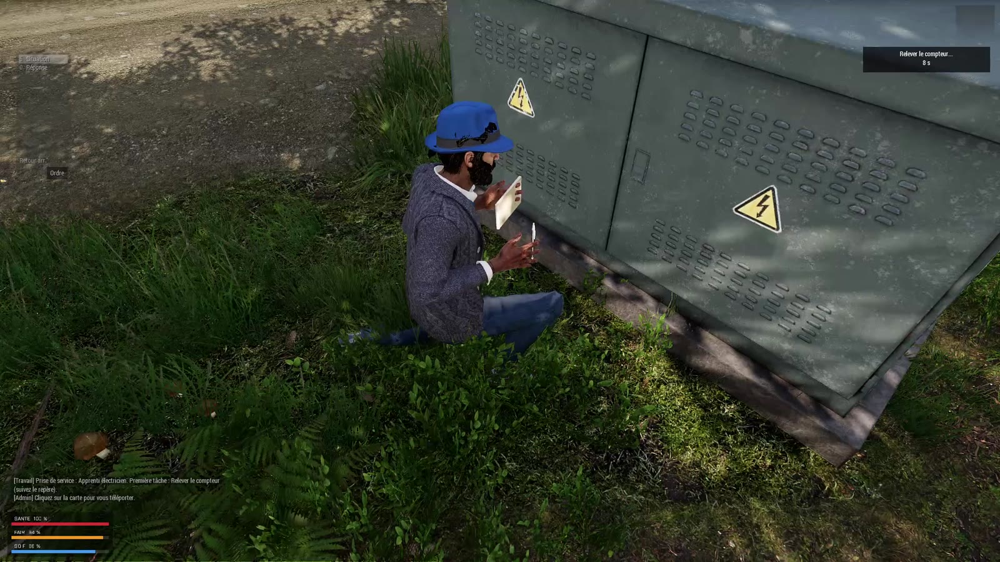
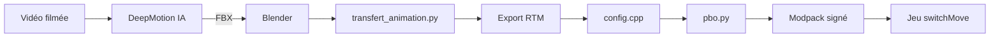

# Addon du jeu et outils de production (`eastrp_core`, `tools/`, `animations/`)

> L'addon `eastrp_core` ajoute au jeu les objets du serveur (nourriture, pièces d'usine) avec leurs icônes, ainsi qu'une animation sur mesure ; les scripts Python de `tools/` et `animations/` servent à fabriquer ces fichiers sans les logiciels officiels.

Contrairement aux autres modules, il ne s'agit pas de fonctions SQF de la mission, mais d'un **addon** (un mod chargé par le jeu avant la mission) et d'**outils** qui s'exécutent sur le PC du développeur.

## Ce que ce module démontre en informatique

- **Configuration déclarative et héritage de classes** : `config.cpp` ne contient aucun code exécutable ; il décrit des objets par des classes qui héritent les unes des autres (`EastRP_Water` hérite de `EastRP_ItemBase`, qui hérite de la classe du jeu `CA_Magazine`), comme de l'héritage en programmation orientée objet.
- **Formats de fichiers binaires** : `paa.py` et `pbo.py` écrivent octet par octet deux formats propriétaires de Bohemia Interactive (l'éditeur d'Arma 3) avec `struct.pack` (en-têtes, entiers « little-endian », tables d'offsets, somme de contrôle SHA-1).
- **Compression de texture par blocs (DXT5)** : `paa.py` contient un petit encodeur qui découpe l'image en blocs de 4×4 pixels et réduit chaque bloc de 64 à 16 octets.
- **Génération procédurale** : `icons.py` dessine les icônes uniquement avec du code (polygones, rectangles arrondis, ombre floutée), sans logiciel de dessin.
- **Maths vectorielles et matrices de rotation** : `transfert_animation.py` copie un mouvement d'un squelette à un autre en calculant, pour chaque os et chaque image, la rotation qui aligne les deux squelettes (produits vectoriels, bases orthonormées, matrices 4×4).
- **Normalisation de données** : le même script ramène des noms d'os de logiciels différents (`mixamorig:LeftUpLeg`, `l_upleg_JNT`…) à une forme unique (`leftupleg`) pour pouvoir les comparer.
- **Pipeline d'assets (chaîne de production)** : une vidéo filmée devient, étape par étape, une animation jouée en jeu ; chaque outil a une seule responsabilité.

## Fichiers

| Fichier / dossier | Rôle |
|---|---|
| `addons/eastrp_core/config.cpp` | Déclaration de l'addon : `CfgPatches`, 7 objets (`CfgMagazines`), 1 animation (`CfgMovesMaleSdr`) |
| `addons/eastrp_core/data/*_ca.paa` | Icônes d'inventaire 128×128 avec transparence (suffixe `_ca` = couleur + alpha) |
| `addons/eastrp_core/data/fiche_pompe_co.paa` | Image opaque (suffixe `_co`) affichée dans le quiz du métier d'usine (`JOB_fnc_quizBuild`) |
| `addons/eastrp_core/anim/eastrp_releve_compteur_v2.rtm` | Animation « relevé de compteur » (en-tête `RTM_0101`, 494 images, 64 os) |
| `tools/paa.py` | Écrivain de textures `.paa` (compression DXT5 + mipmaps) |
| `tools/pbo.py` | Empaquetage d'un dossier en archive `.pbo` |
| `tools/icons.py` | Dessin procédural de 3 icônes (eau, sandwich, ration) |
| `tools/LISEZ-MOI.txt` | Mode d'emploi en 4 lignes des outils |
| `animations/transfert_animation.py` | Script Blender : transfert (retargeting) d'une animation FBX sur le squelette Arma |
| `animations/LISEZ-MOI.txt` | Une ligne : « Mets ici les fichiers FBX des animations (SayMotion, etc.) » |

Le fichier `addons/eastrp_core.pbo` lui-même n'est pas versionné (`*.pbo` est dans `.gitignore`) : on le reconstruit avec `pbo.py`.

## Comment ça marche (flux)

| Capture de mouvement (DeepMotion) | Transfert sur le squelette Arma (Blender) | Résultat en jeu |
|---|---|---|
|  |  |  |

### Pipeline d'une animation

1. **Vidéo** : on se filme en train de faire le geste (ici : s'agenouiller, ouvrir un boîtier électrique, noter sur un carnet, se relever).
2. **DeepMotion** : un service en ligne de **capture de mouvement par IA** (motion capture sans combinaison ni capteurs) : un réseau de neurones estime la position du corps à chaque image de la vidéo et produit un squelette animé au format **FBX** (format d'échange 3D d'Autodesk). Les commentaires du script citent aussi SayMotion et Mixamo comme sources compatibles.
3. **Blender** : on importe le FBX et le squelette d'Arma (`OFP2_ManSkeleton`) dans la même scène, puis on lance `transfert_animation.py`, qui crée une nouvelle « action » (animation) sur le squelette Arma.
4. **Export `.rtm`** : l'action est exportée au format d'animation d'Arma. Cette étape se fait avec un outil externe à Blender/Arma qui **n'est pas dans le dépôt** (le script s'arrête à la création de l'action).
5. **Config** : `config.cpp` déclare l'état d'animation `EastRP_ReleveCompteur` qui pointe vers le `.rtm`.
6. **Jeu** : la mission le joue avec `switchMove` (`JOB_fnc_clientAnim`) ; l'étape « Relever le compteur » du métier d'électricien y fait référence dans `jobSystem/config/settings.hpp`.

### Pipeline d'une icône

`icons.py` dessine une image → `paa.py` la convertit en `.paa` → `config.cpp` l'utilise comme `picture` → `pbo.py` empaquette le dossier → `modpack/maj_eastrp_core.bat` le copie et le signe dans le modpack (voir module 10).

## L'addon : `config.cpp`

### `CfgPatches` → `EastRP_Core`
- **Dans le jeu :** donne un nom à l'addon et déclare ses dépendances.
- **En informatique :** c'est un **manifeste de dépendances** : `requiredAddons[] = {"A3_Weapons_F", "A3_Anims_F_Config_Sdr"}` oblige le jeu à charger ces addons officiels avant le nôtre, car nos classes héritent des leurs (`CA_Magazine`, `CutSceneAnimationBase`). `units[]` et `weapons[]` sont vides : l'addon n'ajoute ni véhicule ni arme.

### `CfgMagazines` : les objets
- **Dans le jeu :** 7 objets d'inventaire : `EastRP_Water`, `EastRP_Sandwich`, `EastRP_Ration` (consommés via le système de besoins) et `EastRP_PieceBrute`, `EastRP_PieceUsinee`, `EastRP_CorpsPompe`, `EastRP_PompeEau` (étapes de l'usine de pompes à eau).
- **En informatique :** les objets sont déclarés comme des **chargeurs** (magazines) et non comme des objets classiques : le commentaire en tête du fichier explique le choix (ils s'empilent, se rangent dans l'uniforme ou le sac et ne peuvent pas être lancés). Une classe de base `EastRP_ItemBase` (avec `scope = 1`, donc invisible dans l'arsenal) factorise les valeurs communes (`count = 1`, `ammo = ""`, `initSpeed = 0`, modèle 3D générique) ; chaque objet n'écrit que ce qui change (`scope = 2` pour être visible, nom affiché, description, icône `picture`, masse, modèle 3D d'objet du jeu de base pour la nourriture). C'est le principe **DRY** (ne pas se répéter) appliqué par héritage.

Les effets des aliments ne sont **pas** dans l'addon : le commentaire renvoie à `needSystem\config\settings.hpp` de la mission. L'addon décrit l'objet, la mission décide de son comportement (séparation données / logique).

### `CfgMovesMaleSdr` → `EastRP_ReleveCompteur`
- **Dans le jeu :** une animation de 16,5 s où l'électricien s'agenouille, ouvre le boîtier, note, puis se relève.
- **En informatique :** c'est un **état d'une machine à états** d'animation : le moteur du jeu décrit les mouvements comme des états reliés par des transitions. Les champs principaux :
  - `file` : chemin du `.rtm` ;
  - `speed = 0.0607` : vitesse = 1 / durée en secondes (494 images à 30 images/s ≈ 16,5 s), le commentaire donne le calcul ;
  - `looped = 0` : ne boucle pas ;
  - `disableWeapons`, `canPullTrigger = 0` : pas d'arme pendant l'animation ;
  - `actions = "NoActions"` : sans cela, d'après le commentaire, le contrôleur du personnage le remettrait debout tout de suite ;
  - `minPlayTime = 1` : l'animation ne peut pas être interrompue avant la fin (sauf par script ou inconscience) ;
  - `ConnectTo[]` / `InterpolateTo[]` : les **transitions** possibles et leur coût : vers la position à genoux (`AmovPknl…`), debout (`AmovPerc…`) ou `Unconscious`.

## Les outils Python

### `tools/paa.py` : écrivain de textures PAA

**Qu'est-ce qu'une compression de texture par blocs ?** Une carte graphique doit lire les textures très vite et à n'importe quel endroit. Un format comme PNG compresse bien mais il faut tout décompresser avant usage. Les formats **par blocs** (famille DXT / S3TC / BCn) découpent l'image en petits carrés de 4×4 pixels, et chaque bloc est compressé indépendamment dans une taille **fixe**. La carte graphique peut donc retrouver n'importe quel pixel en calculant directement l'adresse de son bloc, et décompresser en matériel. En DXT5, un bloc de 16 pixels RGBA (16 × 4 = 64 octets) devient 16 octets : **ratio 4:1**, avec perte de qualité.

Contenu d'un bloc DXT5 (16 octets) :
- **8 octets d'alpha** (transparence) : 2 valeurs extrêmes `a0`, `a1`, puis 16 indices de 3 bits (48 bits) qui choisissent pour chaque pixel une valeur parmi 8 (les 2 extrêmes + 6 intermédiaires interpolées) ;
- **8 octets de couleur** : 2 couleurs extrêmes en **RGB565** (5 bits rouge, 6 vert, 5 bleu = 16 bits), puis 16 indices de 2 bits qui choisissent parmi 4 couleurs (les 2 extrêmes + 2 mélanges à 1/3 et 2/3).

Fonctions :

| Fonction | Rôle |
|---|---|
| `_c565(c)` | Convertit une couleur RGB 8 bits en entier RGB565 (décalages de bits `>>3`, `>>2`, `<<11`, `<<5`) |
| `_u565(v)` | Opération inverse : RGB565 → RGB 8 bits, en recopiant les bits de poids fort dans les bits bas (`(r<<3)|(r>>2)`) pour que 31 redonne bien 255 |
| `_block(px)` | Encode un bloc de 16 pixels (voir ci-dessous) |
| `dxt5(img)` | Parcourt l'image par pas de 4 en hauteur et en largeur, encode chaque bloc et concatène les 16 octets obtenus |
| `write_paa(img, path)` | Construit le fichier `.paa` complet (en-tête, tags, mipmaps) |

**`_block`, pas à pas :**
1. Alpha : `a0` = max, `a1` = min. S'ils sont égaux, les indices sont tous à 0. Sinon on construit la palette de 8 valeurs (`((7-i)*a0 + i*a1)//7`) et, pour chaque pixel, on prend l'indice de la valeur la plus proche (`argmin`), puis on range les 16 indices de 3 bits dans un entier de 48 bits (`bits |= v << (3*i)`).
2. Couleur : on ne regarde que les pixels pas trop transparents (`a > 8`), pour ne pas fausser les couleurs avec des pixels invisibles. Les deux couleurs extrêmes sont le **max et le min par canal** : c'est la méthode de la « boîte englobante » annoncée dans la docstring, simple mais moins précise que les encodeurs professionnels (qui cherchent l'axe principal des couleurs).
3. On s'assure que `c0 > c1` (ordre qui sélectionne le mode à 4 couleurs), on construit la palette de 4 couleurs et, pour chaque pixel, on choisit celle à la plus petite **distance euclidienne au carré**. Les 16 indices de 2 bits forment un entier de 32 bits.
4. Résultat : `struct.pack('<HHI', c0, c1, bits)` (`<` = little-endian, `H` = entier 16 bits, `I` = 32 bits).

**`write_paa`, pas à pas :**
1. **Mipmaps** : l'image est réduite de moitié en boucle (128, 64, 32, 16, 8, 4 pixels) avec un filtre LANCZOS. Les mipmaps sont des versions plus petites qu'utilise la carte graphique quand l'objet est loin : moins de scintillement et de mémoire lue.
2. **Tags** : le format PAA stocke des métadonnées sous forme `GGAT` + nom inversé + taille + données (`tag()`). Le script écrit `AVGC` (couleur moyenne), `MAXC` (couleur max), `FLAG` (indicateur de transparence) en ordre **BGRA**, puis `OFFS`, une table de 16 positions.
3. L'en-tête commence par `05 FF`, l'identifiant du type DXT5. La table `OFFS` est d'abord remplie de zéros (on ne connaît pas encore les positions), puis **réécrite à la fin** une fois les mipmaps placés (`head[offs_pos:offs_pos+64] = ...`). C'est une technique classique d'écriture de format binaire : réserver la place, puis « patcher » les offsets.
4. Chaque mipmap est écrit avec largeur, hauteur (16 bits), taille sur 3 octets puis données DXT5 ; 6 octets nuls terminent le fichier.

Vérification : une icône 128×128 donne 16 384 + 4 096 + 1 024 + 256 + 64 + 16 = 21 840 octets de données, ce qui correspond aux 22 016 octets des fichiers `*_ca.paa` une fois l'en-tête ajouté.

### `tools/pbo.py` : empaquetage PBO

Un **PBO** est l'archive d'Arma (comparable à un `.zip` non compressé) : le jeu charge les addons sous cette forme. Fonction unique `build(src, out, prefix)` :
1. Parcourt récursivement le dossier source (`os.walk`), lit chaque fichier en mémoire et calcule son chemin relatif avec des `\` (convention Windows attendue par le jeu).
2. Trie les fichiers par nom en minuscules (ordre stable et indépendant de la casse).
3. Écrit une première entrée spéciale (nom vide, méthode `0x56657273` = « Vers » en ASCII) suivie de l'extension d'en-tête `prefix` → `eastrp_core`. Le **préfixe** est le chemin virtuel sous lequel le jeu monte l'archive : c'est pour cela que `config.cpp` peut écrire `\eastrp_core\data\water_ca.paa`.
4. Pour chaque fichier : nom + 5 entiers 32 bits (méthode 0 = non compressé, taille, réservé, date, taille des données). Une entrée vide termine la table.
5. Concatène les données des fichiers, puis ajoute un octet nul et l'empreinte **SHA-1** de tout ce qui précède. C'est une **somme de contrôle** : elle permet de détecter un fichier corrompu (ce n'est pas une signature : n'importe qui peut la recalculer ; la signature est traitée au module 10).

Utilisation (LISEZ-MOI) : `python pbo.py ..\addons\eastrp_core ..\addons\eastrp_core.pbo eastrp_core`.

### `tools/icons.py` : génération procédurale d'icônes

- Travaille sur une toile de **512×512** transparente (`new()`), dessine avec `ImageDraw` (polygones, rectangles arrondis, texte), puis réduit à **128×128** : dessiner 4 fois plus grand puis réduire avec LANCZOS est une forme de **suréchantillonnage** (anti-crénelage : bords lisses).
- `fin(img, name)` ajoute une **ombre portée** : elle prend le canal alpha (la silhouette), le floute (`GaussianBlur(10)`), le rend à 35 % d'opacité, le décale de (8, 10) pixels, puis pose l'image par-dessus (`alpha_composite`). Elle enregistre un aperçu PNG et le `.paa` via `write_paa`.
- Trois icônes sont dessinées : bouteille d'eau (bouchon, goulot, corps, étiquette « EAU », reflet), sandwich (couches de pain, salade, tomate, fromage) et ration (boîte en fausse perspective avec trois faces de teintes différentes).

Points honnêtes :
- Le script ne génère **que** `water`, `sandwich` et `ration`. Les icônes de l'usine (`piece_brute`, `piece_usinee`, `corps_pompe`, `pompe_eau`) et `fiche_pompe_co.paa` sont dans le dépôt, mais le code qui les a produites n'y est pas.
- Les chemins sont **codés en dur** pour un environnement Linux (`/root/tools`, `/root/eastrp_core/...`) : la commande `python icons.py` du LISEZ-MOI ne fonctionnera tel quel sous Windows qu'après adaptation de ces chemins.

### `tools/LISEZ-MOI.txt`

Indique l'ordre : `icons.py` (icônes) → `pbo.py` (archive) → `modpack\construire_modpack.bat` (mise à jour du modpack).

### `animations/transfert_animation.py` : retargeting dans Blender

Le **retargeting** consiste à rejouer l'animation d'un squelette sur un autre squelette qui n'a ni les mêmes noms d'os, ni les mêmes longueurs, ni la même orientation de départ. On ne copie donc pas les valeurs brutes : on copie la **direction** de chaque membre dans l'espace.

Le script se lance dans Blender (onglet Scripting) et utilise l'API `bpy` et la bibliothèque `mathutils` (vecteurs, matrices).

**Données (lignes 8-30)**
- `NOM_ACTION` : nom de l'animation à créer (à changer pour chaque nouvelle animation).
- `CHAINE` : table de correspondance. Chaque entrée = `(os Arma, os source, (enfant Arma, enfant source), (paire gauche/droite Arma, paire gauche/droite source) ou None)`. L'enfant donne la **direction principale** de l'os (ex. de l'épaule vers le coude) ; la paire gauche/droite, facultative, donne une **direction secondaire** pour fixer la torsion (ex. pour le bassin : les deux hanches ; pour la main : index et auriculaire). La liste est ordonnée **des parents vers les enfants** (bassin, colonne, cou, puis bras et jambes générés par une boucle `for c in ("Left", "Right")`), ce qui compte pour la suite.

**`norme(nom)`** : normalisation des noms d'os. Garde la partie après `:` (enlève `mixamorig:`), passe en minuscules, enlève le suffixe `_jnt` (DeepMotion), transforme `l_` / `r_` en `left` / `right`, supprime les `_`. Ainsi `mixamorig:LeftUpLeg`, `LeftUpLeg` et `l_upleg_JNT` deviennent tous `leftupleg`.

**`trouve_armature(nom_os)`** : parcourt les objets de la scène et renvoie le premier squelette (`ARMATURE`) qui contient un os portant ce nom normalisé. Le squelette Arma est reconnu par son os `Pelvis`, le squelette FBX par `Hips`. Si l'un manque, le script s'arrête avec un message clair.

**`os_de(obj, nom)`** : renvoie l'os de pose (`pose bone`) dont le nom normalisé correspond, ou `None`.

**`base(p, s)`** : construit un **repère orthonormé** (3 axes perpendiculaires de longueur 1) à partir d'une direction principale `p` et d'une direction secondaire `s` : `x = p` normalisé, `z = x × s` (produit vectoriel, perpendiculaire aux deux), `y = z × x`. Les trois axes forment une matrice de rotation 3×3.

**Filtrage de la chaîne (lignes 67-75)** : on ne garde que les entrées dont tous les os existent dans les deux squelettes ; si seule la paire secondaire manque, on la retire (`sec = None`) ; sinon l'os est ignoré avec un message `[EastRP] os ignoré`. Le script tolère donc des squelettes sources incomplets.

**`pos_src(nom)` / `pos_tgt(nom)`** : position de la tête d'un os dans le monde (`matrix_world @ head` : passage des coordonnées locales de l'objet aux coordonnées globales).

**Préparation (lignes 77-106)**
- Récupère l'action du FBX et sa plage d'images `f0 → f1`, règle la scène dessus.
- Remet le squelette Arma en pose de repos (matrice identité, rotations en **quaternions**, une représentation des rotations sans blocage de cardan).
- Sur la première image, calcule trois valeurs de calage :
  - `R_yaw` : rotation autour de l'axe vertical. Le script compare la droite gauche-droite des hanches des deux squelettes, projetée au sol (`plat`), et calcule l'angle avec `atan2(produit vectoriel, produit scalaire)`. Les deux personnages regardent ainsi dans la même direction.
  - `echelle` : rapport des longueurs de jambe (hanche → pied) Arma / source. Il sert à convertir les déplacements du bassin source en déplacements à l'échelle Arma (`max(..., 1e-6)` évite une division par zéro).
  - `hips0`, `pelvis0` : positions de départ du bassin source et du bassin Arma.

**Boucle principale (lignes 114-148), pour chaque image :**
1. Mémorise dans un dictionnaire `P` les positions (déjà tournées par `R_yaw`) des os source utiles, pour ne pas les recalculer.
2. Remet tout le squelette Arma à zéro.
3. Pour chaque os de la chaîne, **dans l'ordre parent → enfant** :
   - `vt` = direction actuelle de l'os Arma (tête de l'os → tête de son enfant), `vs` = même direction côté source ;
   - si une paire secondaire existe, la rotation est `base(vs, sv) @ base(vt, st)ᵀ` : on passe du repère Arma au repère neutre (transposée = inverse pour une rotation), puis au repère source. Cela aligne la direction **et** la torsion ;
   - sinon, `vt.rotation_difference(vs)` donne la plus petite rotation qui amène `vt` sur `vs` (la torsion n'est pas contrôlée) ;
   - la rotation est appliquée **autour de la tête de l'os** : `Translation(head) @ R @ Translation(-head) @ M` (on ramène le pivot à l'origine, on tourne, on remet en place) ;
   - pour le `Pelvis` uniquement, la position est imposée : `pelvis0 + (P["Hips"] - hips0) * echelle`. Le bassin Arma part de sa position de repos et suit le **déplacement relatif** du bassin source, mis à l'échelle. C'est ce qui le fait descendre quand le personnage s'agenouille, tout en gardant la hauteur de départ du squelette Arma (les pieds restent au niveau du sol de ce squelette à la première image). Il n'y a pas de calcul de contact pied/sol plus poussé : le « recalage au sol » repose uniquement sur ce déplacement relatif ;
   - `view_layer.update()` après chaque os, pour que les enfants partent de la pose à jour de leur parent (d'où l'importance de l'ordre de `CHAINE`).
4. Pose une **image clé** (keyframe) de rotation et de position sur **tous** les os, à chaque image.

À la fin, la scène revient à la première image et le script affiche le nombre d'images transférées. Garder une image clé par image explique en partie la taille du `.rtm` (2,5 Mo pour 494 images × 64 os).

## Sécurité et robustesse

- **Vérifications avant traitement** dans le script Blender : présence des deux squelettes et d'une animation sur le FBX (exceptions explicites), os manquants ignorés avec un message plutôt qu'un plantage.
- **Protection contre les divisions par zéro** : `max(longueur, 1e-6)` pour l'échelle, et les os de longueur quasi nulle sont sautés (`if vt.length < 1e-6 ... continue`).
- **Intégrité du PBO** : l'empreinte SHA-1 finale permet au jeu de détecter un fichier abîmé (intégrité, pas authenticité).
- **Objets non lançables et interruption contrôlée** : choisir `CfgMagazines` empêche de jeter les objets ; `minPlayTime = 1` et `actions = "NoActions"` empêchent d'annuler l'animation en bougeant.
- **Ce qui protège réellement l'addon** contre une version modifiée côté joueur est la signature numérique, traitée dans le module 10.

## Limites et pistes d'amélioration

- L'encodeur DXT5 utilise la « boîte englobante » (min/max par canal) : qualité moindre qu'un encodeur par analyse en composantes principales. Il suppose aussi des dimensions multiples de 4 sans le vérifier.
- `pbo.py` charge tous les fichiers en mémoire et n'exclut aucun fichier source (tout le dossier est empaqueté, y compris d'éventuels fichiers temporaires).
- `icons.py` a des chemins codés en dur pour Linux et ne couvre que 3 des 8 images ; l'origine des 5 autres n'est pas dans le dépôt.
- L'export `.rtm` dépend d'un outil externe non documenté dans le dépôt, et `NOM_ACTION` doit être modifié à la main pour chaque nouvelle animation.
- Le transfert d'animation ne gère pas les doigts (hormis l'orientation de la main), ni un vrai contact des pieds avec le sol ; une seule animation personnalisée existe pour l'instant.
