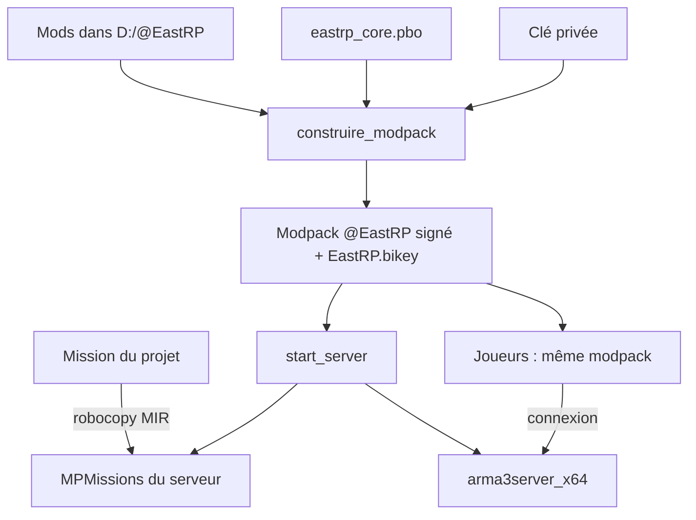

# Déploiement : modpack, serveur dédié et base de données (`modpack/`, `server/`, `db/`)

> Ces scripts transforment le projet en un serveur jouable : ils regroupent et signent tous les mods en un seul modpack, installent et lancent le serveur dédié Arma 3 avec la mission à jour, et préparent une base de données MariaDB qui n'est pas encore utilisée par le jeu.

Il ne s'agit pas de fonctions SQF mais de scripts Windows : **PowerShell** (`.ps1`, le langage de script moderne de Windows) et **Batch** (`.bat`, l'ancien langage de l'invite de commandes), ainsi que de fichiers SQL.

## Ce que ce module démontre en informatique

- **Signature numérique et cryptographie à clé publique** : chaque `.pbo` du modpack est signé avec une clé privée gardée secrète ; le serveur ne reçoit que la clé publique (`.bikey`) pour vérifier les signatures.
- **Automatisation de build / déploiement** : un seul double-clic construit le modpack, un autre installe ou met à jour le serveur, un troisième synchronise la mission et lance le serveur.
- **Build incrémental** : `construire_modpack.ps1` ne recopie que les fichiers nouveaux ou modifiés (taille + date) et ne signe que les fichiers sans signature, comme `make` ou `rsync`.
- **Résolution de conflits déterministe** : quand deux mods contiennent un fichier du même nom, une règle claire décide lequel gagne (le dernier traité, avec une liste de mods prioritaires), et chaque doublon est tracé dans un rapport.
- **Gestion des secrets** : mots de passe et clé privée sont exclus du dépôt (`.gitignore`), seuls des fichiers exemples avec `CHANGE_MOI` sont versionnés.
- **Modélisation relationnelle et principe du moindre privilège** : schéma SQL avec clé primaire, types adaptés, et utilisateur de base limité à une seule base et à la machine locale.
- **Programmation défensive** : chaque script vérifie ses prérequis (dossiers, clé, outils) et s'arrête avec un message clair (`Stop-Erreur`, `$ErrorActionPreference = 'Stop'`).

## Fichiers

| Fichier | Rôle |
|---|---|
| `modpack/construire_modpack.ps1` (+ `.bat`) | Construit le modpack `@EastRP` : copie tous les mods, crée la clé si besoin, signe tout |
| `modpack/maj_eastrp_core.ps1` (+ `.bat`) | Met à jour uniquement notre addon `eastrp_core.pbo` dans le modpack |
| `modpack/ajouter_mods_workshop.ps1` (+ `.bat`) | Ajoute directement des mods du Steam Workshop (liste de numéros) au modpack et les signe |
| `modpack/corriger_doublons.ps1` (+ `.bat`) | Correctif ponctuel : remplace 2 fichiers dont la mauvaise version avait été gardée |
| `server/config.bat` | Réglages communs : dossier du serveur, SteamCMD, nom de mission, port, mods |
| `server/start_server.bat` | Vérifie les mods, synchronise la mission, lance le serveur dédié |
| `server/sync_mission.bat` | Copie miroir de la mission vers `MPMissions` du serveur (`robocopy /MIR`) |
| `server/update_server.bat` | Installe / met à jour le serveur dédié avec SteamCMD |
| `server/ouvrir_dans_editeur.bat` | Lien entre le dossier de l'éditeur Arma et la mission du projet |
| `server/server.cfg.example` | Modèle de configuration du serveur (copié en `server.cfg`) |
| `db/01_create_database.sql` | Création de la base `eastrp` et d'un utilisateur dédié |
| `db/02_schema.sql` | Table `players` |
| `db/03_migration_inventaire_physique.sql` | Migration d'une ancienne version de la table |
| `docs/DATABASE_SETUP.md` | Procédure d'installation MariaDB + extDB3 + test |
| `.gitignore` | Fichiers à ne jamais versionner |

Les `.bat` du dossier `modpack` ne font qu'appeler le `.ps1` du même nom avec `-ExecutionPolicy Bypass` (pour autoriser l'exécution du script) puis `pause` (pour laisser la fenêtre ouverte et lire le résultat).

## Comment ça marche (flux)

1. Le développeur regroupe les mods voulus dans `D:\@EastRP` (un sous-dossier `@…` par mod).
2. `construire_modpack` fusionne tous leurs `.pbo` et notre `eastrp_core.pbo` dans un seul mod `D:\EastRP_Modpack\@EastRP`, les signe avec la clé EastRP et dépose la clé publique dans `keys\`.
3. `start_server` vérifie que le modpack existe, copie la mission à jour dans le serveur, puis lance `arma3server_x64.exe` avec ce modpack.
4. Les joueurs chargent le **même** modpack dans le launcher (le commentaire de `config.bat` insiste dessus) et se connectent.

## Signature numérique : principe

Une **signature numérique** prouve deux choses sur un fichier : qui l'a produit (**authenticité**) et qu'il n'a pas été modifié depuis (**intégrité**). Elle repose sur une **paire de clés** liées mathématiquement :

- la **clé privée** (`EastRP.biprivatekey`) sert à **signer**. L'outil `DSSignFile.exe` calcule une empreinte du `.pbo` et la chiffre avec cette clé, ce qui donne le fichier `nom.pbo.EastRP.bisign` posé à côté ;
- la **clé publique** (`EastRP.bikey`) sert seulement à **vérifier**. Le serveur la place dans son dossier `keys` ; à la connexion, il peut contrôler que chaque `.pbo` du joueur a une signature valide pour une clé qu'il connaît. Si un joueur modifie un fichier (par exemple pour tricher), la signature ne correspond plus.

**Pourquoi la clé privée n'est jamais publiée** : quiconque la possède peut signer n'importe quel fichier, y compris un `.pbo` truqué, que le serveur accepterait alors comme authentique. La clé publique, elle, ne permet que de vérifier : on peut la donner à tout le monde. D'où, dans le code :
- `construire_modpack.ps1` range la clé dans `modpack\cle_privee\` avec le commentaire « NE JAMAIS PARTAGER », et affiche en rouge son chemin à la fin ;
- `.gitignore` exclut `modpack/cle_privee/` ;
- seule la `.bikey` est copiée dans le modpack (`keys\`).

Re-signer tous les mods avec **notre** clé simplifie le serveur : une seule clé à déclarer au lieu d'une par auteur. Les anciennes signatures et clés des auteurs sont supprimées.

**Point honnête :** dans `server.cfg.example`, `verifySignatures = 0` (et `BattlEye = 0`, « désactivé en développement »). En l'état, le serveur de développement **ne vérifie donc pas** les signatures : la chaîne de signature est prête, mais elle ne protège réellement qu'une fois ce réglage activé (valeur 2 dans Arma 3).

## Scripts du modpack

| Script | Rôle en une ligne |
|---|---|
| `construire_modpack.ps1` | Build complet et incrémental du modpack signé |
| `maj_eastrp_core.ps1` | Recopie et re-signe uniquement notre addon |
| `ajouter_mods_workshop.ps1` | Ajoute des mods Workshop par numéro, avec signature |
| `corriger_doublons.ps1` | Correctif ponctuel de deux fichiers en conflit |

### `construire_modpack.ps1`
- **Rôle :** construire `D:\EastRP_Modpack\@EastRP`, un mod unique qui contient tous les mods du serveur, signés avec la clé EastRP.
- **Étapes, dans l'ordre du code :**
  1. **Réglages** en tête : `$Source`, `$Dest`, `$NomCle`, `$Exclure` (mods à ignorer), `$Prioritaires` (mods dont la version gagne toujours), dossier des Arma 3 Tools.
  2. **Vérifications** : dossier source, présence de `addons\eastrp_core.pbo`, recherche récursive de `DSSignFile.exe` et `DSCreateKey.exe` dans Arma 3 Tools ; sinon arrêt avec la marche à suivre.
  3. **Ordre des mods** : tri alphabétique, puis les prioritaires placés **à la fin**. Calcul de la taille totale et de l'espace libre sur le disque.
  4. **Clé** : si `EastRP.biprivatekey` n'existe pas, `DSCreateKey` crée la paire (une seule fois, puis réutilisée).
  5. **Plan** : un dictionnaire ordonné `$plan` (clé = nom de fichier en minuscules → fichier source) et `$origine` (→ nom du mod). Pour chaque mod, seuls les `.pbo` situés dans un dossier `addons` sont pris. Si le nom existe déjà, le nouveau remplace l'ancien et une ligne `DOUBLON` est écrite dans le rapport : **le dernier mod traité gagne**. Les `.dll`, `.so`, `.ini` à la racine d'un mod et un dossier `sql_custom` sont aussi copiés (le commentaire cite extDB3). Notre addon est ajouté en dernier.
  6. **Copie incrémentale** : un fichier n'est recopié que si sa taille ou sa date de modification diffère de celle déjà présente. Avant de copier, on vérifie qu'il reste assez de place (avec 5 % de marge). L'ancienne signature d'un fichier recopié est supprimée. Barre de progression avec `Write-Progress`.
  7. **Nettoyage** : suppression des `.pbo` qui ne viennent plus d'aucun mod, des signatures orphelines, de tout autre fichier dans `addons`, et de toute clé autre que `EastRP.bikey` dans `keys`.
  8. **Signature** : uniquement les `.pbo` qui n'ont pas encore de `.EastRP.bisign` ; chaque échec est compté et noté.
  9. **Fichiers du mod** : copie de la `.bikey` dans `keys`, écriture de `mod.cpp` (nom et description affichés dans le launcher) et de `CREDITS.txt` (liste des mods inclus).
  10. **Rapport** `rapport_modpack.txt` (mods, doublons, retraits, échecs) et résumé coloré à l'écran.
- **En informatique :** c'est un petit **système de build** : entrées (dossiers de mods), règles (priorité, exclusions), sortie reproductible, travail minimal grâce à la comparaison taille/date, et journal de ce qui a été fait.

### `maj_eastrp_core.ps1`
- **Rôle :** après une modification de notre addon, le recopier dans le modpack et le re-signer, sans reconstruire le reste.
- **Fonctionnement :** vérifie le `.pbo`, le modpack, la clé privée et `DSSignFile.exe` ; supprime l'ancienne signature, copie, signe, puis contrôle que le `.bisign` existe bien.

### `ajouter_mods_workshop.ps1`
- **Rôle :** ajouter des mods du Steam Workshop listés par leur numéro dans `$Mods` (C33 Objects, plusieurs packs PLP).
- **Fonctionnement :** pour chaque numéro, cherche le dossier téléchargé par Steam (sinon avertissement « abonne-toi »), lit le nom du mod dans `meta.cpp` avec une **expression régulière**, puis copie et signe chaque `.pbo`. Un fichier est sauté s'il a la même taille, une date au moins aussi récente **et** déjà une signature (vérification d'idempotence : relancer le script ne refait pas le travail).
- **Point d'attention :** ces fichiers sont copiés directement dans le modpack, pas dans `D:\@EastRP`. D'après le code de `construire_modpack.ps1`, l'étape de nettoyage supprime les `.pbo` qui ne viennent d'aucun mod de `$Source` : un rebuild complet retirerait donc ces mods s'ils ne sont pas aussi placés dans le dossier source.

### `corriger_doublons.ps1`
- **Rôle :** script **ponctuel** (« A lancer une seule fois ») : il remplace `v12_base.pbo` et `Aka_data_base.pbo` par leur version du Workshop, puis les re-signe. Il corrige un conflit de noms ; ces deux mods (V12 et Aka) sont aussi ceux listés dans `$Prioritaires` de `construire_modpack.ps1`, ce qui évite que le problème revienne au prochain rebuild.

## Scripts du serveur

### `config.bat`
Variables partagées par tous les scripts du dossier (appelé avec `call`) : `ARMA_DIR`, `STEAMCMD_DIR`, `MISSION=RP.Maksniemi`, `PORT=2302`, `MODS=D:\EastRP_Modpack\@EastRP`. L'ancienne méthode (liste de mods Workshop séparés par `;`) est gardée en commentaire. Centraliser ces valeurs évite de les répéter dans chaque script.

### `start_server.bat`
1. Charge `config.bat`. Si `server.cfg` n'existe pas, le crée à partir de `server.cfg.example` ; crée le dossier `profiles` (journaux `.rpt` et données du serveur).
2. Vérifie que chaque mod de `MODS` contient un dossier `addons` (ou `Addons`). L'astuce `"%MODS:;=" "%"` remplace chaque `;` par `" "` pour transformer la liste en éléments séparés que la boucle `for` peut parcourir. Si un mod manque : message et arrêt (`exit /b 1`).
3. Appelle `sync_mission.bat`.
4. Lance `arma3server_x64.exe` avec : le port, le fichier de config, le dossier de profils, `-world=empty` (pas de carte chargée au démarrage), `-autoInit` (la mission démarre sans attendre un administrateur) et `-mod=` (le modpack).

### `sync_mission.bat` : `robocopy /MIR`
`robocopy` est l'outil de copie robuste de Windows. Avec `/MIR` (**miroir**), le dossier de destination devient une copie exacte de la source : fichiers nouveaux ou modifiés copiés, **et fichiers absents de la source supprimés** dans la destination. Ainsi un fichier effacé dans le projet disparaît aussi du serveur, sans résidu d'anciennes versions. `/NFL /NDL /NJH /NJS` réduisent l'affichage (pas de liste de fichiers, pas d'en-tête ni de résumé). Revers de `/MIR` : toute modification faite directement dans `MPMissions` est écrasée ; la source de vérité est le projet.

### `update_server.bat`
Appelle **SteamCMD** (Steam en ligne de commande) : connexion anonyme, installation dans `ARMA_DIR` de l'application `233780` (serveur dédié Arma 3) avec `validate` (vérification de l'intégrité des fichiers).

### `ouvrir_dans_editeur.bat`
Crée une **jonction** (`mklink /J`, un lien de dossier Windows) entre le dossier des missions de l'éditeur et `missions\RP.Maksniemi` du projet. Ce qui est enregistré dans l'éditeur Eden modifie donc directement les fichiers du projet. Le chemin contient un emplacement à remplacer (`TON_PROFIL_ARMA`) ; le script ne recrée pas le lien s'il existe déjà.

### `server.cfg.example`
Nom du serveur « EastRP - DEV », mot de passe admin `CHANGE_MOI`, 10 joueurs max, `persistent = 1` (la mission continue sans joueur), `allowedFilePatching = 0` (les joueurs ne peuvent pas charger de fichiers non empaquetés), `verifySignatures = 0` et `BattlEye = 0` (mode développement), et la mission `RP.Maksniemi` en difficulté `Regular`. Le vrai `server.cfg` n'est pas versionné, car il contient les mots de passe réels.

## Base de données (prévue, pas encore branchée)

**État réel :** la persistance actuelle des modules passe par le profil du serveur (`profileNamespace`). Dans `coreSystem/config/settings.hpp`, `storage = "profile"` est commenté « "extdb3" = base de données (à venir) », et aucune fonction de la mission ne lit encore ce réglage. Le seul code SQF qui touche la base est `CORE_fnc_dbTest`, un **test de connexion** activé par `dbTest = 1` : il interroge extDB3 (version, ajout de la base, `SELECT 1`, `SELECT COUNT(*) FROM players`) et écrit les résultats dans le journal. Aucune donnée de joueur n'est lue ni écrite en base.

**extDB3** est une extension (une DLL) qui permet au script SQF d'envoyer des requêtes SQL à **MariaDB** (un serveur de base de données compatible MySQL) via `callExtension`. `construire_modpack.ps1` sait déjà copier les `.dll`/`.ini` et `sql_custom` d'un mod comme extDB3.

### `db/01_create_database.sql`
Crée la base `eastrp` en `utf8mb4` (UTF-8 complet, y compris les emojis) et un utilisateur `eastrp` qui ne peut se connecter que depuis `localhost` et n'a des droits que sur `eastrp.*` : c'est le **principe du moindre privilège** (le jeu n'utilise pas le compte `root`). Le mot de passe est un `CHANGE_MOI_MOT_DE_PASSE` à remplacer avant exécution.

### `db/02_schema.sql`
Table `players` (moteur InnoDB, qui gère les transactions) :

| Colonne | Type | Remarque |
|---|---|---|
| `uid` | `VARCHAR(20)` clé primaire | SteamID64 du joueur |
| `name` | `VARCHAR(64)` | nom |
| `cash`, `bank` | `BIGINT` | entiers 64 bits : pas d'erreur d'arrondi ni de dépassement pour l'argent |
| `loadout` | `MEDIUMTEXT` | équipement physique, sérialisé en texte |
| `pos` | `VARCHAR(100)` | dernière position |
| `dir` | `FLOAT` | dernière direction |
| `updated` | `TIMESTAMP` | mis à jour automatiquement (`ON UPDATE CURRENT_TIMESTAMP`) |

Les `IF NOT EXISTS` rendent les scripts **idempotents** : on peut les relancer sans erreur.

### `db/03_migration_inventaire_physique.sql`
**Migration** de schéma pour une table créée avec l'ancienne version : supprime la colonne `items`, ajoute `loadout` et `dir`. À n'exécuter que dans ce cas ; la suppression de `items` efface définitivement son contenu.

### `docs/DATABASE_SETUP.md`
Procédure pas à pas : installer MariaDB, exécuter les deux scripts SQL dans HeidiSQL, installer extDB3 (avec un avertissement sur la provenance de la DLL, qui est un exécutable), configurer `extdb3-conf.ini`, charger l'extension, puis lancer le test `dbTest = 1` et lire les lignes `[CORE][DB]`. Le document se termine sur l'étape suivante prévue : écrire la vraie sauvegarde des joueurs. Il mentionne `MODS=@Maksniemi;@extDB3`, alors que `config.bat` utilise désormais le modpack : ce passage est antérieur au modpack et serait à mettre à jour.

## `.gitignore`

Trois familles de fichiers exclus du dépôt :
- **Secrets** : `server/server.cfg` (mots de passe), `modpack/cle_privee/` (clé privée de signature).
- **Fichiers produits** (régénérables) : `*.pbo`, `*.bisign`, `*.zip`. L'addon se reconstruit avec `tools/pbo.py`.
- **Journaux et données locales** : `server/profiles/`, `*.log`, `*.rpt`, `*.bidmp`, `*.mdmp` (rapports de plantage), `.vscode/`.

## Sécurité et robustesse

- Clé privée hors dépôt, seule la clé publique est distribuée ; avertissements explicites dans le script et le `.gitignore`.
- Mots de passe absents du dépôt : seuls des modèles avec `CHANGE_MOI` sont versionnés.
- Utilisateur SQL limité à une base et à `localhost`.
- `allowedFilePatching = 0` empêche les joueurs de remplacer des fichiers du jeu par des fichiers libres.
- Vérification des prérequis avant toute action (mods, clé, outils, place disque), arrêt propre avec message.
- Contrôle après chaque signature (le `.bisign` existe-t-il ?) et rapport des échecs.
- Limite actuelle : `verifySignatures = 0` et `BattlEye = 0` sur la configuration de développement, donc la signature n'est pas encore exigée des joueurs.

## Limites et pistes d'amélioration

- Chemins codés en dur (`D:\`, `C:\Program Files (x86)\...`) dans chaque `.ps1` au lieu d'un fichier de réglages commun comme `config.bat` côté serveur.
- La détection « déjà à jour » repose sur la taille et la date, pas sur une empreinte du contenu.
- `ajouter_mods_workshop.ps1` écrit directement dans le modpack, ce qui peut être annulé par le nettoyage d'un rebuild complet.
- La base de données n'est pas branchée : le schéma n'a qu'une table, sans gestion de versions des migrations ; la persistance réelle reste le profil du serveur.
- `docs/DATABASE_SETUP.md` est en partie dépassé (variable `MODS`).
- Il n'y a pas de configuration de production (signatures et BattlEye activés) à côté de l'exemple de développement.
